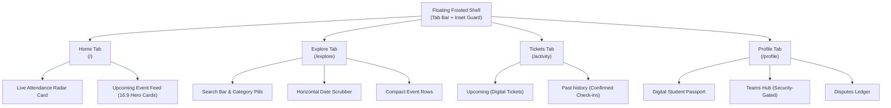

# Design System & Redesign Specification — NST Events Mobile

**System Version:** 3.6.0 (The Prism Mobile Standard — Definitive Production Spec)  
**Target:** `apps/mobile` (Expo SDK 57.0.20, React Native 0.86.3, React 19.2.3, Expo Router 57.0.19, TypeScript)  
**Styling Architecture (Resolved):** React Native `StyleSheet.create` + TypeScript design tokens (`useAppTheme()`) is the canonical Phase 1 mobile styling system. Unused `nativewind`, `tailwindcss`, and obsolete `apps/mobile/tailwind.config.js` were removed from `apps/mobile` so zero unsupported styling runtimes remain. Optional CSS-variable / NativeWind integration is deferred out of Phase 1.  
**Parent System Alignment:** Monorepo Design System Version 3.6.0 (`DESIGN.md`)  
**Design Influences:** Linear Mobile, Apple Wallet, Luma, Raycast  
**Status:** Source-aligned closure pass complete. Active Phase 1 runtime uses `StyleSheet.create`, `@expo/vector-icons@15.1.1`, `expo-haptics@57.0.3`, React Native `Animated`, `expo-secure-store@57.0.3`, and TanStack React Query in-memory caching. Deferred to future native-build / Phase 2 milestones: `lucide-react-native` (+ `react-native-svg`), `react-native-reanimated`, encrypted persistent offline storage (`SQLCipher` / encrypted `MMKV`), and Section 7 Phase 2 backend endpoints. Open gates: Teams Hub backend RLS security review (see `BACKEND_BUG_AUDIT.md`) and physical iOS/Android native-build & device QA.  
**Last updated:** November 18, 2026  

---

## 0. Delivery Phases

To decouple visual and ergonomic execution from pending backend service work, implementation is split into two distinct delivery phases:

### 0.1 Phase Breakdown

| Feature / Area | Phase | Endpoint / Mechanism Used | Blocked By / Dependencies | Notes / Source File |
|---|:---:|---|---|---|
| **Design Tokens & Foundation** | **Phase 1** | No network | None (Ready) | Local TS tokens & React Native `StyleSheet.create` (no NativeWind in Phase 1) |
| **Floating Navigation Shell** | **Phase 1** | No network | None (Ready) | `src/ui/core/MobileShell.tsx` |
| **Home Feed Re-skin** | **Phase 1** | `GET /v1/events` (Existing) | None (Ready) | `apps/api/src/modules/events/events.router.ts (GET /v1/events)` |
| **Live Radar Card (Single Session)** | **Phase 1** | `GET /v1/events/:id/sessions` (Existing) | None (Ready) | `apps/api/src/modules/events/events.service.ts (listSessions)`; circle geometry (`venueLatitude`, `venueLongitude`, `geofenceRadius`) |
| **Explore Directory & Date Scrubber** | **Phase 1** | `GET /v1/events` (Existing) | None (Ready) | `apps/api/src/modules/events/events.router.ts (GET /v1/events)` |
| **Tickets Hub (Pass & History View)** | **Phase 1** | `GET /v1/users/me/registrations`, `GET /v1/users/me/attendance` (Existing) | None (Ready) | `apps/api/src/modules/registrations/registrations.router.ts (getMyRegistrations)`, `apps/api/src/modules/attendance/attendance.router.ts (getMyAttendance)`; handles `REGISTERED`, `WAITLISTED`, `CANCELLED` and nullable `maxCapacity` |
| **Profile & Student Passport Re-skin**| **Phase 1** | `GET /users/me` (Existing; alias `/v1/users/me`) | None (Ready) | `apps/api/src/modules/users/users.router.ts (me)`; `apps/api/src/app.ts` mounts both `/users` and `/v1/users`; mobile calls `/users/me`. No bound-device status returned in Phase 1 |
| **Scanner HUD Re-skin (Standard Flow)**| **Phase 1** | `POST /v1/attendance/mark` (Existing) | None (Ready) | `apps/api/src/modules/attendance/attendance.router.ts (markAttendance)` |
| **System States & Skeletons** | **Phase 1** | No network | None (Ready) | Section 6 specs |
| **Accessibility & Contrast CI Tests**| **Phase 1** | Local CI test script (`scripts/verify-mobile-design.js`) | None (Ready) | Automated WCAG AA contrast & cross-reference assertions |
| **Attendance Dispute Filing (Basic)** | **Phase 1** | `GET /v1/attendance/disputes`, `POST /v1/attendance/disputes` (Existing) | None (Ready) | Re-skin of shipped functionality; `apps/api/src/modules/attendance/attendance.router.ts (disputes)`; concatenates picker + note into `reason`; bounded server-side by `submit_attendance_dispute` window |
| **Team Roster & Membership Hub** | **Phase 1 (Runtime RLS Test Gate)** | `GET /v1/events/:id/teams`, `POST /v1/events/:id/teams`, `GET /v1/teams/:id`, `POST /v1/teams/:id/join`, `DELETE /v1/teams/:id/leave` (Existing + Hardened RPCs) | **Runtime RLS DB Verification Gate** (`20261118000000_harden_teams_hub_rls_and_roster_rpc`, not yet deployed) | Least-privilege migration tightens `Allow SELECT on teams` and adds batched `SECURITY DEFINER` RPCs (`get_team_member_counts`, `get_team_leader_display_names`, `get_authorized_team_rosters`) without weakening `event_registrations` or `users` RLS; `teams.service.ts` updated (`6/6` static tests pass). Runtime PostgreSQL RLS test (`teams-hub-rls-closure.test.ts`) remains OPEN pending local/CI test DB execution and deployment. |
| **Unread Notification & Badge Counts**| **Phase 1** | `GET /v1/notifications/unread-count` (Existing) | None (Ready; degraded fallback in Section 0.2) | Returns **aggregate** unread notification count across all notification types (`tx.notification.count({ where: { userId, readAt: null } })` in `apps/api/src/modules/notifications/notifications.service.ts`). Not filtered to disputes only; team invitations (404) excluded from Phase 1 badges. |
| **Multi-Session Live Carousel** | **Phase 2** | `GET /v1/events/live-sessions` (New required) | Section 7 Row 15 | Global live feed absent in backend; single-event sessions only |
| **Waitlist Status Indicator** | **Phase 2** | `GET /v1/events/:id/waitlist-status` (New required) | Section 7 Row 14 | Event payload lacks waitlist fields; requires dedicated route |
| **Team Pending Invitations Inbox** | **Phase 2** | `GET /v1/users/me/team-invitations` (New required) | Section 7 Row 5 | Backend returns 404 (`apps/mobile/src/hooks/use-invitations.ts`); pending invites dropped from Phase 1 Profile badge |
| **Manual Session PIN Check-In** | **Phase 2** | `POST /v1/attendance/mark-manual` (New required) | Section 4.6 Decisions 1, 2, 3; Section 7 Row 8 | Requires PIN generation and manual submission RPCs |
| **Self-Service Device Rebind Flow** | **Phase 2** | `POST /v1/users/me/device-rebind-*` (New required) | Section 4.6 Decisions 4, 5, 6, 7; Section 7 Rows 11, 12, 13 | Requires OTP issuance and hardware re-binding service |
| **Organizer-Assisted Check-In Flow** | **Phase 2** | `POST /v1/attendance/mark-assisted` (New required) | Section 4.6 Decision 16; Section 7 Row 9 | Requires organizer authorization and reason code ingestion |
| **Door QR Dynamic Rotation & Scan** | **Phase 2** | Secret provisioning endpoint + Organizer App decoder | Section 4.6 Decisions 8, 15; Section 7 Rows 10, 18 | Requires per-student TOTP secret provisioning |
| **Dispute Evidence Attachments** | **Phase 2** | File upload pipeline for photo evidence | Section 4.6 Decision 10; Section 7 Row 3 | Asset upload pipeline for proof screenshots |
| **Hardware Device Attestation** | **Phase 2** | Native Play Integrity / App Attest ingestion | Section 4.6 Decisions 14, 17; Section 7 Row 16 | Requires native attestation module compilation |
| **Mock-Location Detection Ingestion** | **Phase 1 (Active Rejection)** | `POST /v1/attendance/mark` (accepts `mock_location_detected: boolean`) | None (Active in DB RPC; Android-only signal) | `mark_attendance_v5` rejects `mock_location_detected = true` with SQLSTATE `U0008 (MOCK_LOCATION_REJECTED)`, collapsed by `error-handler.ts` to HTTP 422 `LOCATION_VERIFICATION_FAILED`. Android exposes `mocked?: boolean`; iOS returns `undefined` (client sends `false`) |

### 0.2 Phase 1 Degraded Scanner Behavior

Until Phase 2 endpoints ship, features that depend on unbuilt backend capabilities or missing payload fields degrade gracefully according to the following matrix:

| Screen / Element | Needs (Data or Endpoint) | Phase 1 Behavior if Unavailable | Notes / Source File |
|---|---|---|---|
| **Header Inbox Badge** | Aggregate unread count (`GET /v1/notifications/unread-count`) | `GET /v1/notifications/unread-count` returns an **aggregate, unfiltered unread-notification count** across all notification types (`tx.notification.count({ where: { userId, readAt: null } })`). The UI must represent it honestly as the aggregate inbox count (never as a dispute-only badge). Pending team invitations (404) are excluded from Phase 1 badges and navigation. If the endpoint fails or returns `0`, degrade gracefully to plain `[INBOX]` with no numeric badge. | `apps/api/src/modules/notifications/notifications.service.ts:67-86`; `apps/mobile/src/hooks/use-notification-inbox.ts`; tested in `tests/notification-badge.test.tsx`. |
| **Event Card Capacity ("Almost full" / "Waitlist open")** | Waitlist queue count / waitlist status flags | Wire contract note: `GET /v1/events` (`listEvents`) emits both `registrationCount` (column `events.registration_count`) and `participantCount`/`participant_count` (RLS-scoped `_count.eventRegistrations`, which undercounts for students); `GET /v1/events/:id` (`getEventById`) emits `registrationCount` and `participantCount`/`registeredParticipantCount` (via `get_event_participant_count`). The client UI **exclusively consumes** `registrationCount: number` paired with `maxCapacity: number | null`. If `maxCapacity === null`, event has unlimited capacity; renders plain `n registered` without progress bar and without full/almost-full states. If `maxCapacity !== null`, renders `n / capacity registered` progress bar. "Almost full" warning triggers only when capacity ratio >= 80%. "Waitlist open" pill is omitted. | Event schema: `packages/database/prisma/schema.prisma (Event)`; `apps/api/src/modules/events/events.service.ts (listEvents, getEventById)`. |
| **Home Multi-Session Carousel & Unregistered Live Card** | Global live-sessions multi-event feed (`GET /v1/events/live-sessions`) | Backend currently provides session list per event (`GET /v1/events/:id/sessions`) but no global cross-event live feed. Phase 1 degrades multi-session carousel to a single live radar card derived from the active event's session data. | `apps/api/src/modules/events/events.service.ts (listSessions)`. |
| **Tickets: Personal Door QR** | Secret provisioning endpoint + organizer scanner decoder | Ticket pass displays event details, seat/tier, and team info without the active dynamic QR code. Renders disabled-style row: *"Door QR coming soon"* with explanatory reason line: *"Organizer door scanning is scheduled for Phase 2; check in via session scanner."* | Blocked on Phase 2 secret provisioning and organizer scanner support. |
| **Scanner "Outside Venue" State** | Venue circle geometry in client session response | `GET /v1/events/:id/sessions` returns center coordinates (`venueLatitude`, `venueLongitude`) and radius (`geofenceRadius`). The client computes haversine distance to drive the advisory GPS status pill. The scan button remains enabled; server (`POST /v1/attendance/mark`) remains authoritative and returns HTTP 422 `detail: "LOCATION_VERIFICATION_FAILED"` (Express `errorHandler` collapses internal SQLSTATE `U0007: OUTSIDE_GEOFENCE` and `U0008: MOCK_LOCATION_REJECTED`). | `apps/api/src/modules/events/events.service.ts (ATTENDANCE_SESSION_SAFE_SELECT)`; `apps/api/src/middleware/error-handler.ts (errorHandler)`. |
| **Dispute Screens & Filing** | Attendance dispute endpoints | Re-skin of existing shipped functionality (`apps/mobile/app/(app)/disputes/*`). Students select reason from picker and can enter an optional note; client concatenates them into a single `reason` string payload. Filing deadline is bounded server-side by `submit_attendance_dispute` (`event_end_time + INTERVAL '24 hours'`; SQLSTATE `U0048: DISPUTE_WINDOW_EXPIRED`). Form displays real statuses: `PENDING`, `APPROVED`, `REJECTED` (with `reviewNotes` on rejection). Photo evidence attachments remain deferred to Phase 2. | Existing endpoints `GET /v1/attendance/disputes`, `POST /v1/attendance/disputes` in `apps/api/src/modules/attendance/attendance.router.ts (disputes)`. |
| **Team Screens & Invites** | Team endpoints & RLS review | **Release Gate**: Backend `Allow SELECT on teams` allows any authenticated user to read team metadata (`id`, `event_id`, `name`, `leader_id`, `status`, and `leader_name` if leader passes `users` RLS), while `Allow SELECT on event_registrations` hides other students' registration rows from non-admin callers (including teammates). Mobile UI restricts team detail lookups to the current user's registration-derived `teamId` where possible (UX hygiene only — NOT a backend security fix). Team invitations inbox (`GET /v1/users/me/team-invitations`) returns 404 and is excluded from Phase 1 badges/navigation. | `apps/api/src/modules/teams/teams.service.ts`; `packages/database/prisma/migrations/20260806150000_phase5_rls_completion/migration.sql`; `BACKEND_BUG_AUDIT.md`. |
| **Scanner `DEVICE_COLLISION` (Phase 1) vs `DEVICE_MISMATCH` (Phase 2)** | Device collision telemetry ingestion | Backend `mark_attendance_v5` does NOT reject device collisions: it records attendance with `status: 'PRESENT'`, sets `audit_metadata->device_collision_detected = true`, logs `ATTENDANCE_DEVICE_COLLISION`, and `attendance.service.ts` exposes top-level `{ flagged: true }`. In Phase 1, when `response.flagged === true`, the Check-in Receipt displays a non-blocking advisory notice (no fake support URL is invented; support destination awaits product owner confirmation in Section 4.6 Decision 13). Blocking hardware-binding rejection (`DEVICE_MISMATCH`) and self-service rebind OTP remain Phase 2. | `packages/database/functions.sql (mark_attendance_v5)`; `apps/api/src/modules/attendance/attendance.service.ts (markAttendance)`; Section 4.6 Decision 13. |
| **Best-Effort Server-Time Sync & Countdowns** | HTTP `Date` response header | Implemented in `apps/mobile/src/lib/server-clock.ts` and wired into `apps/mobile/src/infrastructure/api.ts`: captures local request-start/response-receive timestamps, parses valid HTTP `Date` headers, compensates for RTT midpoint + 1-second quantization (`±500ms` uncertainty floor), rejects high-latency/malformed/stale samples, smooths routine adjustments to prevent countdown jumps, refreshes on `AppState` foreground return, and falls back cleanly to local device time (`device-fallback`) without ever accusing the user's device of tampering. No backend `CLOCK_SKEW` error code exists. **Status**: Client logic implemented and unit-tested (`tests/server-clock.test.ts`); on-wire presence and iOS/Android device QA remain **OPEN**. | `apps/mobile/src/lib/server-clock.ts`; `apps/mobile/src/infrastructure/api.ts`; `apps/mobile/tests/server-clock.test.ts`. On-wire & device QA **OPEN**. |

**Scanner Runtime Rules in Phase 1:**
- `DEVICE_COLLISION` (Phase 1): Attendance **succeeds** (HTTP 201, `status: 'PRESENT'`, top-level `flagged: true`). UI shows Check-in Receipt with non-blocking advisory notice: *"Device conflict noted for institutional audit."* (Support destination is `TBD (product owner)`, Section 4.6 Decision 13; no placeholder URL rendered). Blocking `DEVICE_MISMATCH` rejection and hardware rebind flow remain Phase 2.
- **Best-Effort Server-Time Sync**: Implemented in `src/lib/server-clock.ts` + `src/infrastructure/api.ts` (unit-tested; on-wire and iOS/Android device QA remain OPEN). Transparently falls back to local device clock when unsynced or stale; never labels a user's device as malicious or invents a backend `CLOCK_SKEW` response.
- **Manual PIN Button**: Hidden in Phase 1 (`POST /v1/attendance/mark-manual` is Phase 2); only camera scanning is active.
- **Assisted Check-In Link**: Phase 1 displays a **static informational modal only**: *"Please approach an organizer at the venue door with your physical student ID card."* This modal does **not** record attendance, does **not** execute a check-in transaction, and has no dynamic Door QR, SSE, or polling (`POST /v1/attendance/mark-assisted` is Phase 2).

---

## 1. Architectural Philosophy & UX Foundations

NST Events Mobile is the student's daily companion for hackathon check-ins, campus event discovery, team management, and attendance verification. The Prism Mobile Standard discards the legacy 0px brutalist "terminal parody" and establishes five foundational principles:

1. **Surface Stepping & Continuous Geometry**:
   - Continuous squircle radii (`xs: 6px` to `2xl: 28px`). On iOS, components declare `borderCurve: 'continuous'`; on Android, React Native renders standard circular arcs with identical border radii.
   - In dark mode, depth is created through **surface lightness stepping** (`canvas: #0B0F17` → `surfaceSubtle: #0F1523` → `surface: #141C2E` → `surfaceElevated: #1E293F`) combined with crisp hairlines (`borderSubtle: rgba(255, 255, 255, 0.10)`). Black drop shadows are reserved strictly for light mode.

2. **Tactile & Disciplined Haptics (Fatigue-Free Policy)**:
   - Haptics are strictly reserved for direct user-initiated actions and terminal results:
     - **Selection Ticks**: Subtle `Haptics.selectionAsync()` on bottom tab switches and segmented control changes.
     - **Commit Taps**: Medium impact `Haptics.impactAsync(Haptics.ImpactFeedbackStyle.Medium)` on primary action buttons (Register, Confirm, Scan).
     - **Result Events**: `Haptics.notificationAsync(Haptics.NotificationFeedbackType.Success)` on successful check-in; `Haptics.notificationAsync(Haptics.NotificationFeedbackType.Error)` on hard terminal failures.
   - Zero haptic feedback on screen mounts, permission checks, feed scrolling, or passive state changes.
   - Haptics respect OS-level tactile feedback behavior, supplemented by an in-app toggle in Profile settings.

3. **Natural Human Typography & Small-Caps Overlines**:
   - All screen headers, event cards, buttons, and form labels use **natural sentence case**. Screaming all-caps is eliminated.
   - An explicit **Overline style** (`fontSize: 12`, `fontFamily: 'Inter_700Bold'`, `letterSpacing: 0.8`, `textTransform: 'uppercase'`) is permitted exclusively for section labels (`Upcoming on campus`), category tags (`Hackathon`), date month chips (`Nov 28`), and date scrubber day labels (`MON 24`).
   - Monospace (`JetBrains Mono`) is strictly quarantined to technical telemetry: cryptographic session hashes, coordinates, student PRN/roll numbers, and countdown timers.

4. **Apple Wallet Digital Passbook Mental Model**:
   - Event registrations are interactive digital passes (notch cutouts, dynamic QR shortcuts, live attendance status).
   - Information architecture is unified into four distinct, unambiguous tabs: **Home**, **Explore**, **Tickets**, and **Profile**.

5. **Failure-Resilient Attendance & Trust Model**:
   - Every failure mode (GPS drift, expired QR, hardware glare, camera failure, device collision) has a deterministic, phase-appropriate recovery path and human-readable guidance. In Phase 1, the camera scanner is active, Manual PIN is hidden (Phase 2), and Assisted Check-In opens a static, non-transactional instructional modal only (it does not record attendance).

### 1.1 Product Glossary

The following canonical terms are used consistently across all documentation, UI copy, and codebase identifiers:
- **Ticket**: An event registration record displayed in the Tickets tab (formerly referred to as "attendance pass" or "ticket pass").
- **Check-in receipt**: The celebratory modal sheet shown immediately after a successful attendance scan.
- **Door QR**: The dynamic, rotating personal QR code presented by a student for organizer scanning at the door (formerly "dynamic QR pass"; Phase 2).
- **Upcoming**: The tab segment containing active and future registrations (formerly "Upcoming Passes").
- **Past history**: The chronological ledger of recorded attendance returned by `GET /v1/users/me/attendance` supporting backend statuses `PRESENT`, `ABSENT`, and `EXCUSED` (formerly "Past History Ledger"). Synthesizing unrecorded missed sessions across events and filing missed-session disputes directly from Past history are deferred to Phase 2.

---

## 2. Complete Design Token Specification

### 2.1 Color Tokens & Calibrated Contrast Palette

Every text and border pairing is mathematically calibrated to meet or exceed WCAG 2.1 AA requirements (≥4.5:1 for body text, ≥3.0:1 for large text and interactive boundaries). All contrast numbers below reflect exact values computed via alpha-compositing over the actual parent surface (`surface`, `surfaceSubtle`, or `surfaceElevated`).

```typescript
export const colors = {
  dark: {
    // Canvas & Layered Surfaces (Calibrated step contrast for sunlight visibility)
    canvas: '#0B0F17',              // Base viewport canvas
    surfaceSubtle: '#0F1523',       // Inset container surface
    surface: '#141C2E',             // Standard card surface
    surfaceElevated: '#1E293F',     // Modals, floating sheets, menus
    surfaceGlass: 'rgba(20, 28, 46, 0.85)', // Frosted blur chrome
    surfaceGlassOpaque: '#141C2E',  // Android non-blur fallback

    // Borders & Hairlines
    borderSubtle: 'rgba(255, 255, 255, 0.10)',
    borderStrong: 'rgba(255, 255, 255, 0.18)',
    borderInput: 'rgba(255, 255, 255, 0.38)', // 3.54:1 vs surface | 3.57:1 vs surfaceSubtle | 3.39:1 vs surfaceElevated (passes 3:1)
    borderHighlight: 'rgba(255, 255, 255, 0.45)',

    // Interactive Input States
    placeholderText: '#94A3B8',      // 6.63:1 vs surface | 7.11:1 vs surfaceSubtle | 5.67:1 vs surfaceElevated (passes 4.5:1)
    errorText: '#F87171',            // 6.15:1 vs surface | 6.59:1 vs surfaceSubtle | 5.26:1 vs surfaceElevated (passes 4.5:1)
    errorBorder: '#EF4444',          // 4.52:1 vs surface | 4.84:1 vs surfaceSubtle | 3.86:1 vs surfaceElevated (passes 3:1)
    focusBorder: '#60A5FA',          // 6.69:1 vs surface | 7.17:1 vs surfaceSubtle | 5.72:1 vs surfaceElevated (passes 3:1)

    // Typography Hierarchy
    textPrimary: '#F8FAFC',          // 18.33:1 vs canvas | 16.25:1 vs surface
    textSecondary: '#CBD5E1',        // 12.92:1 vs canvas | 11.45:1 vs surface
    textMuted: '#94A3B8',            // 7.48:1 vs canvas | 6.63:1 vs surface (passes 4.5:1)
    textInverse: '#0B0F17',

    // Brand — NST Electric Cobalt
    brandPrimary: '#2563EB',         // White text on 2563EB: 5.17:1 (passes AA)
    brandPressed: '#1D4ED8',         // Touch feedback state
    brandText: '#60A5FA',            // 7.54:1 vs canvas | 6.69:1 vs surface
    brandSubtle: 'rgba(37, 99, 235, 0.16)',
    brandGlow: 'rgba(59, 130, 246, 0.35)',

    // Solid Fills (White text on solid)
    solidRed: '#DC2626',             // White text on DC2626: 4.83:1 (passes AA)
    solidEmerald: '#047857',         // White text on 047857: 5.48:1
    solidAmber: '#B45309',           // White text on B45309: 5.02:1
    onSolidText: '#FFFFFF',

    // Tinted Badges (Text on Tint composited over respective surfaces)
    badgeTintRed: 'rgba(239, 68, 68, 0.16)',
    badgeTextRed: '#F87171',         // 5.27:1 vs surface | 5.66:1 vs surfaceSubtle | 4.55:1 vs surfaceElevated (passes 4.5:1)
    badgeTintEmerald: 'rgba(16, 185, 129, 0.16)',
    badgeTextEmerald: '#34D399',     // 6.81:1 vs surface | 7.40:1 vs surfaceSubtle | 5.81:1 vs surfaceElevated
    badgeTintAmber: 'rgba(245, 158, 11, 0.16)',
    badgeTextAmber: '#FBBF24',       // 7.69:1 vs surface | 8.33:1 vs surfaceSubtle | 6.57:1 vs surfaceElevated
    badgeTintCobalt: 'rgba(37, 99, 235, 0.16)',
    badgeTextCobalt: '#60A5FA',      // 5.75:1 vs surface | 6.21:1 vs surfaceSubtle | 4.95:1 vs surfaceElevated

    // Overlays & Scrims
    scrimTop: 'rgba(11, 15, 23, 0.85)',
    scrimBottom: 'rgba(11, 15, 23, 0.95)',
  },

  light: {
    // Canvas & Layered Surfaces
    canvas: '#F8FAFC',              // Clean porcelain background
    surfaceSubtle: '#F1F5F9',       // Inset secondary surface
    surface: '#FFFFFF',             // Standard card surface
    surfaceElevated: '#FFFFFF',     // Modals and elevated sheets
    surfaceGlass: 'rgba(255, 255, 255, 0.88)',
    surfaceGlassOpaque: '#F8FAFC',

    // Borders & Hairlines
    borderSubtle: '#E2E8F0',
    borderStrong: '#CBD5E1',
    borderInput: '#64748B',          // 4.76:1 vs white surface | 4.34:1 vs surfaceSubtle (passes 3:1)
    borderHighlight: '#475569',

    // Interactive Input States
    placeholderText: '#5C6B80',      // 5.43:1 vs white surface | 4.95:1 vs surfaceSubtle (adjusted minimally from #64748B to pass 4.5:1)
    errorText: '#B91C1C',            // 6.47:1 vs white surface | 5.91:1 vs surfaceSubtle (passes 4.5:1)
    errorBorder: '#DC2626',          // 4.83:1 vs white surface | 4.41:1 vs surfaceSubtle (passes 3:1)
    focusBorder: '#1D4ED8',          // 6.70:1 vs white surface | 6.12:1 vs surfaceSubtle (passes 3:1)

    // Typography Hierarchy
    textPrimary: '#0F172A',          // 17.06:1 vs canvas | 17.85:1 vs surface
    textSecondary: '#334155',        // 9.90:1 vs canvas | 10.35:1 vs surface
    textMuted: '#475569',            // 7.24:1 vs canvas | 7.58:1 vs surface (passes 4.5:1)
    textInverse: '#FFFFFF',

    // Brand — NST Electric Cobalt
    brandPrimary: '#1D4ED8',         // White text on 1D4ED8: 6.70:1
    brandPressed: '#1E40AF',
    brandText: '#1D4ED8',            // 6.41:1 vs canvas | 6.70:1 vs surface
    brandSubtle: '#EFF6FF',
    brandGlow: 'rgba(29, 78, 216, 0.20)',

    // Solid Fills (White text on solid)
    solidRed: '#DC2626',             // White text on DC2626: 4.83:1
    solidEmerald: '#047857',         // White text on 047857: 5.48:1
    solidAmber: '#B45309',           // White text on B45309: 5.02:1
    onSolidText: '#FFFFFF',

    // Tinted Badges (Text on Tint over white / subtle surfaces)
    badgeTintRed: '#FEF2F2',
    badgeTextRed: '#B91C1C',         // 5.91:1 vs #FEF2F2
    badgeTintEmerald: '#ECFDF5',
    badgeTextEmerald: '#047857',     // 5.21:1 vs #ECFDF5
    badgeTintAmber: '#FFFBEB',
    badgeTextAmber: '#92400E',       // 6.84:1 vs #FFFBEB
    badgeTintCobalt: '#EFF6FF',
    badgeTextCobalt: '#1D4ED8',      // 6.16:1 vs #EFF6FF

    // Overlays & Scrims
    scrimTop: 'rgba(15, 23, 42, 0.75)',
    scrimBottom: 'rgba(15, 23, 42, 0.90)',
  },
};
```

### 2.2 Continuous Corner Radii Scale

```typescript
export const radii = {
  none: 0,
  xs: 6,      // Micro tags, secondary chips
  sm: 10,     // Badges, date month chips
  md: 12,     // Buttons, text fields, inner ticket modules
  lg: 16,     // Event cards, modal sheets, ticket shells
  xl: 20,     // Live radar card, scanner reticle
  '2xl': 28,  // Floating navigation bar, action pills
  full: 9999, // Pill buttons, avatar rings, live dots
};
```

### 2.3 Spacing Scale

4px base spacing system with a 2px micro-spacing exception (`2xs`: 2px for tight badge padding and border-adjacent offsets):

```typescript
export const spacing = {
  '2xs': 2,
  xs: 4,
  sm: 8,
  md: 12,
  base: 16,   // Standard screen & card padding
  lg: 20,
  xl: 24,     // Section gap
  '2xl': 32,
  '3xl': 40,
};
```

### 2.4 Typography Scale

Static weights mapped to preloaded Expo Google Fonts (`Inter` and `JetBrains Mono`). Strict **12px floor**: All 211 legacy sub-12px text declarations across 39 files in `apps/mobile/src` and `apps/mobile/app` have been migrated to the 12px floor (`fontSize: 12`), leaving **0 unapproved violations** and **0 exceptions** (continuously enforced via `scripts/verify-mobile-design.js`):

| Token | Family | Size | Line Height | Letter Spacing | Use Case |
|---|---|:---:|:---:|:---:|---|
| `display` | `Inter_700Bold` | 32 | 38 | -0.6 | Large feature titles |
| `title` | `Inter_700Bold` | 22 | 28 | -0.4 | Screen headers, modal titles |
| `headline` | `Inter_600SemiBold` | 18 | 24 | -0.2 | Card titles, section headers |
| `buttonPrimary` | `Inter_600SemiBold` | 16 | 22 | -0.2 | Primary action buttons (Scan, Register) |
| `body` | `Inter_400Regular` | 15 | 22 | 0 | Descriptions, articles, form entries |
| `bodyMedium` | `Inter_500Medium` | 15 | 22 | 0 | Emphasized content, table rows |
| `callout` | `Inter_500Medium` | 13 | 18 | +0.1 | Secondary card meta, chip text |
| `caption` | `Inter_400Regular` | 12 | 16 | +0.2 | Subtext, timestamps, helper labels |
| `overline` | `Inter_700Bold` | 12 | 16 | +0.8 | Uppercase category tags & section labels |
| `countdown` | `JetBrainsMono_700Bold`| 16 | 20 | 0 | Live session timer (`tabular-nums`) |
| `mono` | `JetBrainsMono_500Medium`| 13 | 18 | 0 | Session codes, hashes, table IDs |
| `monoSm` | `JetBrainsMono_400Regular`| 12 | 16 | 0 | GPS coordinates, roll numbers |

```typescript
// Countdown timer typographic configuration:
export const countdownStyle = {
  fontFamily: 'JetBrainsMono_700Bold',
  fontSize: 16,
  lineHeight: 20,
  fontVariant: ['tabular-nums'] as const,
};
```

### 2.5 Touch Ergonomics & Iconography

- **Touch Target Floor**: Minimum 44×44pt on iOS, 48×48dp on Android across all interactive elements (`Button`, `FilterChip`, icon buttons, torch toggle, segmented tabs, slim live bar; plus Phase 2 manual PIN trigger).
- **Icon Set (Phase 1 Active vs Deferred)**:
  - *Phase 1 Active Runtime*: `@expo/vector-icons` (`MaterialIcons`, installed at `15.1.1`) powers all shipped tab bar and screen iconography (`home`, `explore`, `confirmation-number`, `person`, etc.) with zero native module rebuild overhead.
  - *Deferred Future Milestone*: Migration to `lucide-react-native` (`House`, `Compass`, `Ticket`, `User` — requires `react-native-svg` native module compilation) is explicitly deferred out of Phase 1 and is **not** active in the current build.
- **Tab Bar Active State**:
  - Inactive: `size={22}`, `color={colors[theme].textMuted}`
  - Active: `size={22}`, `color={colors[theme].brandText}`, with a 4px circular indicator dot centered below the icon.
- **Icon Sizing Scale**:
  - `xs`: 14px (inline badge indicators)
  - `sm`: 18px (meta row icons, chip icons)
  - `md`: 22px (navigation tab icons, header icons)
  - `lg`: 26px (viewfinder controls, camera torch)
  - `xl`: 32px (empty state and modal illustrations)

### 2.6 Layered Elevation & Shadows

```typescript
export const elevation = {
  // Light Mode Shadows (ambient dual-layer)
  light: {
    card: {
      shadowColor: '#0F172A',
      shadowOffset: { width: 0, height: 4 },
      shadowOpacity: 0.06,
      shadowRadius: 12,
      elevation: 2,
    },
    floating: {
      shadowColor: '#0F172A',
      shadowOffset: { width: 0, height: 10 },
      shadowOpacity: 0.12,
      shadowRadius: 20,
      elevation: 8,
    },
  },
  // Dark Mode Elevation (surface lightness stepping + border hairlines, zero black shadows)
  dark: {
    card: {
      backgroundColor: colors.dark.surface,
      borderWidth: 1,
      borderColor: colors.dark.borderSubtle,
    },
    floating: {
      backgroundColor: colors.dark.surfaceElevated,
      borderWidth: 1,
      borderColor: colors.dark.borderStrong,
    },
  },
};
```

### 2.7 Motion, Physics & Reduced-Motion Governance

- **Active Phase 1 Animation Engine**: React Native's built-in `Animated` API (`Animated.timing`, `Animated.spring`, `Animated.loop` with `useNativeDriver: true` where supported). `react-native-reanimated` is **not** imported or declared as a direct dependency in Phase 1 and is deferred as an optional future enhancement.
- **Durations**:
  - Micro-interactions (toggles, chip presses): 120ms
  - UI Transitions (tabs, accordion expand): 220ms
  - Sheet & Modal transitions: 320ms spring
- **Spring Configurations** (React Native `Animated.spring`):
  ```typescript
  export const springs = {
    buttonPress: { damping: 15, stiffness: 300, mass: 0.8, useNativeDriver: true },
    sheetEnter: { damping: 24, stiffness: 220, mass: 1, useNativeDriver: true },
  };
  ```
- **Reduced-Motion Rules**:
  - Checked via React Native's `AccessibilityInfo.isReduceMotionEnabled()`.
  - When reduced motion is active:
    - Live radar beacon ring freezes to a solid glowing dot (no scaling pulsation).
    - Scanner reticle pulse becomes a static illuminated frame.
    - Spring-loaded bottom sheets replace spring translations with a 150ms opacity cross-fade.
    - All gyroscope-driven tilt or holographic effects on student badges are disabled.

### 2.8 Canonical Styling Architecture & Optional Future CSS Mapping

> [!IMPORTANT]
> **Canonical Phase 1 Mobile Styling Decision**: `apps/mobile` executes pure **React Native `StyleSheet.create` + TypeScript design tokens (`useAppTheme()`)**. Unused `nativewind`, `tailwindcss`, and obsolete `apps/mobile/tailwind.config.js` were permanently removed from `apps/mobile` so no unsupported styling runtime exists. The CSS custom property reference below is retained strictly as an **optional future integration** (derived 1:1 from TypeScript `colors` tokens) and is **not** active in Phase 1.

```css
:root {
  --canvas: #f8fafc;
  --surface: #ffffff;
  --surface-subtle: #f1f5f9;
  --surface-elevated: #ffffff;
  --surface-glass: rgba(255, 255, 255, 0.88);
  --surface-glass-opaque: #f8fafc;
  --border-subtle: #e2e8f0;
  --border-strong: #cbd5e1;
  --border-input: #64748b;
  --border-highlight: #475569;
  --placeholder-text: #5c6b80;
  --error-text: #b91c1c;
  --error-border: #dc2626;
  --focus-border: #1d4ed8;
  --text-primary: #0f172a;
  --text-secondary: #334155;
  --text-muted: #475569;
  --text-inverse: #ffffff;
  --brand-primary: #1d4ed8;
  --brand-pressed: #1e40af;
  --brand-text: #1d4ed8;
  --brand-subtle: #eff6ff;
  --brand-glow: rgba(29, 78, 216, 0.20);
  --solid-red: #dc2626;
  --solid-emerald: #047857;
  --solid-amber: #b45309;
  --on-solid-text: #ffffff;
  --badge-tint-red: #fef2f2;
  --badge-text-red: #b91c1c;
  --badge-tint-emerald: #ecfdf5;
  --badge-text-emerald: #047857;
  --badge-tint-amber: #fffbeb;
  --badge-text-amber: #92400e;
  --badge-tint-cobalt: #eff6ff;
  --badge-text-cobalt: #1d4ed8;
  --scrim-top: rgba(15, 23, 42, 0.75);
  --scrim-bottom: rgba(15, 23, 42, 0.90);
}

.dark {
  --canvas: #0b0f17;
  --surface: #141c2e;
  --surface-subtle: #0f1523;
  --surface-elevated: #1e293f;
  --surface-glass: rgba(20, 28, 46, 0.85);
  --surface-glass-opaque: #141c2e;
  --border-subtle: rgba(255, 255, 255, 0.10);
  --border-strong: rgba(255, 255, 255, 0.18);
  --border-input: rgba(255, 255, 255, 0.38);
  --border-highlight: rgba(255, 255, 255, 0.45);
  --placeholder-text: #94a3b8;
  --error-text: #f87171;
  --error-border: #ef4444;
  --focus-border: #60a5fa;
  --text-primary: #f8fafc;
  --text-secondary: #cbd5e1;
  --text-muted: #94a3b8;
  --text-inverse: #0b0f17;
  --brand-primary: #2563eb;
  --brand-pressed: #1d4ed8;
  --brand-text: #60a5fa;
  --brand-subtle: rgba(37, 99, 235, 0.16);
  --brand-glow: rgba(59, 130, 246, 0.35);
  --solid-red: #dc2626;
  --solid-emerald: #047857;
  --solid-amber: #b45309;
  --on-solid-text: #ffffff;
  --badge-tint-red: rgba(239, 68, 68, 0.16);
  --badge-text-red: #f87171;
  --badge-tint-emerald: rgba(16, 185, 129, 0.16);
  --badge-text-emerald: #34d399;
  --badge-tint-amber: rgba(245, 158, 11, 0.16);
  --badge-text-amber: #fbbf24;
  --badge-tint-cobalt: rgba(37, 99, 235, 0.16);
  --badge-text-cobalt: #60a5fa;
  --scrim-top: rgba(11, 15, 23, 0.85);
  --scrim-bottom: rgba(11, 15, 23, 0.95);
}
```

> [!NOTE]
> **Optional Future CSS/Utility Integration**: `apps/mobile` intentionally has zero `.css` files, zero `className=` usages, and no `nativewind` or `tailwindcss` dependency in `apps/mobile/package.json` (`apps/dashboard` independently retains `tailwindcss@4.3.3`). If a future milestone evaluates utility-class styling on mobile, it must undergo a dedicated native build verification before adoption. Dedicated alpha tokens in TypeScript (`borderInput`, `brandSubtle`) remain the production standard.

### 2.9 Navigation Bar Constants & Inset Math

```typescript
export const DEFAULT_TAB_BAR_HEIGHT = 64;
export const TAB_BAR_BOTTOM_OFFSET = 12;

// Dynamic bottom scroll padding (supporting measured tab bar height and font scaling):
// The measured height of the floating navigation bar replaces the default of 64px (DEFAULT_TAB_BAR_HEIGHT);
// the 12px bottom offset (TAB_BAR_BOTTOM_OFFSET) is separate and remains a distinct inset.
export const getContentBottomInset = (bottomInset: number, measuredTabBarHeight = DEFAULT_TAB_BAR_HEIGHT) =>
  Math.max(bottomInset, TAB_BAR_BOTTOM_OFFSET) + measuredTabBarHeight + 16;
```

---

## 3. Screen-by-Screen Architecture & Blueprints



> [!NOTE]
> **Wireframe Iconography Note**: Emoji shown in wireframes below are ASCII placeholders for layout illustration. Phase 1 production screens use `@expo/vector-icons` (`MaterialIcons`) and programmatic status dots (`lucide-react-native` migration is deferred out of Phase 1).

### 3.1 Global Shell & Navigation Header

```
┌─────────────────────────────────────────────────────────────┐
│ NST Events                                           [ 2 ]  │
├─────────────────────────────────────────────────────────────┤
```

- **Header Simplification**:
  - Left: Clean vector university emblem with `NST Events` title in `Inter_700Bold`.
  - Right: **Aggregate Inbox Badge** displaying the unfiltered unread notification count from `GET /v1/notifications/unread-count` across all notification types (degrades cleanly to plain `[INBOX]` / no badge when `0` or on network error).
  - Search is consolidated strictly into **Explore**; Profile is consolidated into **Profile**.
- **Cross-Tab Live Session Surfacing**:
  - The live indicator dot appears on the **Home** tab icon **only when Home is not the focused tab**.
  - For students registered for the active live session, a persistent 44px slim announcement bar sits above non-home tabs: `Check-in open for Session 2 · Tap to scan →`. The entire 44px bar is tappable. On Home, the live radar card is the sole indicator.
- **Profile Hub Surfacing**:
  - In Phase 1, the **Profile** tab does **not** claim a dispute-only numeric badge derived from the generic `/v1/notifications/unread-count` endpoint (which counts all notification types). Pending team invitations (404) are also excluded from Phase 1 badges and navigation.
- **Dynamic Type in Navigation**:
  - At font scales > 1.5×, tab bar labels remain visible and the tab bar container grows vertically (measured via `useBottomTabBarHeight` or `onLayout`). If measured height exceeds `MAX_TAB_BAR_HEIGHT = 88px` (Section 4.6 Decision 18), the floating pill docks to the bottom edge *(pending physical iOS/Android device QA)*.

---

### 3.2 Home Screen: Live Attendance Radar & Event Feed

```
┌─────────────────────────────────────────────────────────────┐
│ NST Events                                           [ 2 ]  │
├─────────────────────────────────────────────────────────────┤
│                                                             │
│ ┌─────────────────────────────────────────────────────────┐ │
│ │ Live attendance session                                 │ │
│ │                                                         │ │
│ │ National Hackathon 2026                                 │ │
│ │ Main Auditorium · Session 2 Check-in                    │ │
│ │ Closes in 18:42                                         │ │
│ │                                                         │ │
│ │ [ Scan to mark attendance                             ] │ │
│ └─────────────────────────────────────────────────────────┘ │
│                                                             │
│ UPCOMING ON CAMPUS                          See all →       │
│ ┌─────────────────────────────────────────────────────────┐ │
│ │ [ 16:9 Event Poster with Scrim Overlay ]                │ │
│ │ ┌─────────┐                                             │ │
│ │ │ NOV 28  │ DevClub Workshop: Rust in Production        │ │
│ │ └─────────┘ Computer Lab 4 · 4:00 PM                    │ │
│ │                                                         │ │
│ │ Registered       ═══════════════════ 142 / 200 registered│ │
│ └─────────────────────────────────────────────────────────┘ │
└─────────────────────────────────────────────────────────────┘
```

#### Card States & Edge Cases:
1. **Unscanned Active Session**:
   - Live pulsating red dot (`badgeTintRed` + `badgeTextRed`), live countdown clock, primary CTA: `[ Scan to mark attendance ]` (48px height, `buttonPrimary` typography, `radii.md`). Live radar card shell uses `radii.xl`.
2. **Authoritative Countdown Timing**:
   - All "Closes in" countdown timers are computed using a **server-time offset** captured at fetch time (`serverTimeOffset = serverNow - deviceNow`), refreshed whenever the application returns to the foreground. Timers do not rely on local uncalibrated device clocks.
3. **Already Checked In State**:
   - Immediately upon successful scan, the card transitions to:
     - Badge: `Checked in ✓` (`badgeTintEmerald` + `badgeTextEmerald`)
     - Headline: `Attendance confirmed at 10:14 AM`
     - Subtext: Next session status (e.g. `Session 3 check-in opens at 2:00 PM`)
     - Secondary CTA: `[ View check-in receipt ]`
     - Prevents duplicate check-in confusion.
4. **Multiple Live Sessions**:
   - If multiple tracks are live concurrently, renders a horizontal snap carousel with pagination indicator (`1 of 2`).
5. **Student Unregistered for Live Session**:
   - Renders as a normal feed card with `Live` badge and CTA: `[ View event ]` (not a live radar card).
6. **Session Expired State**:
   - Replaces countdown with `Session closed · Check-in ended`. Secondary text button: `Missed check-in? File dispute →`.
7. **Capacity State Wording**:
   - Canonical Count Field: Client exclusively reads `registrationCount: number`.
   - Normal: `142 / 200 registered`
   - Near Full (≥80%): `Almost full · 12 spots left` (`badgeTextAmber`) (unified 80% threshold matching Section 0.2)
   - Full: `Full capacity · Waitlist open` (when waitlist endpoint/data exists in Phase 2)
   - Unlimited Capacity (`maxCapacity === null`): `142 registered` (rendered with no progress bar and no capacity cap)

---

### 3.3 Attendance Scanner & Hardware Check-In HUD

```
┌─────────────────────────────────────────────────────────────┐
│ [Top Scrim: insets.top + 96px]                              │
│  ← Back             Attendance Radar                 Torch  │
│                                                             │
│              [ You're at the venue · Ready ]                │
├─────────────────────────────────────────────────────────────┤
│                                                             │
│                ┌───────────────────────────┐                │
│                │ ╭                       ╮ │                │
│                │                           │                │
│                │        Point camera       │                │
│                │     at session projector  │                │
│                │                           │                │
│                │ ╰                       ╯ │                │
│                └───────────────────────────┘                │
│                                                             │
│ [Bottom Scrim: insets.bottom + 160px]                       │
│             Auditorium Session 2 · 18:42 Remaining          │
│                                                             │
│             [ Can't scan? Enter session code ]              │
│             [ Request assisted check-in ]                   │
└─────────────────────────────────────────────────────────────┘
```

#### Scanner HUD Rules:
- **Theme Invariance**: The scanner screen **always renders with dark-theme tokens** regardless of system theme to preserve camera contrast.
- **Inset-Relative Scrims**:
  - Top Scrim: `insets.top + 44 (controls) + 36 (GPS pill) + 16 padding` (`insets.top + 96px`).
  - Bottom Scrim: `insets.bottom + 160px`.
- **Standing Assistance Links**:
  - *Phase 1*: Manual PIN entry (`[ Can't scan? Enter session code ]`) is **hidden** because `POST /v1/attendance/mark-manual` does not exist in `apps/api`. Below the viewfinder, the standing secondary link `[ Request assisted check-in ]` opens a static informational modal instructing the student to present their physical university ID card to an organizer at the venue door.
  - *Phase 2*: When PIN entry is permitted for a session, the HUD displays `[ Can't scan? Enter session code ]` above `[ Request assisted check-in ]`. For high-security sessions where PIN is disabled, the PIN button is hidden and `[ Request assisted check-in ]` becomes the primary fallback.
- **Client GPS Evaluation Rule**:
  - The client UI does **not** hard-disable the scan button on raw GPS distance alone.
  - *Phase 1 Implementation*: Session responses from `GET /v1/events/:id/sessions` provide circle geometry (`venueLatitude`, `venueLongitude`, and `geofenceRadius`), but no polygon geometry. The client computes haversine distance against session center coordinates and radius to drive the advisory GPS status pill and outside-venue warning. However, the scan button remains **enabled**, keeping the server (`POST /v1/attendance/mark`) authoritative upon submission.
  - *Phase 2 Target Rule*: Scan may be disabled client-side **only** when reported GPS accuracy is reliable (`accuracy <= 30m`) AND distance to the session center exceeds `geofenceRadius + accuracy`.
  - *Recovery Actions*: When outside the venue radius, the HUD renders two actionable buttons: `[ Re-check location ]` and `[ Request assisted check-in ]` with explanatory subtext: *"Campus Wi-Fi or metal building structures can impair indoor GPS fix. If you are inside the hall, request assisted check-in."*

#### Outcome-Driven GPS Banding:

| GPS Status | Condition (Derived from Server Rules) | Pill State | Scan Button Behavior |
|---|---|---|---|
| **Venue Confirmed** | `accuracy <= 50m` & `distance <= geofenceRadius` | `You're at the venue · Ready` (`badgeTextEmerald`) | Enabled |
| **Approximate** | `50m < accuracy <= 100m` & `distance <= geofenceRadius` | `Location is approximate` (`badgeTextAmber`) | Enabled (warning banner) |
| **Unconfirmed** | `distance > geofenceRadius` & `distance <= geofenceRadius + accuracy` | `Can't confirm location` (`badgeTextAmber`) | Enabled (server validates) |
| **Weak Signal** | `accuracy > 100m` (exceeds server 100m limit) or timeout | `Weak GPS signal · Move near window` (`badgeTextAmber`) | Enabled (server rejects if >100m; advice shown) |
| **Outside Venue** | `accuracy <= 30m` & `distance > geofenceRadius + accuracy` | `Outside the venue` (`badgeTextRed`) | Advisory outside-venue banner; button remains enabled in Phase 1 (server rejects with HTTP 422 `LOCATION_VERIFICATION_FAILED`, collapsing internal SQLSTATE `U0007: OUTSIDE_GEOFENCE` and `U0008: MOCK_LOCATION_REJECTED`) |

#### Canonical Backend-to-UI Error Mapping Table (Authoritative Source of Truth)

All error references across `apps/mobile/DESIGN.md`, root `DESIGN.md`, and `/Users/sohamdhande/Docs_Local/ISD/DESIGN.md` point to this canonical mapping derived directly from `apps/api/src/middleware/error-handler.ts`, `apps/api/src/modules/attendance/attendance.service.ts`, and `packages/database/functions.sql`:

| HTTP response | Backend semantic code | Internal condition | UI state | Message | Recovery action |
|---|---|---|---|---|---|
| `422 Unprocessable Entity` | `LOCATION_VERIFICATION_FAILED` | Express `error-handler.ts:28-32` collapses SQLSTATE `U0007` (`OUTSIDE_GEOFENCE`) and SQLSTATE `U0008` (`MOCK_LOCATION_REJECTED`) into one wire code | `LOCATION_VERIFICATION_FAILED` (generic location failure; client **cannot** distinguish `U0007` vs `U0008` from response) | "Unable to verify your venue location. Ensure you are inside the venue with mock location apps disabled, then try again." | `[ Re-check Location ]` · `[ Request Assisted Check-In ]` |
| `422 Unprocessable Entity` | `LOCATION_UNRELIABLE` / `LOCATION_UNAVAILABLE` / `INVALID_LOCATION` | SQLSTATE `U0011` (`accuracy > 100m`), `U0009` (missing coords), `U0010` (invalid coords) | `GPS_WEAK` | "GPS fix is unavailable or unstable. Move closer to a window or door." | `[ Re-acquire Fix ]` |
| `422 Unprocessable Entity` | `QR_EXPIRED` | Service TOTP validation outside valid window (`attendance.service.ts`) | `QR_EXPIRED` | "This attendance QR code has expired or is no longer valid. Please scan the current code displayed on screen." | `[ Scan Live Code ]` |
| `422 Unprocessable Entity` | `SIGNATURE_ALREADY_CONSUMED` | SQLSTATE `U0014` (offline sync signature replay) | `QR_ALREADY_USED` | "This code has already been used. Please scan the current live code on screen." | `[ Scan Live Code ]` |
| `422 Unprocessable Entity` | `NOT_REGISTERED` | SQLSTATE `U0003` (no event registration) | `NOT_REGISTERED` | "You are not registered for this event. Registration is required to mark attendance." | `[ View Event Details ]` |
| `422 Unprocessable Entity` | `WAITLISTED` | SQLSTATE `U0002` (registration waitlisted) | `REGISTRATION_WAITLISTED` | "Your registration is currently waitlisted. Only confirmed attendees can check in." | `[ View Ticket ]` |
| `422 Unprocessable Entity` | `REGISTRATION_NOT_ELIGIBLE` | SQLSTATE `U0004` (cancelled or ineligible registration) | `REGISTRATION_INELIGIBLE` | "Your registration is not eligible for attendance check-in." | `[ View Ticket ]` |
| `409 Conflict` | `ALREADY_RECORDED` / `ATTENDANCE_ALREADY_RECORDED` | Duplicate check-in (`U0054` / service 409) | `ALREADY_RECORDED` | "Your attendance for this session is already recorded." | `[ View Ticket ]` |
| `422 Unprocessable Entity` | `SESSION_CLOSED` | Session not open or closed (`U0005`, `U0049`, service validation) | `SESSION_CLOSED` | "The attendance window for this session has closed." | `[ File Attendance Dispute ]` |
| `201 Created` (Non-blocking flag) | `status: 'PRESENT'`, `flagged: true` | `mark_attendance_v5` detects shared device (`audit_metadata->device_collision_detected = true`, logs `ATTENDANCE_DEVICE_COLLISION`) | `DEVICE_COLLISION` (Success + Advisory Banner) | "Attendance recorded. Note: device conflict flagged for institutional audit." | `[ View Ticket ]` *(no invented support link; support destination TBD per Decision 13)* |

#### Comprehensive Failure-State Matrix (Client Pre-Checks + Server Responses):

| Failure Code | Layer | Real-World Scenario | User-Facing Guidance | Action CTA | Haptic Trigger | Backend Response / Code (`attendance.service.ts` & SQLSTATE) |
|---|---|---|---|---|:---:|---|
| `CAMERA_DENIED` | Client pre-check | Camera permission revoked | "Camera access is required to scan the live attendance code." | `[ Open Device Settings ]` | None (on mount) | N/A (client-side pre-check) |
| `LOCATION_DENIED` | Client pre-check | GPS permission revoked | "Precise location is required by university verification policy." | `[ Enable Precise Location ]` | None (on mount) | N/A (client-side pre-check) |
| `LOCAL_MOCK_LOCATION_ADVISORY` | Client telemetry (Android only) | Local Android `LocationObject.mocked === true` detected before scan | "Mock location appears enabled on this Android device. Disable mock location apps before scanning." | `[ Open Location Settings ]` | None (advisory) | Local Android pre-scan indicator only (`iOS` returns `undefined` -> `false`); server submission rejects with `LOCATION_VERIFICATION_FAILED` |
| `LOCATION_VERIFICATION_FAILED` | Server HTTP 422 | Server rejected location (either outside venue radius OR mock location detected — indistinguishable on wire) | "Unable to verify your venue location. Ensure you are inside the venue with mock location apps disabled, then try again." | `[ Re-check Location ]`<br>`[ Request Assisted Check-In ]` | `Error` (on scan) | `LOCATION_VERIFICATION_FAILED` (HTTP 422; Express `error-handler.ts` collapses `OUTSIDE_GEOFENCE` / `U0007` and `MOCK_LOCATION_REJECTED` / `U0008`) |
| `GPS_WEAK` | Server HTTP 422 / Client | Satellite fix degraded or accuracy > 100m | "GPS fix is unavailable or unstable. Move closer to a window or door." | `[ Re-acquire Fix ]` | `Warning` (on scan) | `LOCATION_UNRELIABLE` (`U0011`), `LOCATION_UNAVAILABLE` (`U0009`), `INVALID_LOCATION` (`U0010`) |
| `QR_EXPIRED` | Server HTTP 422 | QR code expired or outside valid TOTP window | "This attendance QR code has expired or is no longer valid. Please scan the current code displayed on screen." | `[ Scan Live Code ]` | `Warning` (on scan) | `QR_EXPIRED` (HTTP 422; service validation outside ±1 window) |
| `QR_ALREADY_USED` | Server HTTP 422 | QR signature already consumed or replayed | "This code has already been used. Please scan the current live code on screen." | `[ Scan Live Code ]` | `Warning` (on scan) | `SIGNATURE_ALREADY_CONSUMED` (`U0014`, HTTP 422; offline sync replay) |
| `NOT_REGISTERED` | Server HTTP 422 | Student not registered for event | "You are not registered for this event. Registration is required to mark attendance." | `[ View Event Details ]` | `Error` (on scan) | `NOT_REGISTERED` (`U0003`, HTTP 422) |
| `REGISTRATION_WAITLISTED` | Server HTTP 422 | Registration is waitlisted | "Your registration is currently waitlisted. Only confirmed attendees can check in." | `[ View Ticket ]` | `Warning` (on scan) | `WAITLISTED` (`U0002`, HTTP 422) |
| `REGISTRATION_INELIGIBLE` | Server HTTP 422 | Registration cancelled or ineligible | "Your registration is not eligible for attendance check-in." | `[ View Ticket ]` | `Error` (on scan) | `REGISTRATION_NOT_ELIGIBLE` (`U0004`, HTTP 422) |
| `ALREADY_RECORDED` | Server HTTP 409 | Duplicate scan | "Your attendance for this session is already recorded." | `[ View Ticket ]` | `Warning` (on scan) | `ALREADY_RECORDED` (HTTP 409 Conflict) / `ATTENDANCE_ALREADY_RECORDED` (`U0054`) |
| `DEVICE_COLLISION` | Server HTTP 201 (Flagged) | Shared device across student accounts | "Attendance recorded. Note: device conflict flagged for institutional audit." | `[ View Ticket ]` *(support link omitted until Decision 13 confirms official URL)* | `Success` (on scan) | Scan **succeeds** with `status: 'PRESENT'`, `flagged: true`. Server inserts `ATTENDANCE_DEVICE_COLLISION` into `audit_logs` without rejecting scan. |
| `DEVICE_MISMATCH` | Phase 2 only | Unbound or new smartphone (one student on unrecognized hardware) | "This device is not bound to your student account." | `[ Request Device Rebind ]` *(Phase 2 only)* | `Error` (on scan) | **Not enforced in Phase 1** (no hardware binding or rebind routes exist in backend; Phase 2 target) |
| `CLOCK_SYNC_FALLBACK` | Client best-effort telemetry | HTTP `Date` sample unavailable/stale or large device clock offset | Countdowns use `server-clock.ts` (`device-fallback` when uncertain); never labels device malicious. Optional non-accusatory tip if verified drift is large. | `[ Open Date & Time Settings ]` *(optional tip only)* | None | No online backend `CLOCK_SKEW` error code exists (client sync via `src/lib/server-clock.ts`; on-wire & device QA OPEN) |
| `NETWORK_OFFLINE` | Client network | Campus Wi-Fi down | "No internet connection detected." | `[ Retry ]` *(Tip: Switch to mobile data)* | `Error` (on scan) | N/A (client network fetch error) |
| `SESSION_CLOSED` | Server HTTP 422 | Session timer reached 00:00 | "The attendance window for this session has closed." | `[ File Attendance Dispute ]` | `Error` (on scan) | `SESSION_CLOSED` (HTTP 422; service error, `U0005`, `U0049`) |

> [!NOTE]
> **Server-Side Location & Geofence Architecture**: The PostgreSQL RPC `mark_attendance_v5` validates coordinates via PostGIS `ST_DWithin(venuePoint, studentPoint, geofenceRadius)` in meters (boundary inclusion is `distance <= geofenceRadius`), rejects accuracy exceeding 100 meters (`LOCATION_UNRELIABLE` / `U0011`), and actively rejects `p_mock_location_detected = true` (`MOCK_LOCATION_REJECTED` / `U0008`). GPS accuracy is NOT added to radius by the server. When either `OUTSIDE_GEOFENCE` (`U0007`) or `MOCK_LOCATION_REJECTED` (`U0008`) occurs, Express `errorHandler` collapses both into HTTP 422 `detail: "LOCATION_VERIFICATION_FAILED"`. Because the serialized HTTP response does not expose which SQLSTATE fired, the client displays the unified `LOCATION_VERIFICATION_FAILED` recovery card (never falsely claiming only geofence breach or only mock location). If the backend returns an unmapped code, the client displays a generic error banner with CTA `[ View Registration ]`.

> [!WARNING]
> **No Offline Scans**: Scans are **never queued offline**. Real-time cryptographic freshness requires an active network connection. If offline, the UI displays an "Offline" banner with the last-updated timestamp.

#### Check-in Success Experience:
Upon successful check-in:
1. Instant `Haptics.notificationAsync(Haptics.NotificationFeedbackType.Success)`.
2. Viewfinder freezes gracefully.
3. An animated bottom sheet slides in featuring an illuminated green checkmark, recorded timestamp, session title, and primary actions: `[ Done ]` and `[ View check-in receipt ]`.

---

### 3.4 Tickets Hub (Activity Screen Redesign)

Replaces the 5 fragmented raw subtabs with a clean **2-option segmented switcher** (currently located at `app/(app)/(tabs)/activity.tsx`; planned route rename `activity.tsx` → `tickets.tsx` owned by mobile engineer):

```
┌─────────────────────────────────────────────────────────────┐
│ My Tickets                                           [ 2 ]  │
├─────────────────────────────────────────────────────────────┤
│               [  Upcoming (2)  |  Past history  ]           │
│                                                             │
│ ┌─────────────────────────────────────────────────────────┐ │
│ │ National Hackathon 2026                                 │ │
│ │ Main Auditorium · Nov 28 - 30, 2026                     │ │
│ │ ─────────────────────────────────────────────────────── │ │
│ │ [ Door QR ]                    Check-in opens Nov 28    │ │
│ │                                                         │ │
│ │ Team: ByteCrafters · Table B-14                         │ │
│ └─────────────────────────────────────────────────────────┘ │
└─────────────────────────────────────────────────────────────┘
```

- **Upcoming**: Digital tickets for student registrations (`radii.lg`). Reads canonical `registrationCount: number` for event statistics (displays `n registered` with no progress bar when `maxCapacity === null`). Adapts to the registration's state:
  - `REGISTERED`: Active digital ticket pass. Includes seat/table details, team roster link, and a **Door QR** placeholder (rotating TOTP in Phase 2; disabled "Door QR coming soon" row in Phase 1 per Section 0.2).
  - `WAITLISTED`: Amber banner pass (`badgeTintAmber` + `badgeTextAmber`: *"Waitlisted — spot confirmation pending"*); Door QR slot is hidden.
  - `CANCELLED`: Muted pass card (`textMuted`) with deactivated appearance and *"Registration cancelled"* badge.
- **Past history**: Chronological ledger of recorded attendance returned by `GET /v1/users/me/attendance`, displaying real backend statuses (`PRESENT`, `EXCUSED`, and recorded `ABSENT`) with session timestamps.
  - **Missed Sessions (Phase 2)**: `GET /v1/users/me/attendance` returns only recorded `AttendanceRecord` rows; it does **not** detect or synthesize unrecorded missed sessions. Deriving skipped sessions across events and filing disputes directly from Past history rows are deferred to Phase 2. In Phase 1, dispute filing is accessed via the Profile Disputes Ledger (`/disputes`) and the `SESSION_CLOSED` scanner error CTA.
  - **Dispute Status Inline**: Displays resolution progress (`PENDING` → `Dispute pending`, `APPROVED` → `Dispute approved`, `REJECTED` → `Dispute rejected`, tapping reveals `reviewNotes`).
- **Offline Storage Architecture (Phase 1 Scope vs Deferred Encrypted Persistence)**:
  - **Phase 1 Active Storage**: `expo-secure-store@57.0.3` is used strictly for small cryptographic secrets, auth tokens (`access_token`, `refresh_token`), push token markers, and hardware device ID (`src/lib/secure-storage.ts`, `src/lib/device-id.ts`). Event catalogs, tickets, and history payloads reside strictly in **in-memory TanStack React Query cache** (no unencrypted persistent ticket store on disk).
  - **Deferred to Future Native-Build Milestone**: Persistent encrypted offline ticket/history storage (e.g., `SQLCipher` or encrypted `MMKV` with encryption key stored in `expo-secure-store`) is **explicitly deferred** out of Phase 1 because it requires native prebuild / EAS native compilation, key-rotation lifecycle design, and on-device encryption verification. Do **not** describe in-memory cache or unencrypted storage as encrypted offline persistence.

---

### 3.5 Explore Screen & Compact Event Rows

- **Unified Search Bar**: Fast query input with 250ms debounce and instant clear button.
- **Horizontal Date Scrubber**: Scrollable single-row day picker displaying `MON 24`, `TUE 25`, `WED 26` with indicator dots on event days.
- **Compact Event Row Anatomy**:
  - **Container**: `radii.lg`, 1px `borderSubtle`, background `surface`, 12px padding.
  - **Thumbnail**: 64×64 rounded image at `radii.md` (`12px`) with subtle inner outline.
  - **Text Stack**: Overline category tag (12px bold uppercase), Event Title (sentence case `callout`), Venue and Date/Time (`caption` muted text).
  - **Right Accessory**: Chevron icon or green `Registered` pill chip.
  - **Ergonomics**: Enables rapid scanning of 6+ events per screen viewport.

---

### 3.6 Profile & Passport Screen

- **Digital Student Passport Card**:
  - Elevated titanium card (`radii.lg`, `surfaceElevated`) showcasing student photo, full name, batch graduation year, academic program code, and official institution badge.
  - Gyroscope tilt effect is **disabled by default**; accessible via opt-in setting with a low-battery pause guard.
- **Bound Device Status Line (Phase 2 Target)**:
  - *Phase 1*: Omitted (`GET /users/me` does not return bound device metadata, and hardware binding enforcement is not implemented in Phase 1).
  - *Phase 2*: Displays hardware model and registration timestamp once backend device-binding endpoints ship: `Hardware bound: Pixel 8 Pro (Bound: Nov 17, 2026)`.
- **Navigation Hubs**:
  - `Teams Hub` (In Phase 1, scopes team lookups to `teamId` derived from `GET /v1/users/me/registrations` where possible — UX hygiene only; gated on backend RLS review per `BACKEND_BUG_AUDIT.md`. Pending invitations inbox returns 404 and is excluded from Phase 1 badges/navigation).
  - `Disputes Ledger` (Direct navigation to `/disputes`; no fake dispute-only badge derived from the aggregate `/v1/notifications/unread-count` endpoint).
  - `Theme Selector` (Segmented toggle: System, Dark, Light).
  - `Haptic Feedback Toggle` (System Default / In-app Off).

---

## 4. Attendance Trust Model & Threat Notes

### 4.1 Manual Session PIN Flow

| Parameter | Value / Rule | Owner | Notes |
|---|---|---|---|
| **Character Set** | 6-character confusable-free: `23456789ABCDEFGHJKLMNPQRSTUVWXYZ` | Mobile & Backend | Excludes `0`, `O`, `1`, `I` to prevent character confusion |
| **PIN TTL** | `TBD (backend owner)` | Backend | Recommended: 10 minutes or duration of active session |
| **Attempt Limit** | `TBD (backend owner)` | Backend | Recommended: 3 failed attempts before student account lockout |
| **Lockout Duration** | `TBD (backend owner)` | Backend | Recommended: 5 minutes cooldown upon exceeding attempt limit |
| **Rate Limiting** | `TBD (backend owner)` | Backend | Rate limit per student account and per device, not per IP (campus Wi-Fi shares NAT addresses, so IP limits would lock out entire classrooms) |
| **Display Policy** | PIN must **never be displayed on the projector** | University Operations | Organizer announces PIN verbally in-room to prevent remote photo sharing |
| **Proximity Validation** | Manual PIN submission **still requires GPS coordinates and device UUID** | Backend | Manual entry overrides camera issues only, not geographic proximity |
| **Audit Logging** | Records explicitly tagged `method=manual` with session PIN ID | Backend | Audit trail allows organizer to inspect proportion of manual vs camera scans |

### 4.2 Device Rebind Flow

| Parameter | Value / Rule | Owner | Notes |
|---|---|---|---|
| **Rate Limit** | `TBD (product owner)` | Backend | Recommended: 1 automatic self-service rebind per student per semester; prevents frequent device swapping |
| **Cooldown** | `TBD (backend owner)` | Backend | Recommended: 30 days between self-service rebind attempts |
| **OTP TTL** | `TBD (backend owner)` | Backend | Recommended: 5 minutes validity |
| **OTP Max Attempts** | `TBD (backend owner)` | Backend | Recommended: 3 failed entries before OTP expires |
| **OTP Resend Limit** | `TBD (backend owner)` | Backend | Recommended: Maximum 2 resends per request |
| **OTP Resend Cooldown**| `TBD (backend owner)` | Backend | Recommended: 60 seconds between resends |
| **Audit Log Fields** | `student_id`, `old_device_uuid`, `new_device_uuid`, `ip_address`, `timestamp`, `user_agent` | Backend | Full audit trail logged upon OTP verification |
| **Previous Device Alert**| Push notification sent to old device token: *"Your account was bound to a new device"* | Backend | Immediate notice if student account was compromised |
| **Mid-Session State** | After successful rebind OTP confirmation, client returns student immediately to scanner with session still open | Mobile | Prevents students from losing active attendance window |
| **Lost Phone Interim** | Student uses Organizer-Assisted Check-In at the venue door | Operations | Physical university ID card required |
| **Faculty Approval SLA** | `TBD (backend owner)` | University Operations | Recommended: 24 business hours for exception approvals |

> [!CAUTION]
> **Threat Model Note on Email OTP**: Google OAuth already uses the student's institutional email (`@adypu.edu.in`). Therefore, email OTP verification adds defense-in-depth against stolen physical devices but adds limited assurance if credentials are shared. It does **not** prevent proxy attendance if a student delegates email access.

### 4.3 Personal Dynamic Ticket QR (Door QR)

| Parameter | Value / Rule | Owner | Notes |
|---|---|---|---|
| **Scanner Compatibility**| `Unverified` | Product & Mobile | Assumes existing organizer scanner app can decode student-presented QRs without modifications |
| **Secret Derivation** | Random per-student secret with a version number, stored server-side, rotatable and revocable per student | Backend | A leaked master key must not expose all students; per-student secrets isolate breaches |
| **Secret Storage** | Stored strictly in `expo-secure-store`. `expo-secure-store` holds **only secrets**, never application payloads | Mobile | SecureStore is restricted to tokens and cryptographic keys |
| **Token Rotation** | Signed TOTP payload (`v1:student:<id>:<totp>`) rotating every 30 seconds | Mobile | Standardized 30-second interval; prevents static screenshot forwarding |
| **Clock Skew Policy (Future Decision)** | `TBD (backend owner)` — not active in Phase 1 | Mobile & Backend | Phase 1 uses best-effort HTTP `Date` synchronization (`src/lib/server-clock.ts`) with explicit local-device fallback when unsynced or stale; no backend `CLOCK_SKEW` error code exists and client clock estimates never independently reject attendance. Any optional non-accusatory local advisory above ±30s for Phase 2 Door QR remains a future design decision rather than active behavior. |

### 4.4 Organizer-Assisted Check-In

| Parameter | Value / Rule | Owner | Notes |
|---|---|---|---|
| **Request Protocol** | In-room request: Student approaches organizer with physical university identity card | University Operations | Verifies student presence without mobile hardware |
| **Hardware Reqs** | Requires no working camera or phone screen on student device | Operations & Mobile | Completely camera-free and screen-free |
| **Organizer Rate Limit**| `TBD (backend owner)` | Backend | Recommended: Max 30 assisted check-ins per organizer per session |
| **Reason Code** | Mandatory reason code selected by organizer (`Camera Damaged`, `Battery Dead`, `Device Rebind Pending`, `Accessibility Assistance`) | Operations & Backend | Prevents arbitrary manual bypass |
| **Audit Logging** | Check-in record explicitly tagged `method=assisted` with organizer user ID and justification note | Backend | Subject to daily session audit report; organizer ID kept in audit log only |

### 4.5 Location & Device Integrity

| Parameter | Value / Rule | Owner | Notes |
|---|---|---|---|
| **Mock-Location Detection (Android)** | Android `mocked?: boolean` flag read from `expo-location` `LocationObject` and sent as `mock_location_detected` to `POST /v1/attendance/mark` | Mobile & Backend | **Active Rejection (Phase 1)**: `mark_attendance_v5` in `packages/database/functions.sql` actively rejects `p_mock_location_detected = true` with SQLSTATE `U0008` (`MOCK_LOCATION_REJECTED`). Express `error-handler.ts` collapses `U0008` and `U0007` (`OUTSIDE_GEOFENCE`) into HTTP 422 `detail: "LOCATION_VERIFICATION_FAILED"` (see Section 3.3 Canonical Error Mapping Table). |
| **Location Integrity (iOS)** | CoreLocation / `expo-location` does **not** expose an OS-level `mocked` boolean (`location.mocked` is `undefined`; client sends `false`) | Mobile & Backend | iOS cannot perform equivalent client-side mock-location detection. Phase 1 relies on server-side geofence validation (`ST_DWithin`); Phase 2 plans App Attest and telemetry correlation. |
| **Weak GPS Policy (`accuracy > 100m`)** | **Active Rejection**: `mark_attendance_v5` rejects `p_accuracy > 100` with SQLSTATE `U0011` (`LOCATION_UNRELIABLE`, HTTP 422) | Backend | Weak GPS (>100m accuracy) is rejected at the database RPC layer, **not** accepted or tagged for review. |
| **Device Collision (Phase 1 Active)** | Multiple student accounts scanning from the same `device_id` | Backend | **Non-blocking audit telemetry**: `mark_attendance_v5` records attendance (`status: 'PRESENT'`, `points_awarded: 10`), sets `audit_metadata->device_collision_detected = true`, logs `ATTENDANCE_DEVICE_COLLISION` in `audit_logs`, and `attendance.service.ts` returns top-level `flagged: true`. It does **not** block check-in. |
| **Device Mismatch (Phase 2 Target)** | Single student account scanning from an unbound physical device | Backend | **Not enforced in Phase 1**: No hardware binding constraint or device rebind route exists in the database or API. Enforcing blocking `DEVICE_MISMATCH` rejection requires Phase 2 schema and OTP rebind endpoints. |
| **Platform Attestation** | Play Integrity (Android) / App Attest (iOS) | `TBD (backend owner)` | Phase 2 target; unverified and requires native module compilation. |

### 4.6 Open Decisions

The following parameters require explicit backend/product ownership decisions before Phase 2 implementation:
1. `PIN TTL`: Exact duration a manual session PIN remains active (`TBD (backend owner)`; recommended: 10 minutes or active session duration).
2. `PIN Attempt Limit & Lockout`: Maximum invalid attempts before a student account is temporarily locked from check-in (`TBD (backend owner)`; recommended: 3 failed attempts before lockout).
3. `PIN Rate Limits`: Precise per-student and per-device rate limits (`TBD (backend owner)`; recommended: per-account and per-device limits, NAT-safe).
4. `Rebind Limit`: Maximum self-service device rebinds permitted per student per term (`TBD (product owner)`; recommended: 1 automatic self-service rebind per student per semester).
5. `Rebind Cooldown`: Cooldown window between self-service device rebind attempts (`TBD (backend owner)`; recommended: 30 days).
6. `Faculty Approval SLA`: Response window for faculty mentor override of repeated rebind requests (`TBD (backend owner)`; recommended: 24 business hours).
7. `Rebind OTP Parameters`: Exact TTL, max attempts, resend limit, and resend cooldown for device rebind OTP verification (`TBD (backend owner)`; recommended: 5m TTL, 3 attempts, max 2 resends, 60s cooldown).
8. `Door QR Step & Optional Local Clock Advisory (Phase 2 Future Decision)`: Standardized step length is 30 seconds; any optional non-accusatory local advisory when estimated clock difference exceeds ±30s is a future Phase 2 design decision (not active in Phase 1, never a backend error, and never independently rejects attendance; unsynchronized sessions fall back explicitly to local device time via `src/lib/server-clock.ts`).
9. `Dispute Filing Window`: Currently enforced in `submit_attendance_dispute` (`packages/database/functions.sql`) as `event.end_time + INTERVAL '24 hours'` (SQLSTATE `U0048: DISPUTE_WINDOW_EXPIRED`). Extending this to a proposed 48-hour institutional policy requires a backend SQL migration (`TBD (product owner)`).
10. `Dispute Evidence Attachments`: Whether students can attach photo/screenshot proof with dispute filings (`TBD (product owner)`).
11. `Dispute Term Abuse Limit`: Maximum number of unreviewed/pending claims permitted per student per term (`TBD (product owner)`).
12. `Dispute Reason List Copy`: Confirmation of student dispute reason options (`Proposed copy, TBD (product owner)`).
13. `Scanner Device Collision / Support Destination`: Official institutional support portal URL or mailto destination for Phase 1 `DEVICE_COLLISION` advisory guidance (and Phase 2 `DEVICE_MISMATCH` recovery). Omitted from UI links until confirmed (`TBD (product owner)`).
14. `iOS Location Integrity Strategy`: Exact server-side rules for iOS devices where `mocked` flag is absent (`TBD (backend owner)`).
15. `Door QR Compatibility`: Verification of whether existing organizer scanner hardware/app supports student QR payload formats without updates (`Unverified`).
16. `Organizer-Assisted Rate Limit`: Maximum assisted check-ins permitted per organizer (`TBD (backend owner)`; recommended: max 30 per session).
17. `Platform Attestation Integration`: Feasibility, timeline, and backend endpoint readiness for Play Integrity / App Attest ingestion (`TBD (backend owner)`).
18. `Max Tab Bar Height`: Exact threshold before floating pill docks to screen edge under large font scaling (`TBD (product owner)`; recommended: 88px).

---

## 5. Flow Blueprints

### 5.1 Manual Session PIN Bottom Sheet (Phase 2 Target Specification)
> [!NOTE]
> **Phase 1 Reality**: `POST /v1/attendance/mark-manual` does **not** exist in `apps/api`. In Phase 1, the manual PIN entry trigger is hidden on the scanner HUD and this sheet is not shipped. The specification below governs Phase 2 once backend PIN endpoints are implemented.

- **Entry Point (Phase 2)**: Tapping `[ Can't scan? Enter session code ]` on the scanner HUD (hidden if manual PIN is disabled for session).
- **Fields**: Single 6-character text input (plain-language: `sessionPin`).
- **Validation Rules**: Auto-uppercase, confusable-free charset (`23456789ABCDEFGHJKLMNPQRSTUVWXYZ`), exact length 6. Paste supported with auto-sanitization.
- **Background Actions**: GPS location coordinates pre-fetched in background while student types PIN.
- **Loading State**: Primary button shows inline spinner with label "Verifying PIN & Location...". Input disabled.
- **Success State**: Sheet dismisses, viewfinder freezes, and Check-in Receipt sheet opens with `Haptics.notificationAsync(Success)`.
- **Failure States**:
  - Invalid PIN: "Incorrect session PIN. Please check with the organizer." (Shows "X attempts remaining" only if backend returns attempt counts). Haptic: `Warning`.
  - Location Verification Failure: Uses the canonical Section 3.3 `LOCATION_VERIFICATION_FAILED` copy ("Unable to verify your venue location. Ensure you are inside the venue with mock location apps disabled, then try again."). Haptic: `Error`.
  - Lockout: "Too many failed attempts. Try again later or ask the organizer for assisted check-in." Haptic: `Error`.

### 5.2 Device Rebind Flow (Phase 2 Target Specification)
> [!NOTE]
> **Phase 1 Reality**: Hardware binding enforcement and device rebind endpoints (`POST /v1/users/me/device-rebind-request`, `POST /v1/users/me/device-rebind-verify`, `PATCH /v1/admin/device-rebinds/:id`) do **not** exist in `apps/api`. In Phase 1, shared devices trigger non-blocking `DEVICE_COLLISION` audit flags (`status: 'PRESENT'`, `flagged: true`). This flow is deferred to Phase 2.

- **Entry Point (Phase 2)**: Tapping `[ Request Device Rebind ]` from `DEVICE_MISMATCH` scanner error or Profile bound hardware section.
- **Screen 1 (Request)**: Displays current bound device model, new device model, and institutional email destination (`@adypu.edu.in`). Single CTA: `[ Send Verification Code ]`.
- **Screen 2 (OTP Entry)**: 6-digit numeric input with 60s resend timer.
- **Loading State**: "Verifying hardware identity...".
- **Success State**: Banner "Device bound successfully". Immediately routes student back to the active scanner with the session still open. Haptic: `Success`.
- **Failure States**:
  - Invalid OTP: "Invalid verification code. Please check your university inbox." Haptic: `Warning`.
  - Expired OTP: "Verification code expired. Request a new code." Haptic: `Warning`.
  - Limit Exceeded: "Device rebind limit reached. Faculty mentor approval required." CTA: `[ Request Mentor Override ]`. Haptic: `Error`.
- **Old-Device Push Notification**: *"Security Alert: Your NST Events account was rebound to a new Pixel 8 Pro. If this was not you, contact Campus Security / Support immediately."*

### 5.3 Attendance Dispute Filing (Phase 1 Active)
- **Entry Point**:
  - *Phase 1 Entry Points*: Tapping `[ File Attendance Dispute ]` from `SESSION_CLOSED` scanner error, or accessing the Disputes Ledger from Profile (`app/(app)/(tabs)/profile.tsx` → `/disputes`).
  - *Phase 2 Entry Point*: Tapping `[ File dispute ]` on an unjoined missed session row in Tickets Past history is deferred to Phase 2.
- **Fields**:
  - `selectedSession`: Pre-filled read-only session card (Event title, venue, scheduled time).
  - `disputeReason`: Single-choice picker (`Technical Glitch`, `Scanner Issue`, `Geofence Inaccuracy`, `Late Arrival with Permission` — *Proposed copy, TBD (product owner)*).
  - `studentNote`: Optional text area (`Inter_400Regular`, max 300 characters).
  - *Payload Construction*: The client concatenates `disputeReason` and `studentNote` into a single `reason` string payload (e.g. `"${disputeReason}: ${studentNote}"`) submitted to `POST /v1/attendance/disputes`.
- **Filing Window (Backend-Authoritative)**: Enforced authoritatively by the backend stored procedure (`submit_attendance_dispute` computes `v_dispute_window_expires_at := v_event_end_time + INTERVAL '24 hours'` and returns SQLSTATE `U0048: DISPUTE_WINDOW_EXPIRED` if expired). Implemented in `apps/mobile/src/lib/dispute-deadline.ts` and `apps/mobile/app/(app)/disputes/new.tsx`:
  - The client displays an estimated timezone-aware deadline **only** when a verified `event.endTime` / `event.end_time` value is retrieved from `GET /v1/events/:id` (note: `GET /v1/users/me/attendance` returns only `session.event.title`, not `event.endTime`).
  - The client **never** calculates the filing window from `session.endTime` or `session.closeAt` and **never** uses a local estimate to block or hide submission.
  - When `event.endTime` is unavailable, the UI displays a neutral policy notice (*"Disputes are accepted within 24 hours after the event ends. Final eligibility is verified by the server on submission."*) and permits submission.
  - Backend `DISPUTE_WINDOW_EXPIRED` / `U0048` responses are mapped authoritatively even if a local estimate appeared open (`tests/dispute-deadline.test.ts`). Once filed, the dispute record returns `disputeWindowExpiresAt` and a standard UUID identifier (no custom `#DISP-XXXX` format exists).
- **Validation**: Reason selection is mandatory.
- **Loading State**: "Submitting claim...".
- **Success State**: Replaces form with confirmation screen: "Dispute Submitted". Real backend status progression: `PENDING` (Under review) → `APPROVED` (Resolved; backend sets attendance status to `EXCUSED`) or `REJECTED` (with viewable `reviewNotes`). Haptic: `Success`.
- **Past History & Ledger Representation**:
  - *Phase 1*: Past history displays confirmed/excused records returned by `GET /v1/users/me/attendance`, while dispute statuses (`PENDING` → amber `Dispute pending`, `APPROVED` → emerald `Dispute approved`, `REJECTED` → red `Dispute rejected` with expandable `reviewNotes`) are tracked in the Profile Disputes Ledger (`/disputes`).
  - *Phase 2*: Once missed-session synthesis ships, Past history rows will transition inline from `Absent` to `Dispute pending` / `Dispute approved` (`EXCUSED`) / `Dispute rejected`.

### 5.4 Organizer-Assisted Check-In (Phase 1 Static Fallback & Phase 2 Dynamic Specification)
> [!NOTE]
> **Phase 1 Reality**: `POST /v1/attendance/mark-assisted` does **not** exist in `apps/api`. In Phase 1, tapping `[ Request assisted check-in ]` opens a **static informational modal only** directing the student to show their physical university ID card to an organizer at the venue door. Dynamic Door QR presentation and live SSE/polling confirmation below are **Phase 2**.

- **Entry Point**: Tapping `[ Request assisted check-in ]` from standing HUD link or `LOCATION_VERIFICATION_FAILED` recovery dialogs (and Phase 2 PIN/lockout sheets).
- **Phase 1 Static Fallback View**:
  - Header: "Organizer-Assisted Check-In"
  - Instructions: "1. Approach an organizer at the venue door.\n2. Present your physical university student ID card.\n3. The organizer will verify your attendance."
  - Explicit non-transactional notice: *"This screen provides instructions only — it does not record attendance on its own."*
  - Displays student full name and roll/PRN from cached profile (`GET /users/me`). No live SSE subscription, no polling, no backend check-in transaction, and no Door QR.
- **Phase 2 Dynamic View & States**:
  - Dynamic Display: Displays student photo, full name, PRN roll number, and a rotating 30s backup Door QR.
  - Pending State: "Awaiting organizer verification...". Status updates dynamically via SSE subscription (or push notifications) when available; falls back to polling only if stream is disconnected. Event payload shape: `TBD (backend owner)`.
  - Confirmed State: Screen transitions to full Check-in receipt with green checkmark: "Confirmed by organizer" with timestamp. Organizer user ID is recorded in audit logs only and is omitted from student-facing UI. Haptic: `Success`.

---

## 6. System States & Fallback UI

| Screen | Loading State | Empty State | Error State | Offline State |
|---|---|---|---|---|
| **Home** | Skeleton shapes (`surfaceSubtle`) matching live card + 2 feed cards. Shimmer animation disabled if reduced motion active. | MaterialIcons `event-busy` (xl), headline "No events scheduled", body "Check back later for upcoming campus workshops and hackathons.", CTA `[ Explore Clubs ]`. | Card with MaterialIcons `warning`, message "Failed to load events feed.", CTA `[ Retry ]`. | Top sticky banner "Offline". Displays in-memory React Query cache if populated during current session (persistent encrypted offline storage deferred out of Phase 1). |
| **Explore** | Search bar skeleton + 4 horizontal compact row skeletons. | MaterialIcons `search-off` (xl), headline "No matching events", body "Try adjusting your search query or category filters.", CTA `[ Clear Filters ]`. | "Unable to connect to campus directory.", CTA `[ Retry ]`. | Banner "Offline". Search operates over in-memory React Query cache if populated during current session. |
| **Tickets** | Two ticket skeletons with perforated line placeholders. | MaterialIcons `confirmation-number` (xl), headline "No active tickets", body "You haven't registered for any upcoming events.", CTA `[ Browse Events ]`. | "Could not load tickets ledger.", CTA `[ Reload ]`. | Banner "Offline". Shows in-memory React Query cache if populated during current session (persistent encrypted offline ticket caching and Phase 2 Door QR rotation are deferred). |
| **Profile** | Passport card skeleton + 3 row skeletons. | N/A (student profile always populated from session cache). | "Could not load profile records.", CTA `[ Retry ]`. | Cached student passport displayed with "Offline" badge. Hardware rebind disabled. |
| **Scanner** | Dark screen with centered indicator "Initializing camera & GPS...". | N/A | Full-screen error matching Failure Matrix with dedicated recovery CTA. | Sticky top banner "Offline · attendance verification requires cellular or Wi-Fi". Scan button disabled. |

### Disabled Button Style
- Reduced opacity alone is **insufficient** for accessible touch states.
- A disabled button renders with:
  - Container: Background `surfaceSubtle`, border `borderSubtle`, zero shadow.
  - Text: `textMuted` (`#94A3B8` dark / `#475569` light).
  - Explicit Reason Line: Always paired with an explanatory caption positioned directly beneath the button:
    ```
    [ Scan to mark attendance (Disabled) ]
      Check-in opens Nov 28 at 4:00 PM
    ```

---

## 7. Backend Dependency Check & API Alignment

| # | Capability | Phase | Target Endpoint / Mechanism | Status | Notes |
|:---:|---|:---:|---|---|---|
| 1 | **Live Attendance Scan** | Phase 1 | `POST /v1/attendance/mark` | Existing | Existing backend contract (`apps/api/src/modules/attendance/attendance.router.ts (markAttendance)`) |
| 2 | **Attendance Dispute Filing (Basic)** | Phase 1 | `POST /v1/attendance/disputes`, `GET /v1/attendance/disputes` | Existing | Endpoints exist for listing and filing basic text disputes; Phase 1 is a re-skin of shipped functionality (`apps/api/src/modules/attendance/attendance.router.ts (disputes)`) |
| 3 | **Dispute Evidence Attachments** | Phase 2 | Photo evidence upload pipeline | New required | Multi-part or signed S3 upload endpoint for screenshots/proof (`apps/api/src/modules/attendance/attendance.schema.ts` accepts URL array, but student asset upload pipeline is pending; Section 4.6 Decision 10) |
| 4 | **Team Lifecycle & Roster** | Phase 1 | `GET /v1/events/:id/teams`, `POST /v1/events/:id/teams`, `GET /v1/teams/:id`, `POST /v1/teams/:id/join`, `DELETE /v1/teams/:id/leave` | Existing | Existing backend contracts in `apps/api/src/modules/teams/teams.router.ts (team CRUD)` and `apps/api/src/modules/events/events.router.ts (event teams)`. Re-skin in Phase 1 |
| 5 | **Team Pending Invitations Inbox** | Phase 2 | `GET /v1/users/me/team-invitations` | Missing / Deferred | Endpoint returns 404 in backend; handled via fallback banner in `apps/mobile/src/hooks/use-invitations.ts` |
| 6 | **Notification & Badge Counts** | Phase 1 | `GET /v1/notifications/unread-count` | Existing | Existing backend contract returning `{ unread_count: number }` (`apps/api/src/modules/notifications/notifications.router.ts (unread-count)`). Used in `apps/mobile/src/hooks/use-notification-inbox.ts` |
| 7 | **Organizer Dashboard PIN Generator** | Phase 2 | Dashboard UI action generating 6-character session PIN | New required | Backend generates confusable-free PIN |
| 8 | **Manual Session PIN Check-In** | Phase 2 | `POST /v1/attendance/mark-manual` (accepts PIN + GPS + UUID) | New required | Ingests manual check-in with GPS verification (Section 4.6 Decisions 1, 2, 3) |
| 9 | **Organizer-Assisted Scan** | Phase 2 | `POST /v1/attendance/mark-assisted` (organizer signs entry) | New required | Requires organizer auth and reason code (Section 4.6 Decision 16) |
| 10 | **Organizer App Student QR Decoder** | Phase 2 | Mobile scanner decoding of student Door QR | Unverified | Needs verification against existing scanner app (Section 4.6 Decision 15) |
| 11 | **Device Rebind Request** | Phase 2 | `POST /v1/users/me/device-rebind-request` | New required | Dispatches institutional email OTP (Section 4.6 Decisions 4, 7) |
| 12 | **Device Rebind Verify** | Phase 2 | `POST /v1/users/me/device-rebind-verify` | New required | Validates OTP and updates device UUID binding (Section 4.6 Decisions 5, 7) |
| 13 | **Faculty Approval for Repeated Rebinds** | Phase 2 | `PATCH /v1/admin/device-rebinds/:id` | New required | Mentor override queue (Section 4.6 Decision 6) |
| 14 | **Waitlist Data ("Waitlist open")** | Phase 2 | `GET /v1/events/:id/waitlist-status` | New required | Provides queue position and waitlist state (no waitlist field currently on Event payload; `packages/database/prisma/schema.prisma (Event)`) |
| 15 | **Multi-Session Live Feed Data** | Phase 2 | `GET /v1/events/live-sessions` | New required | Feeds multi-track carousel on Home (current backend only provides per-event session list; `apps/api/src/modules/events/events.service.ts (listSessions)`) |
| 16 | **Device Attestation Ingestion** | Phase 2 | Hardware attestation payload validation | New required | Play Integrity / App Attest validation (Section 4.6 Decisions 14, 17) |
| 17 | **Mock-Location Flag Ingestion** | Phase 1 (Active Rejection) | `POST /v1/attendance/mark` (accepts `mock_location_detected: boolean`) | Existing (Active Rejection) | `mark_attendance_v5` actively rejects `p_mock_location_detected = true` with SQLSTATE `U0008` (`MOCK_LOCATION_REJECTED`), collapsed by Express `error-handler.ts` to HTTP 422 `LOCATION_VERIFICATION_FAILED`. Android exposes `mocked?: boolean` via `expo-location`; iOS returns `undefined` (client transmits `false`). |
| 18 | **Per-Student Secret Provisioning** | Phase 2 | Endpoint provisioning individual Door QR secret | New required | Secure provisioning over TLS to `expo-secure-store` (Section 4.6 Decision 8) |
| 19 | **Native Apple/Google Wallet (.pkpass)** | Phase 2 | Signed PassKit webhooks & certificates | Deferred | Explicitly deferred to Phase 2 |
| 20 | **Cross-Event Teams Hub ("My Teams")** | Phase 1 (Derived) / Phase 2 (Direct) | `GET /v1/users/me/registrations` + `GET /v1/teams/:id` | Existing (Derived) | No direct `/teams/me` route exists. Phase 1 client derives teams by scanning `teamId` from user registrations and fetching team details per id. Direct aggregate route deferred to Phase 2 |

---

## 8. Accessibility, Dynamic Type & Screen Reader Policy

1. **Dynamic Type & Font Scaling (No Arbitrary Caps)**:
   - Dynamic Type scales up to 200% without text clipping *(pending physical iOS/Android device QA)*.
   - At font scales > 1.5×, the floating navigation bar keeps tab labels visible and allows the container to grow vertically. If measured height exceeds `MAX_TAB_BAR_HEIGHT = 88px` (Section 4.6 Decision 18), the floating pill docks to the bottom edge *(pending physical device QA)*.
   - Event titles and card containers declare vertical reflow (`flex-wrap`).
2. **Countdown Accessibility Architecture**:
   - The visual ticking second node declares `importantForAccessibility="no-hide-descendants"` (Android) and `accessibilityElementsHidden={true}` (iOS) to prevent screen reader thrashing.
   - A separate element that is visually hidden but exposed to assistive technology (opacity/size reduced, **not** `display: none` and **not** `accessibilityElementsHidden`) declares `accessibilityLiveRegion="polite"` (Android) to announce minute intervals.
   - An `accessibilityValue` is declared on the visible countdown container that updates on focus, allowing VoiceOver / TalkBack users to read remaining time on demand.
   - On iOS (which ignores `accessibilityLiveRegion`), `AccessibilityInfo.announceForAccessibility(...)` is called at minute milestones (`10 min`, `5 min`, `1 min`, and `30 seconds` remaining).
   - Best-effort countdown values use `apps/mobile/src/lib/server-clock.ts` (`http-date` offset with automatic `device-fallback` when unsynced/stale), refreshed on app foreground (`useServerClockForegroundRefresh`). On-wire and physical device calibration remain **OPEN**.
3. **Screen Reader Adaptive Scanner HUD Focus Sequence**:
   - When VoiceOver or TalkBack is active (`AccessibilityInfo.isScreenReaderEnabled() === true`), assistive focus uses the following Phase-segregated sequences:
     - **Phase 1 Focus Sequence (Active — Manual PIN Absent)**:
       1. Back button (`accessibilityLabel="Go back"`)
       2. Torch toggle (`accessibilityLabel="Toggle camera light"`)
       3. GPS status pill (`accessibilityLabel="GPS status: You're at the venue, Ready"`)
       4. Assisted Check-in static modal trigger (`accessibilityLabel="View organizer-assisted check-in instructions"`, `accessibilityHint="Opens in-person check-in instructions; does not record attendance directly"`)
       5. Session details & countdown timer
     - **Phase 2 Focus Sequence (Deferred — When Manual PIN & Dynamic Assisted Check-In Ship)**:
       - *Session PIN Enabled*: Back → Torch → GPS status pill → Manual PIN button (`accessibilityLabel="Enter session code manually"`) → Assisted Check-in button → Session details & countdown timer.
       - *Session PIN Disabled (High-Security)*: Back → Torch → GPS status pill → Assisted Check-in button → Session details & countdown timer.
4. **Composite Screen Reader Actions**:
   - Event and ticket cards declare composite actions:
     ```tsx
     accessibilityLabel="National Hackathon 2026, Main Auditorium, November 28 at 4:00 PM. Registered."
     accessibilityActions={[
       { name: 'activate', label: 'View event details' },
     ]}
     onAccessibilityAction={() => {
       router.push(`/events/${event.id}`);
     }}
     ```
     *(Phase 2 adds `{ name: 'viewPass', label: 'Open Door QR' }` once Door QR provisioning ships.)*
5. **Contrast CI Test Specification**:
   - Project CI enforces automated contrast assertions via verification suite (`scripts/verify-mobile-design.js`):
     - (a) Asserts zero divergence between TypeScript `colors` tokens and optional CSS custom property reference definitions.
     - (b) Composites all `rgba()` tokens over every parent surface (`surface`, `surfaceSubtle`, `surfaceElevated`) in both themes.
     - (c) Asserts all text/background pairs ≥ 4.5:1 (≥ 3.0:1 for large text).
     - (d) Asserts all interactive input boundaries (`borderInput`, `focusBorder`, `errorBorder`) ≥ 3.0:1.
     - (e) Asserts dark red badge on `surfaceElevated` (`#F87171` over `rgba(239,68,68,0.16)` on `#1E293F`) ≥ 4.5:1 (computed: **4.55:1**, matching Section 2.1 tokens).
6. **To Verify On-Device (OPEN QA Checklist — Not Yet Executed)**:
   - [ ] iOS VoiceOver navigation across scanner overlay and static assisted check-in modal.
   - [ ] Android TalkBack announcement on minute countdown change.
   - [ ] 200% Dynamic Type scaling with vertical tab bar growth.
   - [ ] Reduced-motion behavior when OS reduce-motion setting is toggled.
   - [ ] Verify whether `useBottomTabBarHeight` returns the correct value with the custom floating `tabBar` on device. If not, the custom bar must publish its own measured height via context (`OPEN`).
   - [ ] Live on-wire HTTP `Date` header presence and latency behavior on iOS (`NSURLSession`) and Android (`OkHttp`) over campus Wi-Fi and cellular (`OPEN`).

---

## 9. Component Implementation Inventory

> [!IMPORTANT]
> **Phase 1 Package & Runtime Status (Verified against `apps/mobile/package.json`)**:
> - **Styling**: Pure React Native `StyleSheet.create` + TypeScript tokens (`useAppTheme()`). Unused `nativewind`, `tailwindcss`, and `apps/mobile/tailwind.config.js` removed.
> - **Icons**: `@expo/vector-icons@15.1.1` (`MaterialIcons`) active in Phase 1. `lucide-react-native` (+ `react-native-svg`) explicitly deferred to a future native-build milestone.
> - **Haptics**: `expo-haptics@57.0.3` **installed and wired** via `apps/mobile/src/lib/haptics.ts` (`Button.tsx`, `(tabs)/_layout.tsx`, `scan.tsx`, `disputes/new.tsx`; unit-tested in `tests/haptics.test.ts`).
> - **Animation**: React Native built-in `Animated` API + `AccessibilityInfo.isReduceMotionEnabled()` active in Phase 1. `react-native-reanimated` is **not** imported or declared directly and is deferred as an optional future enhancement.
> - **Storage**: `expo-secure-store@57.0.3` active strictly for small secrets/tokens/device ID; TanStack React Query provides in-memory caching. Persistent encrypted offline storage (`SQLCipher` / encrypted `MMKV`) is explicitly **deferred** pending native build and key-lifecycle verification.
> - **Typography Floor**: All 211 legacy sub-12px font declarations migrated to `>= 12px` across 39 files (**0** remaining violations).

| Component | File Path | Definite Production Spec |
|---|---|---|
| `Button` | `src/ui/Button.tsx` | - Radius: strictly `radii.md` (`12px`).<br>- Typography: `buttonPrimary` (16px, `Inter_600SemiBold`).<br>- Height: 48px+ (touch floor compliant).<br>- Press state: `brandPressed`.<br>- Haptic: `haptics.impactMedium()` wired via `src/lib/haptics.ts` (`expo-haptics@57.0.3`, never fires on mount or disabled press). |
| `EventCard` | `src/ui/core/Cards.tsx` | - Radius: strictly `radii.lg` (`16px`).<br>- Aspect Ratio: 16:9 with gradient scrim.<br>- Typography: Sentence case `headline` (18px, `Inter_600SemiBold`).<br>- Capacity: Reads canonical `registrationCount: number`; semantic states (`Almost full` at ≥80%, unlimited without bar when `maxCapacity === null`, `Waitlist open` Phase 2 only). |
| `TextField` | `src/ui/core/TextField.tsx` | - Radius: strictly `radii.md` (`12px`).<br>- Border: `borderInput` (>3.1:1 contrast across all surfaces).<br>- Focus state: border switches to `focusBorder` (≥3:1) at 2px; `brandGlow` is decorative only.<br>- Error state: border switches to `errorBorder` (≥3:1) with `errorText` (≥4.5:1).<br>- Placeholder: `placeholderText` (≥4.5:1 across all surfaces).<br>- Typography: `Inter_400Regular` (15px). |
| `StatusBadge` | `src/ui/core/StatusBadge.tsx` | - Shape: `radii.full`.<br>- Colors: `badgeTint*` paired with high-contrast `badgeText*`.<br>- Typography: ≥12px floor enforced. |
| `FilterChip` | `src/ui/FilterChip.tsx` | - Shape: `radii.full`.<br>- Touch Area: Minimum 44×44pt (iOS) / 48×48dp (Android) floor.<br>- Typography: Sentence case `callout` (≥12px floor).<br>- Horizontal scroll snap container. |
| `MobileShell` | `src/ui/core/MobileShell.tsx` | - Floating header with aggregate inbox unread count (`GET /v1/notifications/unread-count`, degrades cleanly on error).<br>- Translucent blur on scroll (`surfaceGlass`).<br>- Natural sentence-case screen titles. |
| `AttendanceSuccessView` | `src/ui/AttendanceSuccessView.tsx` | - Confirmation drawer with `haptics.notifySuccess()` wired in `scan.tsx`.<br>- Recorded timestamp + session title (plus non-blocking `DEVICE_COLLISION` advisory notice when `response.flagged === true`).<br>- Actions: "Done" and "View check-in receipt". |
| `ScannerOverlay` | `src/ui/ScannerOverlay.tsx` | - Always renders dark-theme tokens.<br>- 270×270 reticle with 24px illuminated corners.<br>- Top (`insets.top + 96px`) and bottom (`insets.bottom + 160px`) scrims.<br>- Outcome-driven GPS pill with circle geometry and non-disabling client rule.<br>- Phase 1: Manual PIN hidden; standing `[ Request assisted check-in ]` opens static instructional modal only (does not record attendance; 44pt/48dp touch floor). Phase 2: Manual PIN + dynamic assisted flow. |
| `TabsLayout` | `app/(app)/(tabs)/_layout.tsx` | - Tab routes: `index.tsx` (Home), `explore.tsx` (Explore), `activity.tsx` (logical label Tickets — filename not yet renamed), `profile.tsx` (Profile).<br>- Haptic: `haptics.selection()` wired on tab switch.<br>- Height: Measured height via `useBottomTabBarHeight` or context (default 64px); `getContentBottomInset(insets.bottom, height)`.<br>- Dynamic Type vertical growth up to `MAX_TAB_BAR_HEIGHT = 88px` (Section 4.6 Decision 18; pending device QA). |

---

## 10. Non-Goals & Security Constraints

- **Phase 1 Zero Breaking Changes**: Phase 1 makes zero API or backend changes, running strictly on existing endpoints and client storage. Phase 2 introduces additive backend contracts without modifying or breaking existing `/v1/*` contracts.
- **Hardware Security Intact**: In Phase 1, `device_id` telemetry is transmitted on scans and collision-logged on the backend without blocking scans; geofence verification boundaries (center + radius geofence) are fully preserved. Strict hardware UUID rebind lockouts and attestation enforcement are Phase 2 capabilities.
- **No Leaderboards**: Confirmed permanently decommissioned per platform roadmap.
- **No Battery-Draining Gyro Loops**: No accelerometer polling for ornamental holographic effects without explicit user toggle in settings.

---

## 11. Changelog

### v3.0.0 → v3.1.0
- Added initial continuous squircle radius scale (6–28px) and canonical 4-tab model.
- Added initial scanner failure matrix and preliminary spacing/typography tokens.

### v3.1.0 → v3.2.0
- Added outcome-driven GPS banding and defined initial device rebind concept.
- Converted all wireframes and button labels from all-caps to natural sentence case.
- Added explicit `buttonPrimary` (16px) and `countdown` (16px tabular) typography tokens; enforced strict 12px font floor.
- Calibrated initial WCAG 2.1 AA color contrast pairs (`brandText`, `borderInput`).

### v3.2.0 → v3.3.0
- Restored dropped sections: Motion/Physics & Reduced-Motion Governance, Layered Elevation & Shadows, Check-in Success Experience, Non-Goals, and component rows (`AttendanceSuccessView`, `FilterChip`, `MobileShell`).
- Added Section 4: **Attendance Trust Model & Threat Notes** with parameter tables for Manual PIN, Device Rebind, Dynamic Ticket QR, and Organizer-Assisted Check-In; flagged open backend decisions.
- Updated Section 7: **Backend Dependency Check** with statuses across all new required and unverified mechanisms.
- Fixed Scanner Client Behavior: Scan button no longer hard-disabled on raw GPS distance; renamed 50–100m state to "Location is approximate"; explicit dark-theme invariance; inset-relative scrim heights (`insets.top + 96px`, `insets.bottom + 160px`).
- Corrected Haptic Discipline: `Error` haptics reserved strictly for hard failures; removed unverified `AccessibilityInfo` haptic claims.
- Updated Offline & Storage Architecture: Moved ticket/pass payload caching to encrypted local store (MMKV/SQLite); reserved `expo-secure-store` strictly for small secrets.
- Accessibility & Dynamic Type: Ticking countdown uses hidden minute live region; tab bar grows vertically at font scale > 1.5× without hiding labels.
- Evaluated contrast calculations via automated compositing script.

### v3.3.0 → v3.4.0
- **Restorations (Task A)**: Restored Section 3.5 (Explore Screen & Compact Event Rows), Section 3.6 (Profile & Passport Screen), and Section 3 IA Mermaid flowchart. Renumbered cleanly.
- **Security & Trust (Task B)**: Manual PIN rate limiting converted to per-student/device (NAT-safe); parameter tables split into Value and Notes columns; added Section 4.5 (Location & Device Integrity) with Android mock-location verification and platform attestation; replaced static master key with random per-student secret; aligned clock skew threshold at ±60s and added `CLOCK_SKEW` failure code.
- **Backend Dependency Check (Task C)**: Extended Section 7 with rows for organizer app Door QR scanning (Unverified), assisted check-in UI, PIN generator UI, attestation ingestion, mock-location ingestion, and secret provisioning; marked disputes endpoint Unverified.
- **Flow Blueprints (Task D)**: Added Section 5 detailing full blueprints (entry, fields, validation, loading, success, failure copy, haptics) for Manual PIN Sheet, Device Rebind Flow, Attendance Dispute Filing, and Organizer-Assisted Check-In.
- **System States (Task E)**: Added Section 6 defining loading skeletons, empty states, error with retry, and offline banners across all 5 screens, plus accessible disabled button pattern with explanatory caption.
- **Consistency & Tokens (Task F)**: Standardized active tab icon state (Lucide outline with `strokeWidth={2.5}`, `brandText`, 4px dot); added product glossary; updated live indicator rules (Home dot only when unfocused, slim bar registered-only non-home); added 30–100m unconfirmed GPS band; enforced 44pt/48dp touch floor; checked installed package versions and NativeWind documentation on CSS variable limitations; corrected historical changelog.
- **Accessibility Mechanics (Task G)**: Countdown uses visually hidden but assistive-exposed live element + focus `accessibilityValue`; screen-reader adaptive focus reordering for scanner overlay; docked tab bar fallback above `MAX_TAB_BAR_HEIGHT = 88px` (TBD); contrast CI spec tested across all 3 surfaces (including dark red on `surfaceElevated` at 4.57:1); cited official Expo SecureStore documentation.

### v3.4.0 → v3.5.0
- **Phasing (Task E)**: Added Section 0 (`Delivery Phases`) decoupling Phase 1 (no backend required, existing endpoints) from Phase 2 (blocked on backend & Open Decisions); specified Phase 1 degraded scanner behavior; updated Status line.
- **Token Source of Truth (Task A)**: Fixed dark `--text-primary` typo (`#f8fafe` -> `#f8fafc`); added single source of truth rule; added input tokens (`placeholderText`, `errorText`, `errorBorder`, `focusBorder`) with mathematically evaluated contrast; updated TextField focus state (2px border switch, `brandGlow` decorative only); replaced hard-coded colors in tab bar with theme-aware tokens.
- **NativeWind & Opacity (Task B)**: Documented exact installed package versions (NativeWind 4.2.6, Tailwind CSS 4.3.3); cited official NativeWind documentation ([nativewind.dev/docs/core-concepts/variables](https://www.nativewind.dev/docs/core-concepts/variables)); documented channel-based RGB alternative (`Documented, not tested in this repo`).
- **Scanner Recovery & Traps (Task C)**: Added `[ Re-check location ]` and `[ Request assisted check-in ]` recovery actions to outside-venue state; added standing link `[ Request assisted check-in ]` to scanner HUD; specified high-security session fallback; added two screen-reader focus orders (PIN enabled vs disabled); derived countdown timer from server-time offset; updated assisted check-in SSE status and removed organizer ID from student-facing receipt.
- **Open Decisions (Task D)**: Added Section 4.6 items for Rebind OTP TTL/attempts/cooldown, dispute filing window, evidence attachments, dispute abuse limits, dispute copy confirmation, and iOS location integrity; updated Section 4.5 for iOS App Attest and Android client-reported mock caveats.
- **Glossary & Consistency (Task F)**: Promoted Product Glossary to Section 1.1; replaced remaining non-standard terms ("Upcoming Passes", "Digital wallet passes", "attendance receipt", "Past History Ledger"); permitted overline style on date scrubber day labels; added Phase 1 degraded states to Section 6.
- **Accessibility & Dynamic Type (Task G)**: Refined countdown visually hidden element; added focus `accessibilityValue`; defined adaptive scanner screen reader focus sequences.

### v3.5.0 → v3.6.0
- **Phase 1 Audit & Endpoint Realignment (Task A)**: Audited monorepo legacy app and backend services; moved shipped functionality into Phase 1 (Attendance Disputes list, view, and basic filing via `GET /v1/attendance/disputes` and `POST /v1/attendance/disputes`; Team Roster & Membership Hub via `GET /v1/events/:id/teams`, `POST /v1/events/:id/teams`, `GET /v1/teams/:id`, `POST /v1/teams/:id/join`, `DELETE /v1/teams/:id/leave`; Unread Notification & Badge Counts via `GET /v1/notifications/unread-count`). Updated Section 0.1 and Section 7 with exact route/function name citations in Notes columns. Identified missing/deferred endpoints (Team Invitations Inbox `GET /v1/users/me/team-invitations` 404, global multi-session live feed, waitlist fields on Event payload).
- **Phase 1 Degraded Experience Matrix (Task B)**: Extended Section 0.2 with a comprehensive fallback matrix covering Header Bell and Profile tab badges (dot fallback; team invites dropped from Phase 1 Profile badge), Event Card capacity ("Almost full" 80% threshold only when count and capacity exist; unlimited capacity handling with no bar when `maxCapacity === null`; waitlist open omitted; canonical count `registrationCount`), Home multi-session carousel (degrades to single live radar card from existing session data), Tickets personal Door QR (blocked row with "Door QR coming soon"), Scanner outside venue behavior (server-authoritative evaluation without client-side distance pre-disabling; circle center + radius haversine check), Dispute and Team screens re-skin, Scanner `DEVICE_MISMATCH` concrete support destination (`TBD (product owner)`, Section 4.6 Decision 13), and `CLOCK_SKEW` HTTP Date header synchronization (marked Unverified; clarified React Native native networking bypasses browser CORS).
- **Verification Corrections & Tooling (Task C)**: Audited installed package versions in `apps/mobile/package.json` (`nativewind@4.2.6`, `tailwindcss@4.3.3`, peerDependencies `{ "tailwindcss": ">3.3.0" }`); documented actual `tailwind.config.js` JavaScript setup (repo does not use CSS-first config); marked NativeWind variable docs as Unverified (search result only); removed arbitrary size figures for `expo-secure-store`; audited all occurrences of "verified" across the spec, rewording unverified claims to documented/unverified; corrected historical changelog entry for NativeWind documentation check.
- **Inconsistency Resolutions & Alignment (Task D)**: Standardized Door QR dynamic rotation step length to strictly 30 seconds across ticket blueprints, trust tables, and wireframes; expressed clock skew tolerance as steps (±1 step = ±30s) and marked final threshold `TBD (backend owner)` in Section 4.6 Decision 8; changed device rebind limit in Section 4.2 to `TBD (product owner)` with recommendation in Notes; audited failure matrix table count (10 discrete states); clarified floating tab bar inset formula where measured height replaces the 64px default while 12px bottom offset remains separate; corrected light mode brand fill white-on-`#1D4ED8` contrast inline comment to exact calculated 6.70:1; aligned Section 2.1 dark mode inline comments with Python WCAG script output (dark red badge on elevated 4.55:1, matching Section 8(e)).
- **Critique Alignments & Geometry Realignment**:
  - Realigned geofence geometry from "polygon" to "circle (center + radius)" across Section 0.2, Section 3.3, Section 9, and Section 10; clarified that client computes haversine distance for UI pill state while keeping scan button enabled to preserve authoritative server verification. Derived client bands from PostgreSQL RPC `mark_attendance_v5` rules (`ST_DWithin` radius check, 100m accuracy limit).
  - Aligned dispute flow 5.3 with backend statuses (`PENDING`, `APPROVED`, `REJECTED` with viewable `reviewNotes`); concatenated picker reason + note into single `reason` payload; bounded filing by backend `submit_attendance_dispute` window enforcement (`U0048: DISPUTE_WINDOW_EXPIRED`); clarified pre-filing deadline readability is unverified on session; removed invented dispute serial format (strictly standard UUID).
  - Added "Backend Response / Code" column to Comprehensive Failure-State Matrix mapping Express/PostgreSQL RPC error codes: isolated `GEOFENCE_BREACH` strictly to `OUTSIDE_GEOFENCE` (`U0007`); remapped `LOCATION_UNRELIABLE` (`U0011`), `LOCATION_UNAVAILABLE` (`U0009`), and `INVALID_LOCATION` (`U0010`) to `GPS_WEAK`; split `QR_ROTATED` (`QR_EXPIRED`) and `QR_ALREADY_USED` (`SIGNATURE_ALREADY_CONSUMED` / `U0014`); added explicit rows for `NOT_REGISTERED` (`U0003`) and `REGISTRATION_WAITLISTED` (`U0002`); and documented that `DEVICE_MISMATCH` and `CLOCK_SKEW` have no backend rejection codes in Phase 1 (server logs collision telemetry without blocking scans).
  - Handled ticket registration states (`REGISTERED`, `WAITLISTED`, `CANCELLED`), nullable `maxCapacity` (unlimited, no progress bar), and canonical `registrationCount` field. Moved unjoined missed session "Absent" rows to Phase 2 (Phase 1 displays recorded check-ins; dispute entry via Disputes Ledger and `SESSION_CLOSED` scan error).
  - Specified cross-event Teams hub derivation in Phase 1 via `teamId` from user registrations followed by `GET /v1/teams/:id`; dropped invitations from Phase 1 Profile badge.
  - Updated mock-location row in Section 7 to "Existing (accepts flag); handling policy TBD", verifying `mocked?: boolean` in `expo-location` typings and backend ingestion.
  - Removed CORS framing from Date header / `CLOCK_SKEW` and removed obsolete Open Decision on CORS; cleaned up hard-coded TBD copy in Flow 5.1 and 5.2.
  - Added `#` column to Section 7 table and cleanly renumbered Open Decisions in Section 4.6 (merged #8/#9).
- **Condensed Context File Sync (Task E)**: Updated `/Users/sohamdhande/Docs_Local/ISD/DESIGN.md` to System Version 3.6.0, linked to `apps/mobile/DESIGN.md` as single source of truth, updated actual tab route filenames (`activity.tsx`, `index.tsx`, `explore.tsx`, `profile.tsx`), clarified tab bar inset math, updated animation engine to Reanimated, removed repeated contrast ratios with disclaimer, removed SecureStore byte limit, and added core design rule sections.
- **System Version Sync (Step 6)**: Bumped system version to 3.6.0 in `apps/mobile/DESIGN.md`, `DESIGN.md` (root), and `/Users/sohamdhande/Docs_Local/ISD/DESIGN.md`.
