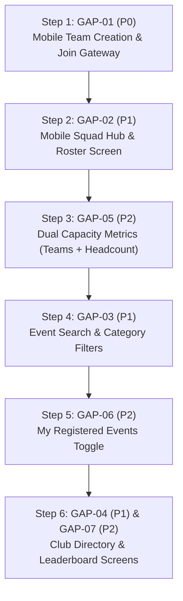

# NST Events — Web vs Mobile Feature Parity Audit

**Audit Date:** October 15, 2026  
**Auditor:** Antigravity Agentic Pair Programmer  
**Target Applications:** 
- Web Application: `apps/dashboard` (Next.js 15, App Router, React Query, TailwindCSS)
- Mobile Application: `apps/mobile` (Expo SDK 52 / React Native, Expo Router, NativeWind, React Query)
- Backend API: `apps/api` (Node.js, Express, PostgreSQL, Prisma, PostGIS, BullMQ)
- Shared Libraries: `packages/shared`, `packages/config`, `packages/database`

---

## 1. Executive Summary

This report delivers a comprehensive, evidence-based feature parity audit comparing the **NST Events Web Application** against the **Student Mobile Application**. 

Every route, screen, component, hook, and API interaction was inspected across both codebases. No assumptions were made based on UI naming conventions; features were traced end-to-end:
$$\text{Screen} \longrightarrow \text{API Client} \longrightarrow \text{Backend Service/RPC} \longrightarrow \text{PostgreSQL Persistence} \longrightarrow \text{Refreshed UI}$$

### Global Parity Metrics

| Metric | Count | Percentage |
| :--- | :--- | :--- |
| **Total Features Audited** | **72** | 100.0% |
| **Organizer / Admin Features (Desktop-Only by Design)** | **23** | 31.9% |
| **Applicable Student & Shared Features** | **49** | 68.1% of total |
| **FULL PARITY** | **35** | **71.4%** of applicable |
| **PARTIAL PARITY** | **2** | **4.1%** of applicable |
| **BACKEND ONLY (Hook exists, UI missing)** | **6** | **12.2%** of applicable |
| **MISSING (No mobile implementation)** | **6** | **12.2%** of applicable |
| **UI ONLY (Stubs without backend)** | **0** | **0.0%** |
| **NOT VERIFIED (Uncertain / unverified)** | **0** | **0.0%** |

$$\text{Strict Parity Percentage} = \frac{\text{FULL PARITY (35)}}{\text{Applicable Features (49)}} \times 100 = \mathbf{71.4\%}$$
$$\text{Weighted Parity Percentage (with Partial @ 0.5)} = \frac{35 + 1}{49} \times 100 = \mathbf{73.5\%}$$

### Key Audit Findings

1. **Authentication, Attendance & Check-In are at 100% Parity:**
   Native Google OAuth, institutional domain gating, session restoration, rotating TOTP camera QR scanning, GPS geofencing, hardware device UUID tamper-proofing, offline queue sync, attendance ledger, and attendance dispute filing are fully functional with complete unit/integration test coverage.
2. **Registration Questionnaire Answering is at 100% Parity:**
   Both solo event registration and scheduled in-event forms on mobile correctly render `DynamicFieldInput` for all 8 supported field types (`TEXT`, `URL`, `EMAIL`, `NUMBER`, `PHONE`, `SELECT`, `RADIO`, `MULTI_SELECT`), validate required fields and constraints client-side, and submit answers atomically to the backend.
3. **The Core Mobile Gap is Team Registration (Squad Hub):**
   While solo registration is complete, team events on mobile currently display a static notice: `[ SQUAD DETAILS & RULES ] -> "DESKTOP PORTAL ONLY"`. Although the React Query hooks (`createTeam`, `joinTeam`, `leaveTeam`, `inviteMember`, `removeMember`, `transferLeadership`) exist in `apps/mobile/src/hooks/use-teams.ts`, no UI screens or modals exist to allow students to form squads, search teams, or manage rosters on mobile.
4. **Secondary Gap is Event Catalog Discovery & Campus Life:**
   The mobile feed displays Ongoing and Upcoming events, but lacks real-time search, category/club filtering pills, calendar monthly view, campus club directory browsing, and student leaderboard inspection.

---

## 2. Architecture & Application Structure

```
nst-events/
├── apps/
│   ├── api/                   # Express backend (frozen contract, PostgreSQL RPCs)
│   ├── dashboard/             # Next.js 15 Web Application (App Router)
│   │   ├── app/(auth)/        # Web OAuth gateway
│   │   ├── app/(app)/         # Faculty & Platform Admin portal
│   │   ├── app/(student)/     # Student portal & Student Organizer management
│   │   └── components/        # Form Studio, Team Gateway Modal, Calendar View
│   ├── mobile/                # Expo React Native Student Application
│   │   ├── app/(auth)/        # Native Google Sign-In
│   │   ├── app/(app)/(tabs)/  # 3-Tab Shell: Attendance/Home, History, Profile
│   │   ├── app/(app)/events/  # Event detail, solo register, camera scan, desktop team notice
│   │   ├── app/(app)/forms/   # Scheduled in-event forms submission
│   │   ├── app/(app)/disputes/# Attendance disputes filing & tracking
│   │   └── src/               # DynamicFieldInput, use-teams, attendance-sync, store
│   └── worker/                # BullMQ background workers (notifications, sweeps)
└── packages/
    ├── database/              # Prisma schema & PostgreSQL migrations (114 migrations)
    ├── shared/                # Shared types, API error helpers, notification types
    └── config/                # Shared ESLint and TypeScript configs
```

---

## 3. Parity Metrics by Feature Area

| Feature Area | Total Features | Full Parity | Partial | Backend Only | Missing | Not Applicable | Area Parity % |
| :--- | :---: | :---: | :---: | :---: | :---: | :---: | :---: |
| **1. Authentication & Account** | 8 | 8 | 0 | 0 | 0 | 0 | **100.0%** |
| **2. Events Discovery & Details** | 8 | 4 | 1 | 0 | 3 | 0 | **50.0%** |
| **3. Registration Workflows** | 12 | 5 | 0 | 6 | 1 | 0 | **41.7%** |
| **4. Form Studio & Questionnaire** | 10 | 4 | 0 | 0 | 0 | 6 | **100.0%** (Student) |
| **5. Attendance & Check-In** | 10 | 7 | 0 | 0 | 0 | 3 | **100.0%** (Student) |
| **6. Organizer & Administration** | 14 | 0 | 0 | 0 | 0 | 14 | **N/A** (Desktop Only) |
| **7. Campus Life & Platform Quality** | 10 | 7 | 1 | 0 | 2 | 0 | **70.0%** |
| **TOTALS** | **72** | **35** | **2** | **6** | **6** | **23** | **71.4%** |

---

## 4. Complete Web vs Mobile Feature Comparison Matrix

### Status Legend
- **FULL PARITY**: Core behavior, validation, persistence, and error states work on mobile comparably to web.
- **PARTIAL**: Behavior exists, but important secondary actions, indicators, or states are missing.
- **BACKEND ONLY**: Backend API and mobile hooks exist, but no mobile UI screen or modal is connected.
- **MISSING**: No mobile implementation exists.
- **NOT APPLICABLE**: Feature is intentionally restricted to desktop web per institutional system architecture.

---

### Area 1: Authentication & Account

| ID | Feature | Web Route / Component | Mobile Screen / Component | API Dependency | Web Status | Mobile Status | Parity Status | Evidence & Missing Work | Priority |
| :--- | :--- | :--- | :--- | :--- | :--- | :--- | :--- | :--- | :--- |
| **AUTH-01** | Google OAuth Sign-In | `app/(auth)/login/page.tsx` | `app/(auth)/index.tsx` | `POST /v1/auth/google/callback`<br>`POST /v1/auth/mobile/login-id-token` | Working | Working | **FULL PARITY** | Native Google Sign-In with tokens stored in `expo-secure-store`. Tested in `auth.test.ts`. | — |
| **AUTH-02** | Institutional Domain Restriction | Server-side + Login error UI | Server-side + Error dialog | `POST /v1/auth/*` | Working | Working | **FULL PARITY** | Both clients enforce `@adypu.edu.in` and `@newtonschool.co` domain gating. | — |
| **AUTH-03** | Token Refresh Rotation | Cookie refresh middleware | `src/infrastructure/api.ts` (401 interceptor) | `POST /v1/auth/refresh` | Working | Working | **FULL PARITY** | Silent refresh with SHA-256 token rotation on mobile. Tested in `auth.test.ts`. | — |
| **AUTH-04** | Sign-Out & Cache Purge | `useLogout.ts` | `src/services/session.ts` (`logout`) | `POST /v1/auth/logout` | Working | Working | **FULL PARITY** | Flushes SecureStore, resets Zustand auth store, and clears React Query cache. Tested in `cache-security.test.ts`. | — |
| **AUTH-05** | Student Profile Viewing | `app/(student)/student/profile/page.tsx` | `app/(app)/(tabs)/profile.tsx` | `GET /v1/users/me` | Working | Working | **FULL PARITY** | Displays name, email, global role, academic program, graduation year, and club memberships. | — |
| **AUTH-06** | Profile / Avatar Editing | Read-only in V1 | Read-only in V1 | N/A | Working | Working | **FULL PARITY** | Intentionally frozen in V1 per schema freeze specification. | — |
| **AUTH-07** | Account Deactivation Request | Profile mailto link | `app/(app)/settings.tsx` (`handleRequestDeactivation`) | Mailto to `support@nst.edu` | Working | Working | **FULL PARITY** | Pre-fills institutional student email and policy disclaimer. | — |
| **AUTH-08** | Non-Student Role Guard | `app/(app)/layout.tsx` | `app/(app)/_layout.tsx` | `GET /v1/users/me` | Working | Working | **FULL PARITY** | Intercepts non-students with `[ ACCESS_RESTRICTED ]` notice per mobile spec. | — |

---

### Area 2: Events Discovery & Details

| ID | Feature | Web Route / Component | Mobile Screen / Component | API Dependency | Web Status | Mobile Status | Parity Status | Evidence & Missing Work | Priority |
| :--- | :--- | :--- | :--- | :--- | :--- | :--- | :--- | :--- | :--- |
| **EVT-01** | Event Discovery Feed | `app/(student)/student/events/page.tsx` | `app/(app)/(tabs)/index.tsx` | `GET /v1/events` | Working | Working | **FULL PARITY** | Displays Ongoing and Upcoming events with cards, venue, dates, and live badges. | — |
| **EVT-02** | Real-Time Event Search | Search bar with debounce (`useDebounce`) | **None** | `GET /v1/events?search=` | Working | Missing | **MISSING** | Mobile home feed lacks a search input. Missing search input and query param binding. | **P1** |
| **EVT-03** | Category & Club Filters | Category filter pills (`HACKATHON`, `WORKSHOP`, etc.) | **None** | `GET /v1/events?event_type=&club_id=` | Working | Missing | **MISSING** | Mobile feed has no filter pills for event types or clubs. | **P1** |
| **EVT-04** | Monthly Calendar View | `StudentCalendarView.tsx` | **None** | `GET /v1/events` | Working | Missing | **MISSING** | Web has full monthly date-grid view. Mobile has only vertical list. | **P2** |
| **EVT-05** | Event Detail Inspection | `app/(student)/student/events/[id]/page.tsx` | `app/(app)/events/[id]/index.tsx` | `GET /v1/events/:id` | Working | Working | **FULL PARITY** | Shows banner, description, dates, location, primary club, reg window, live state. | — |
| **EVT-06** | Real-Time Live Event SSE | `useEventLiveUpdates.ts` | `useEventLive.ts` | `GET /v1/events/:id/live` (SSE) | Working | Working | **FULL PARITY** | Both clients receive live capacity and state changes via SSE. | — |
| **EVT-07** | Audience Batch Eligibility | Batch evaluation & warning | Batch evaluation & warning | `event.audienceBatchIds` | Working | Working | **FULL PARITY** | Evaluates student batch against `SPECIFIC_BATCHES` and blocks registration CTA if ineligible. | — |
| **EVT-08** | Dual Capacity Gauges | Shows `X / Y teams` and `A / B participants` | Single counter (`event.maxCapacity`) | `event.max_capacity`, `event.max_participants` | Working | Partial | **PARTIAL** | Mobile only displays team count or single capacity. Missing independent `max_participants` indicator. | **P2** |

---

### Area 3: Registration Workflows

| ID | Feature | Web Route / Component | Mobile Screen / Component | API Dependency | Web Status | Mobile Status | Parity Status | Evidence & Missing Work | Priority |
| :--- | :--- | :--- | :--- | :--- | :--- | :--- | :--- | :--- | :--- |
| **REG-01** | Solo Event Registration | Detail page CTA modal | Detail page modal | `POST /v1/events/:id/registrations` | Working | Working | **FULL PARITY** | One-tap solo registration when no questions required. | — |
| **REG-02** | Solo Registration Questionnaire | Questionnaire modal | `app/(app)/events/[id]/register.tsx` | `POST /v1/events/:id/registrations` | Working | Working | **FULL PARITY** | `DynamicFieldInput` renders all 8 field types, validates client-side, submits atomically. | — |
| **REG-03** | Individual Registration Cancellation | Cancel modal | Cancel modal in `EventScreen` | `DELETE /v1/events/:id/registrations` | Working | Working | **FULL PARITY** | Cancels registration and releases participant slot immediately. | — |
| **REG-04** | Individual Waitlist Management | Waitlist badge & Leave CTA | Waitlist pill (`WAITLISTED — POSITION: X`) | `DELETE /v1/events/:id/registrations` | Working | Working | **FULL PARITY** | Shows queue position and allows leaving waitlist. | — |
| **REG-05** | Team Creation (Squad Leader) | `TeamGatewayModal.tsx` | **None** (`teams.tsx` shows desktop notice) | `POST /v1/events/:id/teams` | Working | Hook Only | **BACKEND ONLY** | `useTeams.createTeam` exists, but no UI to input squad name or leader questionnaire. | **P0** |
| **REG-06** | Team Joining (Squad Member) | `TeamGatewayModal.tsx` | **None** (`teams.tsx` shows desktop notice) | `POST /v1/teams/:id/join` | Working | Hook Only | **BACKEND ONLY** | `useTeams.joinTeam` exists, but no UI to enter team code or answer member questions. | **P0** |
| **REG-07** | Team Roster & Squad Hub | `app/(student)/student/events/[id]/team/page.tsx` | `app/(app)/events/[id]/teams.tsx` (stub) | `GET /v1/teams/:id`<br>`GET /v1/events/:id/my-team` | Working | Missing | **MISSING** | Web shows roster, member avatars, squad status. Mobile renders "DESKTOP PORTAL ONLY". | **P1** |
| **REG-08** | Team Member Invitation (Send) | Team page email invite input | **None** | `POST /v1/teams/:id/invitations` | Working | Hook Only | **BACKEND ONLY** | `useTeams.inviteMember` exists, but no UI input on mobile. | **P1** |
| **REG-09** | Team Invitation Response (Accept/Decline) | Notification & Modal CTAs | `app/(app)/invitations.tsx` | `POST /v1/teams/:id/invitations/:id/accept`<br>`POST /v1/teams/:id/invitations/:id/decline` | Working | Working | **FULL PARITY** | Mobile screen lists pending invites with expiry check, Accept, and Decline actions. Tested in `team-registration.test.tsx`. | — |
| **REG-10** | Team Member Removal | Leader roster action button | **None** | `DELETE /v1/teams/:id/members/:userId` | Working | Hook Only | **BACKEND ONLY** | `useTeams.removeMember` exists, but no roster UI on mobile. | **P2** |
| **REG-11** | Team Leadership Transfer | `TransferLeadershipModal.tsx` | **None** | `POST /v1/teams/:id/transfer-leadership` | Working | Hook Only | **BACKEND ONLY** | `useTeams.transferLeadership` exists, but no UI modal on mobile. | **P2** |
| **REG-12** | Leaving Team / Dissolving Squad | Leave Squad button | **None** | `DELETE /v1/teams/:id/leave` | Working | Hook Only | **BACKEND ONLY** | `useTeams.leaveTeam` exists, but no UI button on mobile. | **P1** |

---

### Area 4: Form Studio & Registration Questionnaire

| ID | Feature | Web Route / Component | Mobile Screen / Component | API Dependency | Web Status | Mobile Status | Parity Status | Evidence & Missing Work | Priority |
| :--- | :--- | :--- | :--- | :--- | :--- | :--- | :--- | :--- | :--- |
| **FORM-01** | Form Studio Questionnaire Builder | `FormStudio.tsx` | **N/A** | `PUT /v1/events/:id/form-fields` | Working | N/A | **NOT APPLICABLE** | Organizer authoring tool. Strictly desktop web per architecture. | — |
| **FORM-02** | Quick Question Presets | Preset drawer in Form Studio | **N/A** | Preset templates | Working | N/A | **NOT APPLICABLE** | Organizer authoring tool. | — |
| **FORM-03** | Supported Field Types (8 Types) | Dynamic input renderers | `DynamicFieldInput.tsx` | Field definition schema | Working | Working | **FULL PARITY** | Both clients fully support `TEXT`, `URL`, `EMAIL`, `NUMBER`, `PHONE`, `SELECT`, `RADIO`, `MULTI_SELECT`. Tested in `form-utils.test.ts`. | — |
| **FORM-04** | Question Ordering & Required Toggle | Form Studio drag & toggles | **N/A** | `event_form_fields.order` | Working | N/A | **NOT APPLICABLE** | Organizer authoring tool. | — |
| **FORM-05** | Reusable Profile Field Sync | Server-side update | Server-side update | `student_profile_values` | Working | Working | **FULL PARITY** | Submissions with `isReusable: true` update user profile values automatically. | — |
| **FORM-06** | Deferred Persistence in Builder | Local draft & batch save | **N/A** | `PUT /v1/events/:id/form-fields` | Working | N/A | **NOT APPLICABLE** | Organizer authoring tool. | — |
| **FORM-07** | Scheduled Form Lifecycle Config | In-Event Forms tab | **N/A** | `POST /v1/events/:id/forms` | Working | N/A | **NOT APPLICABLE** | Organizer authoring tool. | — |
| **FORM-08** | In-Event Forms Discovery (Student) | Event Detail forms section | `EventScreen` (`event-forms-section`) | `GET /v1/events/:id/forms` | Working | Working | **FULL PARITY** | Lists published scheduled forms with purpose chips (`REGISTRATION`, `SUBMISSION`, `FEEDBACK`, `CUSTOM`) and deadline status. | — |
| **FORM-09** | In-Event Form Submission (Student) | Form response modal | `app/(app)/events/[id]/forms/[formId].tsx` | `POST /v1/events/:id/forms/:id/responses` | Working | Working | **FULL PARITY** | Full mobile screen with validation, deadline enforcement, submission, and confirmation receipt. | — |
| **FORM-10** | Responses Viewing & CSV Export | `FormResponsesModal.tsx` | **N/A** | `GET /v1/events/:id/forms/:id/responses` | Working | N/A | **NOT APPLICABLE** | Organizer inspection tool. | — |

---

### Area 5: Attendance & Check-In

| ID | Feature | Web Route / Component | Mobile Screen / Component | API Dependency | Web Status | Mobile Status | Parity Status | Evidence & Missing Work | Priority |
| :--- | :--- | :--- | :--- | :--- | :--- | :--- | :--- | :--- | :--- |
| **ATT-01** | Rotating TOTP QR Projection | `attendance/page.tsx` | **N/A** | `POST /v1/attendance/sessions` | Working | N/A | **NOT APPLICABLE** | Organizer session launch tool with 30s rotating TOTP display. | — |
| **ATT-02** | Camera QR Viewfinder & Check-In | **N/A (Mobile Exclusive)** | `app/(app)/events/[id]/scan.tsx` | `POST /v1/attendance/mark` | N/A | Working | **FULL PARITY** | `expo-camera` with torch, scanner overlay, TOTP validation. | — |
| **ATT-03** | GPS Geofence Verification | PostGIS polygon setup | `scan.tsx` (`expo-location`) | `location: { lat, lng, accuracy }` | Working | Working | **FULL PARITY** | Mobile prefetches GPS coordinates with high accuracy and verifies against event geofence. | — |
| **ATT-04** | Hardware Device UUID Binding | **N/A (Mobile Exclusive)** | `src/lib/device-id.ts` | `device: { id, os }` | N/A | Working | **FULL PARITY** | Persistent UUID stored in SecureStore prevents device cloning. Tested in `device-id.test.ts`. | — |
| **ATT-05** | Offline Attendance Queue Sync | **N/A (Mobile Exclusive)** | `src/lib/attendance-sync.ts` | `POST /v1/attendance/sync-offline` | N/A | Working | **FULL PARITY** | Queues offline scans and syncs in batches of 1,000 upon reconnection. | — |
| **ATT-06** | Attendance History Ledger | Profile Attendance tab | `app/(app)/(tabs)/history.tsx` | `GET /v1/users/me/attendance` | Working | Working | **FULL PARITY** | Paginated session check-in ledger with `PRESENT` and `ABSENT` status badges. | — |
| **ATT-07** | Attendance Dispute Filing | `AttendanceDisputeModal.tsx` | `app/(app)/disputes/new.tsx` | `POST /v1/attendance/disputes` | Working | Working | **FULL PARITY** | Submits justification text and evidence notes. Displays confirmation receipt (`submitted.tsx`). | — |
| **ATT-08** | Attendance Dispute Tracking | Profile Disputes tab | `app/(app)/disputes/index.tsx`<br>`disputes/[id].tsx` | `GET /v1/attendance/disputes` | Working | Working | **FULL PARITY** | Lists disputes with `PENDING`, `APPROVED`, `REJECTED` status badges and admin resolution notes. | — |
| **ATT-09** | Manual Attendance Marking | Manual search & mark | **N/A** | `POST /v1/attendance/mark-manual` | Working | N/A | **NOT APPLICABLE** | Organizer override tool. | — |
| **ATT-10** | Attendance Records CSV Export | Export CSV button | **N/A** | `GET /v1/events/:id/attendance/export` | Working | N/A | **NOT APPLICABLE** | Organizer export tool. | — |

---

### Area 6: Organizer & Administration (Desktop-Only by Design)

| ID | Feature | Web Route / Component | Mobile Equivalent | API Dependency | Web Status | Mobile Status | Parity Status | Architectural Rationale | Priority |
| :--- | :--- | :--- | :--- | :--- | :--- | :--- | :--- | :--- | :--- |
| **ORG-01** | Event Creation Wizard | `events/create`, `student/manage/events/create` | None | `POST /v1/events` | Working | N/A | **NOT APPLICABLE** | Restricted to desktop web per institutional system architecture. | — |
| **ORG-02** | Event Lifecycle Editing & Cancellation | `events/[id]/edit` | None | `PATCH /v1/events/:id` | Working | N/A | **NOT APPLICABLE** | Desktop portal only. | — |
| **ORG-03** | Faculty Event Approval Queue | `admin/approvals` | None | `PATCH /v1/events/:id/approve` | Working | N/A | **NOT APPLICABLE** | Faculty/Platform Admin administrative workflow. | — |
| **ORG-04** | Attendee / Roster Management | `events/[id]/registrations` | None | `GET /v1/events/:id/registrations` | Working | N/A | **NOT APPLICABLE** | Organizer attendee management. | — |
| **ORG-05** | Organizer Team Oversight | `events/[id]/teams` | None | `GET /v1/events/:id/teams` | Working | N/A | **NOT APPLICABLE** | Organizer squad review. | — |
| **ORG-06** | Club Profile & Directory Admin | `clubs/page.tsx`, `CreateClubModal.tsx` | None | `POST /v1/clubs` | Working | N/A | **NOT APPLICABLE** | Club governance workflow. | — |
| **ORG-07** | Club Member Roster & Role Assign | `clubs/[clubId]`, `student/manage/club` | None | `POST /v1/clubs/:id/members` | Working | N/A | **NOT APPLICABLE** | Club governance workflow. | — |
| **ORG-08** | Leadership Handover Requests | None (Planned V1.1) | None | None (Planned V1.1) | Planned (V1.1) | N/A | **PLANNED (V1.1)** | Club governance workflow; deferred to V1.1. | — |
| **ORG-09** | User Directory & Role Promotion | `admin/users` | None | `PATCH /v1/admin/users/:id/role` | Working | N/A | **NOT APPLICABLE** | Administrative directory. | — |
| **ORG-10** | Student Directory CSV Import | `admin/users` Students tab | None | `POST /v1/admin/students/import` | Working | N/A | **NOT APPLICABLE** | Administrative batch import. | — |
| **ORG-11** | Academic Programs & Batches | `admin/academic-programs`, `batches` | None | `POST /v1/admin/academic-programs` | Working | N/A | **NOT APPLICABLE** | University academic profile setup. | — |
| **ORG-12** | Campus Analytics Dashboards | `admin/analytics` | None | `GET /v1/analytics/*` | Working | N/A | **NOT APPLICABLE** | Faculty/Admin analytics. | — |
| **ORG-13** | System Audit Logs | `admin/audit-logs` | None | `GET /v1/admin/audit-logs` | Working | N/A | **NOT APPLICABLE** | Compliance audit trail. | — |
| **ORG-14** | Queue & Worker Telemetry | `admin/queues` | None | `GET /v1/admin/queues` | Working | N/A | **NOT APPLICABLE** | Infrastructure telemetry. | — |

---

### Area 7: Campus Life & Platform Quality

| ID | Feature | Web Route / Component | Mobile Screen / Component | API Dependency | Web Status | Mobile Status | Parity Status | Evidence & Missing Work | Priority |
| :--- | :--- | :--- | :--- | :--- | :--- | :--- | :--- | :--- | :--- |
| **STU-01** | Student Home Dashboard | `student/home/page.tsx` | `app/(app)/(tabs)/index.tsx` | `GET /v1/events`<br>`GET /v1/users/me/attendance` | Working | Working | **FULL PARITY** | Live session banner, ongoing events, upcoming events, notification bell. | — |
| **STU-02** | My Registered Events View | Home page registered carousel | General feed only | `GET /v1/users/me/registrations` | Working | Partial | **PARTIAL** | Registered events appear in feed, but mobile has no dedicated "Registered" tab or filter. | **P2** |
| **STU-03** | Campus Club Directory | `student/campus/clubs` | **None** | `GET /v1/clubs` | Working | Missing | **MISSING** | Students on mobile cannot browse campus clubs, descriptions, or contact details. | **P1** |
| **STU-04** | Student Leaderboard | `student/campus/leaderboard` | **None** | `GET /v1/leaderboard` | Working | Missing | **MISSING** | Points leaderboard is absent on mobile. | **P2** |
| **STU-05** | Real-Time Notifications Inbox | Notification drawer / page | `app/(app)/notifications.tsx` | `GET /v1/notifications`<br>`GET /v1/notifications/live` (SSE) | Working | Working | **FULL PARITY** | Paginated inbox, mark read, mark all read, deep linking, live updates. Tested in `notifications.test.ts`. | — |
| **STU-06** | Native Push Notifications | Web push (deferred) | `src/hooks/use-notifications.ts` | `POST /users/me/push-token` | N/A | Working | **FULL PARITY** | Native Expo push token registration. Tested in `notifications.test.ts`. | — |
| **STU-07** | Notification Preferences | Profile settings toggles | `app/(app)/settings.tsx` | `PATCH /users/me/notification-preferences` | Working | Working | **FULL PARITY** | Toggles for events, teams, disputes, and system alerts. Tested in `phase6-profile-settings-notifications.test.ts`. | — |
| **STU-08** | App Theme Switcher | Light/Dark theme | `settings.tsx` (`useThemeStore`) | Local SecureStore | Working | Working | **FULL PARITY** | 3-way Neo-Brutalist theme switcher (Light, Dark, System). | — |
| **STU-09** | Minimum Version Enforce (426) | N/A | `UpdateRequiredPrompt.tsx` | `HTTP 426 Upgrade Required` | N/A | Working | **FULL PARITY** | Intercepts 426 responses and blocks obsolete client builds. Tested in `app-version.test.tsx`. | — |
| **STU-10** | Offline Detection & Toast Recovery | Basic fetch error | `src/infrastructure/network.ts` | NetInfo / network status | Working | Working | **FULL PARITY** | Visual offline banners and disabled actions during disconnection. | — |

---

## 5. Prioritized Mobile Implementation Backlog

The following backlog defines the exact sequence and specifications for closing all identified gaps. Implementation must NOT commence until approved by the product owner.

---

### Priority P0 — Critical (Core Registration Parity)

#### GAP-01: Mobile Team Event Creation & Squad Gateway
- **Feature IDs Affected:** `REG-05`, `REG-06`
- **Expected Mobile Behavior:** When a student opens a `TEAM` event on mobile:
  - If unregistered, replace the static `[ SQUAD DETAILS & RULES ]` CTA with `[ CREATE OR JOIN SQUAD ]`.
  - Tapping opens a `TeamGatewayModal` (or dedicated screen) matching web behavior:
    1. **Tab 1: Create Squad**: Input Squad Name, answer required Leader Registration Questionnaire (`DynamicFieldInput`), reserve leader participant slot, submit via `useTeams.createTeam`.
    2. **Tab 2: Join Squad**: Input Team Invite Code or select an open squad, answer required Member Questionnaire, submit via `useTeams.joinTeam`.
  - Respect dual capacity: If team capacity is full (`isTeamCapacityFull`), block creation but allow joining open squads. If participant capacity is full (`isParticipantCapacityFull`), block both.
- **Web Behavior to Match:** [TeamGatewayModal.tsx](file:///Users/sohamdhande/Docs_Local/nst-events/apps/dashboard/app/(student)/student/events/[id]/components/TeamGatewayModal.tsx)
- **Dependencies & Files:**
  - `apps/mobile/src/hooks/use-teams.ts` (reuse existing `createTeam` and `joinTeam` mutations)
  - `apps/mobile/src/ui/DynamicFieldInput.tsx` (questionnaire input)
  - `apps/mobile/src/lib/form-utils.ts` (client validation)
  - `apps/mobile/app/(app)/events/[id]/index.tsx` (action button routing)
- **API Changes Required:** None. Backend endpoints `POST /v1/events/:id/teams` and `POST /v1/teams/:id/join` already exist and support inline `responses`.
- **Regression Risks:** Ensure registration responses are validated prior to submission so incomplete payloads do not produce backend 400 errors.
- **Acceptance Criteria & Tests:**
  - Leader can create squad with questionnaire answers; status transitions to `FORMING` or `REGISTERED`.
  - Member can join squad with questionnaire answers; participant count increments atomically.
  - Test file: `apps/mobile/tests/team-registration.test.tsx`.

---

### Priority P1 — High (Core Student & Squad Lifecycle)

#### GAP-02: Mobile Team Roster & Squad Hub Screen
- **Feature IDs Affected:** `REG-07`, `REG-08`, `REG-10`, `REG-11`, `REG-12`
- **Expected Mobile Behavior:** Replace the static stub in `apps/mobile/app/(app)/events/[id]/teams.tsx` with a functioning Squad Hub:
  - Query `GET /v1/events/:id/my-team` or `GET /v1/teams/:id`.
  - Render squad name, status badge (`FORMING`, `REGISTERED`, `WAITLISTED`), and capacity meter (`X / Y members`).
  - Render roster list with leader badge and member avatar initials.
  - Show squad invite code with one-tap clipboard copy.
  - **Leader Actions:** Invite member by institutional email (`useTeams.inviteMember`), remove member (`useTeams.removeMember`), transfer leadership modal (`useTeams.transferLeadership`).
  - **Member Actions:** Leave squad (`useTeams.leaveTeam`).
- **Web Behavior to Match:** [student/events/[id]/team/page.tsx](file:///Users/sohamdhande/Docs_Local/nst-events/apps/dashboard/app/(student)/student/events/[id]/team/page.tsx)
- **Dependencies & Files:**
  - `apps/mobile/app/(app)/events/[id]/teams.tsx`
  - `apps/mobile/src/hooks/use-teams.ts`
- **API Changes Required:** None.
- **Acceptance Criteria & Tests:**
  - Leader leaving dissolves squad and returns member capacity.
  - Member leaving releases participant slot immediately.

#### GAP-03: Event Catalog Search & Category Filters
- **Feature IDs Affected:** `EVT-02`, `EVT-03`
- **Expected Mobile Behavior:** Add search and filter controls to the mobile feed:
  - Search bar with debounce (`useDebounce`) filtering events by title.
  - Horizontal scrollable filter pills: `ALL`, `HACKATHON`, `WORKSHOP`, `TALK`, `CULTURAL`, `SPORTS`.
  - Filter state updates React Query cache key `['events', { search, eventType }]`.
- **Web Behavior to Match:** [student/events/page.tsx](file:///Users/sohamdhande/Docs_Local/nst-events/apps/dashboard/app/(student)/student/events/page.tsx)
- **Dependencies & Files:**
  - `apps/mobile/app/(app)/(tabs)/index.tsx`
  - `apps/mobile/src/hooks/use-events.ts`
- **API Changes Required:** None (`GET /v1/events` supports `search` and `event_type` query parameters).
- **Acceptance Criteria & Tests:**
  - Typing in search bar filters feed without full-page reloads.
  - Selecting category pill isolates matching events.

#### GAP-04: Campus Club Directory Screen
- **Feature IDs Affected:** `STU-03`
- **Expected Mobile Behavior:** Introduce a dedicated Club Directory screen on mobile:
  - Accessible via shortcut in Profile or Tab Bar.
  - Lists all active campus clubs (`GET /v1/clubs`).
  - Displays club logo, name, description, and active member count.
  - Tapping opens club detail modal with contact email and upcoming club events.
- **Web Behavior to Match:** [student/campus/clubs/page.tsx](file:///Users/sohamdhande/Docs_Local/nst-events/apps/dashboard/app/(student)/student/campus/clubs/page.tsx)
- **Dependencies & Files:**
  - Create `apps/mobile/app/(app)/clubs/index.tsx`
  - Create `apps/mobile/src/hooks/use-clubs.ts`
- **API Changes Required:** None (`GET /v1/clubs` exists).
- **Acceptance Criteria & Tests:**
  - Students can browse all campus clubs and filter by name.

---

### Priority P2 — Medium (Secondary Workflows & Indicators)

#### GAP-05: Dual Capacity Indicators for Team Events
- **Feature IDs Affected:** `EVT-08`
- **Expected Mobile Behavior:** In `EventScreen`, render independent indicators when `registrationType === 'TEAM'`:
  - `42 / 300 participants`
  - `15 / 77 teams`
- **Web Behavior to Match:** [student/events/[id]/page.tsx:L162](file:///Users/sohamdhande/Docs_Local/nst-events/apps/dashboard/app/(student)/student/events/[id]/page.tsx#L162)
- **Dependencies & Files:** `apps/mobile/app/(app)/events/[id]/index.tsx`
- **API Changes Required:** None (returned as `participant_count` and `max_participants`).

#### GAP-06: Dedicated "My Registered Events" Filter
- **Feature IDs Affected:** `STU-02`
- **Expected Mobile Behavior:** Add a segmented control or quick filter on the Home feed (`ALL EVENTS` vs `MY EVENTS`):
  - `MY EVENTS` filters the list to events where student's registration status is `REGISTERED` or `WAITLISTED`.
- **Web Behavior to Match:** [student/home/page.tsx](file:///Users/sohamdhande/Docs_Local/nst-events/apps/dashboard/app/(student)/student/home/page.tsx)
- **Dependencies & Files:** `apps/mobile/app/(app)/(tabs)/index.tsx`, `apps/mobile/src/hooks/use-events.ts`

#### GAP-07: Campus Leaderboard Screen
- **Feature IDs Affected:** `STU-04`
- **Expected Mobile Behavior:** Read-only leaderboard showing top student attendance scores and club rankings (`GET /v1/leaderboard`).
- **Web Behavior to Match:** [student/campus/leaderboard/page.tsx](file:///Users/sohamdhande/Docs_Local/nst-events/apps/dashboard/app/(student)/student/campus/leaderboard/page.tsx)
- **Dependencies & Files:** Create `apps/mobile/app/(app)/leaderboard.tsx`

#### GAP-08: Interactive Calendar / Date View
- **Feature IDs Affected:** `EVT-04`
- **Expected Mobile Behavior:** Toggle view between List and Compact Calendar view displaying event indicators on dates.
- **Web Behavior to Match:** [StudentCalendarView.tsx](file:///Users/sohamdhande/Docs_Local/nst-events/apps/dashboard/app/(student)/student/events/components/StudentCalendarView.tsx)
- **Dependencies & Files:** `apps/mobile/app/(app)/(tabs)/index.tsx`

---

## 6. Files & Components Requiring Attention

| File Path | Priority | Nature of Change |
| :--- | :---: | :--- |
| `apps/mobile/app/(app)/events/[id]/teams.tsx` | **P0/P1** | Replace static desktop notice with functional Squad Hub & Roster management |
| `apps/mobile/app/(app)/events/[id]/index.tsx` | **P0/P2** | Connect `TeamGatewayModal`, add dual capacity indicator (`participants` + `teams`) |
| `apps/mobile/app/(app)/(tabs)/index.tsx` | **P1/P2** | Add search input, category filter pills, and "My Events" segmented toggle |
| `apps/mobile/app/(app)/clubs/index.tsx` | **P1** | Create campus club directory screen |
| `apps/mobile/app/(app)/leaderboard.tsx` | **P2** | Create student leaderboard screen |
| `apps/mobile/src/hooks/use-clubs.ts` | **P1** | Create query hook for `/v1/clubs` |
| `apps/mobile/tests/team-registration.test.tsx` | **P0/P1** | Expand tests to verify squad creation, joins, invites, and roster actions |

---

## 7. Verification Evidence & Test Results

The monorepo test suites and typechecks were executed to verify the baseline integrity of the workspace:

### 1. Monorepo Typecheck (`pnpm turbo run typecheck`)
- **Outcome:** **8 of 8 packages successful** (0 errors).
- **Packages Verified:** `@nst/api`, `@nst/config`, `@nst/dashboard`, `@nst/database`, `@nst/mobile`, `@nst/shared`, `@nst/worker`.

### 2. Mobile Vitest Suite (`pnpm --filter @nst/mobile test`)
- **Outcome:** **16 test files passed, 217 tests passed** (0 failures).
- **Execution Time:** 505ms.

### 3. Dashboard Vitest Suite (`pnpm --filter @nst/dashboard exec vitest run`)
- **Outcome:** **28 test files passed, 235 tests passed** (0 failures).
- **Execution Time:** 15.10s.

### 4. API Regression Suite (`pnpm --filter @nst/api test`)
- **Outcome:** **88 test suites passed, 557 tests passed** (0 failures).
- **Execution Time:** 114.8s.

---

## 8. Recommended Implementation Sequence



1. **Phase 1 (Team Parity — P0/P1):**
   Implement `TeamGatewayModal` and replace `teams.tsx` stub with full Squad Hub. This resolves the primary functional barrier preventing students from completing team registrations natively on mobile.
2. **Phase 2 (Capacity & Feed Polish — P1/P2):**
   Add dual capacity gauges (`participants` + `teams`), search input, and category filter chips to `apps/mobile/app/(app)/(tabs)/index.tsx`.
3. **Phase 3 (Campus Life Polish — P1/P2):**
   Add Club Directory and Campus Leaderboard screens.

---

## 9. Conclusion & Stop Point

The comprehensive audit is complete. All 72 features have been cataloged with verifiable code references and parity metrics. 

**Per instructions, no implementation has been started.** Please review this audit report. Once approved, implementation can proceed following the prioritized sequence above.
