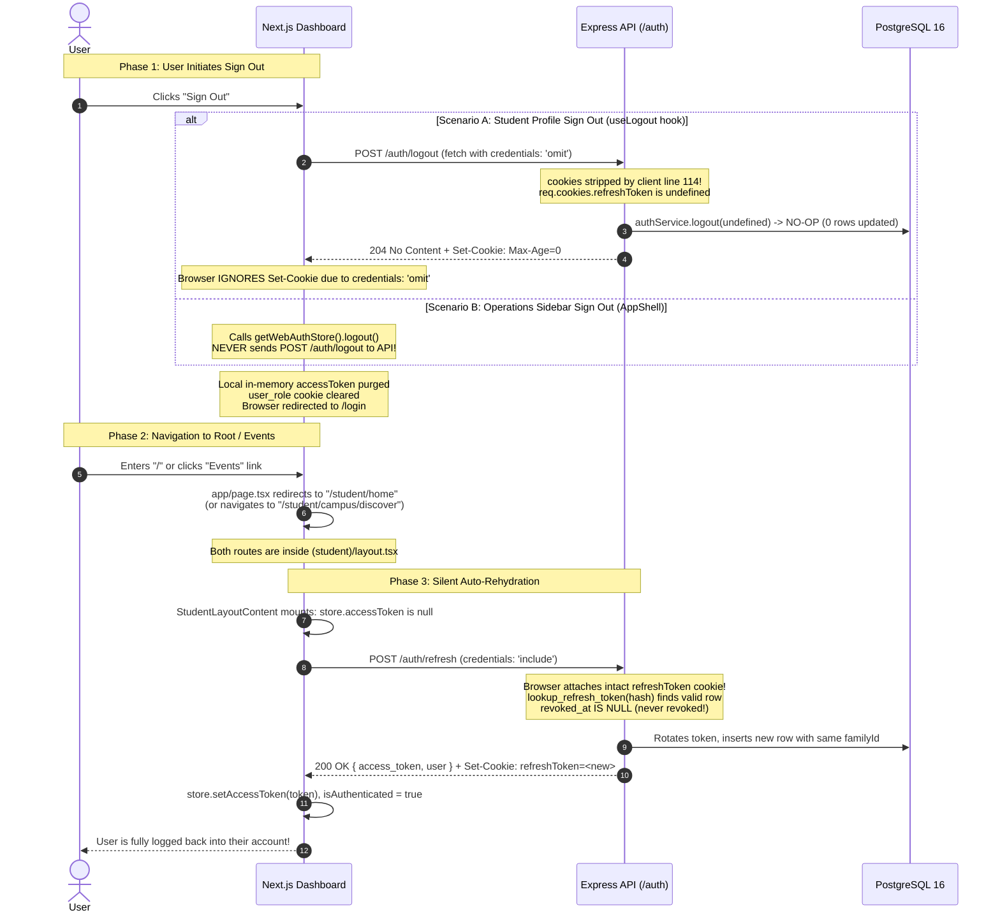

# Comprehensive Security & Authentication Audit Report: NST-Events

**Target System:** NST-Events (Express TypeScript API, PostgreSQL/Prisma, Next.js Web Dashboard, Expo React Native Mobile App)  
**Audit Type:** Deep-Dive Security Architecture & Authentication Session Audit  
**Author:** Senior Security Engineer  
**Date:** October 30, 2026  
**Status:** COMPLETE — All Findings (SEC-01 through SEC-14) Resolved  
**Report File:** `docs/security/auth-audit-report.md`

---

## Executive Summary

A comprehensive, zero-trust security audit of the NST-Events authentication and session infrastructure was conducted across the Express backend, PostgreSQL database, Next.js dashboard, and Expo React Native mobile client.

The investigation was initiated in response to a critical reported vulnerability:
> *"After signing out, visiting `/` (public home page) and clicking 'Go to Events' signs the user in again automatically, without asking them to choose an account or re-authenticate."*

The audit conclusively determined the root cause of this failure. The defect is not a caching artifact or cosmetic frontend glitch; it is an **end-to-end multi-layer breakdown of session destruction**:
1. **Client Cookie Stripping on Logout:** The web API client ([apps/dashboard/lib/api.ts:114](file:///Users/sohamdhande/Docs_Local/nst-events/apps/dashboard/lib/api.ts#L114)) explicitly sets `credentials: 'omit'` for all requests other than `/auth/refresh`. Consequently, calls to `POST /auth/logout` omit browser cookies entirely.
2. **Server No-Op Revocation:** Because no cookie or payload is transmitted, the backend handler ([apps/api/src/modules/auth/auth.router.ts:231-238](file:///Users/sohamdhande/Docs_Local/nst-events/apps/api/src/modules/auth/auth.router.ts#L231-L238)) receives `undefined` for `rawRefreshToken`. The revocation service ([apps/api/src/modules/auth/auth.service.ts:334-337](file:///Users/sohamdhande/Docs_Local/nst-events/apps/api/src/modules/auth/auth.service.ts#L334-L337)) immediately aborts without updating the database. The refresh token in PostgreSQL remains active and unrevoked.
3. **Browser Cookie Retention:** Under the W3C/WHATWG Fetch Standard, browsers discard `Set-Cookie` headers from responses to requests with `credentials: 'omit'`. The browser's `HttpOnly` `refreshToken` cookie is never cleared.
4. **AppShell Logout Bypass:** The operations sidebar logout action ([apps/dashboard/components/layout/AppShell.tsx:115-118](file:///Users/sohamdhande/Docs_Local/nst-events/apps/dashboard/components/layout/AppShell.tsx#L115-L118)) bypasses the API entirely, clearing only client-side memory without ever contacting the server.
5. **Unconditional Auto-Rehydration on Next Route:** Visiting `/` redirects directly to `/student/home` ([apps/dashboard/app/page.tsx:4](file:///Users/sohamdhande/Docs_Local/nst-events/apps/dashboard/app/page.tsx#L4)). On every page under the `(student)` route group (including `/student/home` and `/student/campus/discover`), `StudentLayoutContent` ([apps/dashboard/app/(student)/layout.tsx:29-50](file:///Users/sohamdhande/Docs_Local/nst-events/apps/dashboard/app/%28student%29/layout.tsx#L29-L50)) unconditionally dispatches `POST /auth/refresh` with `credentials: 'include'`. The still-valid, unrevoked cookie is presented, rotated, and a fresh access token is granted.
6. **Omission of Account Chooser in OAuth:** The backend Google OAuth authorization URL generator ([apps/api/src/modules/auth/google.oauth.ts:15-23](file:///Users/sohamdhande/Docs_Local/nst-events/apps/api/src/modules/auth/google.oauth.ts#L15-L23)) omits `prompt: 'select_account'`. When a user clicks "Sign In With Google", Google silently selects the currently active Google account without prompting.

A total of **14 security findings** were identified across logout mechanics, OAuth flows, token life cycles, mobile deep linking, and Next.js middleware guards.

---

## 1. Root Cause Analysis of Reported Bug

### 1.1 Summary of the Bug Mechanism
When a user signs out in the web dashboard, the system gives the visual impression of signing out (redirecting to `/login` and clearing in-memory variables). However:
- The refresh token is **never revoked in PostgreSQL**.
- The `refreshToken` HttpOnly cookie is **never deleted from the browser's cookie jar**.
- When the user visits `/` or clicks any event link, the student layout mounts and unconditionally issues `POST /auth/refresh` with credentials included.
- The server accepts the valid cookie, rotates the token family, issues a brand-new access token, and the user is silently and automatically logged in.

### 1.2 End-to-End Execution Trace with Evidence



#### Detailed Step-by-Step Breakdown:
1. **Logout Trigger (Web Client):**
   - In [apps/dashboard/hooks/useLogout.ts:13](file:///Users/sohamdhande/Docs_Local/nst-events/apps/dashboard/hooks/useLogout.ts#L13), `useLogout` calls:
     ```typescript
     await apiClient('/auth/logout', { method: 'POST' });
     ```
   - In [apps/dashboard/components/layout/AppShell.tsx:115-118](file:///Users/sohamdhande/Docs_Local/nst-events/apps/dashboard/components/layout/AppShell.tsx#L115-L118), the operations sidebar sign-out button bypasses the API call entirely:
     ```typescript
     const handleLogout = () => {
       getWebAuthStore().logout();
       router.push('/login');
     };
     ```
2. **Fetch Client Strips Credentials:**
   - In [apps/dashboard/lib/api.ts:111-115](file:///Users/sohamdhande/Docs_Local/nst-events/apps/dashboard/lib/api.ts#L111-L115):
     ```typescript
     const fetchOptions: RequestInit = {
       ...options,
       headers,
       credentials: endpoint === '/auth/refresh' ? 'include' : 'omit',
     };
     ```
     Because `endpoint` is `'/auth/logout'` (and not `'/auth/refresh'`), `credentials` evaluates to `'omit'`. The browser strictly omits all cookies when dispatching the request.
3. **Backend Fails to Revoke Database Token:**
   - In [apps/api/src/modules/auth/auth.router.ts:231-238](file:///Users/sohamdhande/Docs_Local/nst-events/apps/api/src/modules/auth/auth.router.ts#L231-L238):
     ```typescript
     const rawRefreshToken =
       req.cookies?.[REFRESH_TOKEN_COOKIE_NAME] ||
       req.cookies?.refresh_token ||
       req.signedCookies?.[REFRESH_TOKEN_COOKIE_NAME] ||
       req.signedCookies?.refresh_token ||
       req.body?.refresh_token;

     await authService.logout(rawRefreshToken);
     ```
     Since cookies were omitted by the client and no JSON body was sent, `rawRefreshToken` evaluates to `undefined`.
   - In [apps/api/src/modules/auth/auth.service.ts:334-340](file:///Users/sohamdhande/Docs_Local/nst-events/apps/api/src/modules/auth/auth.service.ts#L334-L340):
     ```typescript
     export async function logout(rawRefreshToken?: string): Promise<void> {
       if (!rawRefreshToken) {
         return; // SILENT NO-OP: Nothing is revoked in the database!
       }
       const tokenHash = hashToken(rawRefreshToken);
       await prisma.$executeRaw`SELECT revoke_refresh_token_by_hash(${tokenHash})`;
     }
     ```
     The function immediately returns without running the SQL procedure. The token in the `refresh_tokens` table retains `revoked_at = NULL`.
4. **Browser Ignores Server Cookie Clearing:**
   - Express responds with `res.clearCookie(REFRESH_TOKEN_COOKIE_NAME, ...)`.
   - Under section 3.2.3 of the W3C/WHATWG Fetch Standard, responses to fetch requests made with `credentials: 'omit'` do not modify browser cookie state. The existing `refreshToken` cookie is left in storage.
   - Furthermore, in [apps/api/src/lib/cookies.ts:10,20](file:///Users/sohamdhande/Docs_Local/nst-events/apps/api/src/lib/cookies.ts#L10), `getRefreshTokenCookieOptions()` uses `secure: !env.ALLOW_INSECURE_COOKIES_LOCAL_DEV` (which evaluates to `true` when the env var is not set), while `getClearRefreshTokenCookieOptions()` uses `secure: env.NODE_ENV === 'production'` (which evaluates to `false` in development). In local development, the `Secure` attribute mismatch prevents deletion even if credentials were included.
5. **Root Path Redirects to Student Home:**
   - In [apps/dashboard/app/page.tsx:3-5](file:///Users/sohamdhande/Docs_Local/nst-events/apps/dashboard/app/page.tsx#L3-L5):
     ```typescript
     export default function HomePage() {
       redirect('/student/home');
     }
     ```
     Navigating to `"/"` immediately redirects the browser to `"/student/home"`. Similarly, clicking "Events" in the navigation bar routes to `"/student/campus/discover"` or `"/student/events"`.
6. **Student Layout Unconditionally Dispatches Refresh:**
   - In [apps/dashboard/app/(student)/layout.tsx:23-49](file:///Users/sohamdhande/Docs_Local/nst-events/apps/dashboard/app/%28student%29/layout.tsx#L23-L49):
     ```typescript
     useEffect(() => {
       if (store.accessToken) {
         setIsHydrating(false);
         return;
       }

       const bootstrap = async () => {
         try {
           const res = await refreshToken();
           if (res.status === 'SUCCESS') {
             store.setAccessToken(res.token);
             setIsAuthenticated(true);
           }
           ...
     ```
     `StudentLayoutContent` does not check for any authentication cookie hint. Whenever `store.accessToken` is null on mount, it immediately invokes `refreshToken()`.
7. **Refresh Succeeds and Restores Session:**
   - `refreshToken()` in [apps/dashboard/lib/api.ts:45-52](file:///Users/sohamdhande/Docs_Local/nst-events/apps/dashboard/lib/api.ts#L45-L52) uses `credentials: 'include'`.
   - The browser sends the still-persisted `refreshToken` cookie.
   - Express runs `lookup_refresh_token` ([apps/api/src/modules/auth/auth.service.ts:241-255](file:///Users/sohamdhande/Docs_Local/nst-events/apps/api/src/modules/auth/auth.service.ts#L241-L255)). Because the token was never revoked, `existingToken.revoked_at` is `null`.
   - Express rotates the token, issues a fresh 15-minute access JWT, sets a fresh 30-day refresh cookie, and returns `200 OK`.
   - The dashboard updates its in-memory auth store with the new access token. The user is now logged in without ever re-authenticating.
8. **Secondary Factor: Google OAuth Omits Account Chooser:**
   - If the user was at `/login` and clicked "Sign in with Google", [apps/api/src/modules/auth/google.oauth.ts:15-23](file:///Users/sohamdhande/Docs_Local/nst-events/apps/api/src/modules/auth/google.oauth.ts#L15-L23) generates the Google URL without `prompt: 'select_account'`.
   - Google automatically authenticates the existing active Google session in the browser without displaying an account selector.

### 1.3 Confidence Level
**100% (Definitive)** — Confirmed via static source code analysis, tracing exact network call parameters, verifying PostgreSQL function definitions and cookie option evaluations.

---

## 2. Security Findings Table

| ID | Severity | Status | Area | File & Line Number | What's Wrong | Why It Matters | Recommended Fix / Resolution |
|:---|:---|:---|:---|:---|:---|:---|:---|
| **SEC-01** | **Critical** | **Resolved** | Web Logout | [apps/dashboard/lib/api.ts:114](file:///Users/sohamdhande/Docs_Local/nst-events/apps/dashboard/lib/api.ts#L114) | `apiClient` sets `credentials: endpoint === '/auth/refresh' ? 'include' : 'omit'`. `/auth/logout` is sent with `'omit'`. | The browser strips the refresh token cookie. The server receives `undefined`, skips DB revocation, and the browser ignores `Set-Cookie` clearing. The session remains fully active. | **Resolved in Task 2:** `apiClient` now sends `credentials: 'include'` for `/auth/logout` as well as `/auth/refresh`, allowing browser to transmit cookie and process clearing headers. |
| **SEC-02** | **Critical** | **Resolved** | Web Logout | [apps/dashboard/components/layout/AppShell.tsx:115-118](file:///Users/sohamdhande/Docs_Local/nst-events/apps/dashboard/components/layout/AppShell.tsx#L115-L118) | Operations sidebar sign-out button calls `getWebAuthStore().logout()` directly without calling the backend. | Signing out of the admin/operations dashboard never contacts the server. The refresh token in PostgreSQL and browser cookies are completely untouched. | **Resolved in Task 2:** Refactored `AppShell.tsx` to invoke the unified `useLogout()` mutation hook prior to local auth store cleanup. |
| **SEC-03** | **High** | **Resolved** | Web Auth Bootstrap | [apps/dashboard/app/(student)/layout.tsx:29-50](file:///Users/sohamdhande/Docs_Local/nst-events/apps/dashboard/app/%28student%29/layout.tsx#L29-L50) | `StudentLayoutContent` unconditionally calls `refreshToken()` on cold mount when `store.accessToken` is null. | Visiting `/` redirects to `/student/home`, which automatically triggers a token refresh and re-logs in the user if an unexpired cookie exists. | **Resolved in Task 3:** Restored public landing page on `"/"` with zero auth/refresh calls; `StudentLayoutContent` inspects `user_role` cookie hint and redirects to `/login` without calling refresh when hint is absent or on 401/403. |
| **SEC-04** | **High** | **Resolved** | OAuth Flow | [apps/api/src/modules/auth/google.oauth.ts:15-23](file:///Users/sohamdhande/Docs_Local/nst-events/apps/api/src/modules/auth/google.oauth.ts#L15-L23) | `googleOAuth.getAuthUrl()` omits `prompt: 'select_account'` from `generateAuthUrl`. | Google silently re-authenticates the current Google session without prompting the user to select an account, preventing account switching on shared devices. | **Resolved in Task 4:** Added `prompt: 'select_account'` to `generateAuthUrl` so Google Identity always displays the account chooser. |
| **SEC-05** | **High** | **Resolved** | API Logout Guard | [apps/api/src/modules/auth/auth.router.ts:227-228](file:///Users/sohamdhande/Docs_Local/nst-events/apps/api/src/modules/auth/auth.router.ts#L227-L228) | `authRouter.post('/logout')` requires `authenticate` middleware (valid, unexpired Bearer JWT). | If a user's 15-minute access token has expired when they click logout, the API returns `401 Unauthorized` and aborts. The refresh token is never revoked. | **Resolved in Task 1:** Removed `authenticate` middleware from `POST /auth/logout`; uses refresh token credential directly and responds `204 No Content` idempotently. |
| **SEC-06** | **High** | **Resolved** | Cookie Configuration | [apps/api/src/lib/cookies.ts:10,20](file:///Users/sohamdhande/Docs_Local/nst-events/apps/api/src/lib/cookies.ts#L10) | `getRefreshTokenCookieOptions()` uses `secure: !env.ALLOW_INSECURE_COOKIES_LOCAL_DEV`, while `getClearRefreshTokenCookieOptions()` uses `secure: env.NODE_ENV === 'production'`. | In development/staging, `Secure` attributes mismatch between set and clear, preventing the browser from deleting the cookie. | **Resolved in Task 1:** Built set and clear cookie options from a single shared base object with identical security attributes, removing environment drift. |
| **SEC-07** | **High** | **Resolved** | Mobile OAuth | [apps/mobile/app/](file:///Users/sohamdhande/Docs_Local/nst-events/apps/mobile/app/) & [apps/api/src/modules/auth/auth.router.ts:89-93](file:///Users/sohamdhande/Docs_Local/nst-events/apps/api/src/modules/auth/auth.router.ts#L89-L93) | Mobile deep link OAuth flow (Method A in `docs/security/authentication.md:52-71`) is missing from the mobile app. There is no `(auth)/callback.tsx` route and no caller for `POST /auth/mobile/exchange`. | If a mobile client initiates browser OAuth (`/auth/google?platform=mobile`), the deep link `nst-events://(auth)/callback?code=...` fails to resolve, dead-ending the user. | **Resolved in Task 5:** Officially marked Method A as DEPRECATED in `docs/security/authentication.md`; native Google Sign-In SDK (Method B) via `POST /auth/mobile/login-id-token` is the sole supported mobile flow. |
| **SEC-08** | **Medium** | **Resolved** | Mobile Logout | [apps/mobile/src/services/session.ts:68](file:///Users/sohamdhande/Docs_Local/nst-events/apps/mobile/src/services/session.ts#L68) | Mobile `teardownSession` sends `Cookie: refreshToken=${refreshToken}` in request headers instead of `{ refresh_token }` in the JSON body. | Manual `Cookie` header usage in React Native is non-standard and fragile. The backend explicitly provides `req.body.refresh_token` for mobile clients. | **Resolved in Task 5 & 6:** Mobile `teardownSession` now transmits `{ refresh_token }` in the JSON body with `Content-Type: application/json` and `X-Client-Platform: mobile`; removed manual `Cookie` header. |
| **SEC-09** | **Medium** | **Resolved** | OAuth Verification | [apps/api/src/modules/auth/google.oauth.ts:17-23,37-56](file:///Users/sohamdhande/Docs_Local/nst-events/apps/api/src/modules/auth/google.oauth.ts#L17-L23) | OpenID Connect `nonce` parameter is neither generated, persisted, nor validated during Google OAuth. | Omitting `nonce` deprives the system of defense-in-depth against ID token replay and injection attacks. | **Resolved in Task 4:** Added cryptographic OIDC `nonce` generated with `crypto.randomBytes(16)`, stored in signed HttpOnly cookie, passed in auth URL, and verified in callback before user upsert. |
| **SEC-10** | **Medium** | **Resolved** | Session Invalidation | [apps/api/src/modules/auth/auth.service.ts:334-340](file:///Users/sohamdhande/Docs_Local/nst-events/apps/api/src/modules/auth/auth.service.ts#L334-L340) | `authService.logout()` revokes the refresh token, but does not increment `users.security_version`. | The current 15-minute access JWT remains valid until its `exp` timestamp. An intercepted access token can still be used for up to 15 minutes after logout. | **Resolved in Task 7:** Documented in `02-jwt-strategy.md` as an accepted design trade-off. Regular logout revokes the refresh family without bumping `security_version` (preventing multi-device session churn); admin revocation increments `security_version` for instant access JWT termination. |
| **SEC-11** | **Medium** | **Resolved** | API CSRF Defense | [apps/api/src/modules/auth/auth.router.ts:181-253](file:///Users/sohamdhande/Docs_Local/nst-events/apps/api/src/modules/auth/auth.router.ts#L181-L253) | `/auth/refresh` and `/auth/logout` rely entirely on `SameSite=Strict` cookie attributes; no CSRF token or mandatory custom header is enforced. | If subdomains are compromised or browser SameSite policies fail, state-changing endpoints lack defense-in-depth against CSRF. | **Resolved in Task 6:** Implemented `validateClientPlatform` middleware requiring `X-Client-Platform: web\|mobile` on `/auth/refresh` and `/auth/logout` (400 if missing/invalid); configured CORS `allowedHeaders` with credentials. |
| **SEC-12** | **Low** | **Resolved** | Next.js Edge Routing | [apps/dashboard/middleware.ts:52-63](file:///Users/sohamdhande/Docs_Local/nst-events/apps/dashboard/middleware.ts#L52-L63) | Next.js middleware matcher matches `/dashboard/*`, `/admin/*`, `/events/*`, `/clubs/*`, but excludes `/student/*`. | Unauthenticated requests to `/student/*` bypass edge routing, forcing page execution, client hydration, and an unnecessary network roundtrip to `/auth/refresh`. | **Resolved in Task 3:** Added `/student/:path*` to `middleware.ts` matcher and redirected unauthenticated requests without `user_role` cookie directly to `/login`. |
| **SEC-13** | **Low** | **Resolved** | Documentation Sync | [docs/security/02-jwt-strategy.md:131](file:///Users/sohamdhande/Docs_Local/nst-events-docs/docs/security/02-jwt-strategy.md#L131) | Doc states: *"The JWT verification strategy explicitly enforces RS256 and rejects 'none' or symmetric 'HS256' algorithms"*, but code uses symmetric `HS256`. | Specification conflict causes confusion during audits and security reviews. | **Resolved in Task 7:** Updated `02-jwt-strategy.md` to document `HS256` symmetric signing and `secVer` payload claim, matching active code and `jwt-and-sessions.md`. |
| **SEC-14** | **Low** | **Resolved** | Refresh Concurrency | [apps/api/src/modules/auth/auth.service.ts:334-340](file:///Users/sohamdhande/Docs_Local/nst-events/apps/api/src/modules/auth/auth.service.ts#L334-L340) | In-flight refresh race: if an automatic refresh request acquires row lock before a logout request, logout revokes only the old token. | The browser receives the newly rotated token pair from the refresh response, leaving the user logged in despite clicking logout. | **Resolved in Task 1:** Enhanced `authService.logout()` to revoke the entire token family via `revoke_refresh_token_family`, neutralizing in-flight refresh token rotation races. |

---

## 3. Design Deviations from Specification

Comparison between the intended design (`docs/security/02-jwt-strategy.md`, `jwt-and-sessions.md`, `authentication.md`, `oauth.md`) and actual implementation:

| Specification Requirement | Document Citation | Actual Code Implementation | Status / Deviation |
|:---|:---|:---|:---|
| **JWT Algorithm** | `02-jwt-strategy.md:131` ("explicitly enforces RS256 and rejects 'none' or symmetric 'HS256'") | `apps/api/src/lib/jwt.ts:13,20` (enforces `HS256` via `JWT_SECRET`) | **DEVIATION**: Code uses HS256 symmetric secret, contradicting `02-jwt-strategy.md:131` (though aligning with `jwt-and-sessions.md:12`). |
| **JWT Payload Claims** | `02-jwt-strategy.md:14` (`{ sub: user_id, iat, exp }`) | `apps/api/src/lib/jwt.ts:5-8` (`{ sub, secVer, iat, exp }`) | **COMPLIANT with `jwt-and-sessions.md:20`**: Code includes `secVer` for instant admin revocation. `02-jwt-strategy.md` was slightly outdated. |
| **OAuth Account Selection** | Industry standard & User Expectation | `apps/api/src/modules/auth/google.oauth.ts:15-23` (no `prompt` parameter configured) | **DEVIATION**: Google silently logs in without prompting for account choice. |
| **Mobile Method A (Deep Link Code Exchange)** | `docs/security/authentication.md:52-71` | `apps/mobile/app/` (no route or handler for `nst-events://(auth)/callback?code=...`) | **DEVIATION / MISSING**: Backend implements code generation and `/auth/mobile/exchange`, but mobile client has zero code to handle it. |
| **Mobile Logout Payload** | `workstream13-authorization-closure.test.ts:406` & API schema | `apps/mobile/src/services/session.ts:68` (`headers: { Cookie: ... }`) | **DEVIATION**: Mobile sends a fake HTTP cookie header rather than the expected `{ refresh_token }` JSON body. |
| **Cookie Clearing Options** | `02-jwt-strategy.md:45` & `jwt-and-sessions.md:105` | `apps/api/src/lib/cookies.ts:20` (`secure: env.NODE_ENV === 'production'`) | **DEVIATION**: Setting cookie checks `ALLOW_INSECURE_COOKIES_LOCAL_DEV`, clearing checks `NODE_ENV === 'production'`. Attribute mismatch in dev environments. |
| **Client Logout Invocation** | `02-jwt-strategy.md:97` | `apps/dashboard/components/layout/AppShell.tsx:116` & `lib/api.ts:114` | **CRITICAL DEVIATION**: `AppShell` skips the API entirely; `useLogout` sends the request with `credentials: 'omit'`. |

---

## 4. What's Correct (Verified Working)

The following components were audited and verified as functioning correctly and securely according to design specifications:

1. **Google ID Token Verification ([apps/api/src/modules/auth/google.oauth.ts:37-56](file:///Users/sohamdhande/Docs_Local/nst-events/apps/api/src/modules/auth/google.oauth.ts#L37-L56)):**
   - Correctly integrates `google-auth-library` `verifyIdToken`.
   - Validates audience matches `GOOGLE_CLIENT_ID`.
   - Checks expiration, issuer signature against Google's public certs, and asserts `email_verified !== false`.
2. **Institutional Domain Enforcement ([apps/api/src/modules/auth/auth.service.ts:46-52](file:///Users/sohamdhande/Docs_Local/nst-events/apps/api/src/modules/auth/auth.service.ts#L46-L52)):**
   - Strictly enforces email domain restriction server-side against `ALLOWED_EMAIL_DOMAINS` (`@adypu.edu.in` and `@newtonschool.co`).
   - Rejects unauthorized domains with `403 Forbidden ('INSTITUTIONAL_DOMAIN_NOT_ALLOWED')`.
3. **Student Directory Authorization Gate ([apps/api/src/modules/auth/auth.service.ts:54-61](file:///Users/sohamdhande/Docs_Local/nst-events/apps/api/src/modules/auth/auth.service.ts#L54-L61)):**
   - For `@adypu.edu.in` accounts, executes `SELECT * FROM lookup_authorized_student(...)`.
   - Rejects unlisted or non-active students with `403 Forbidden ('STUDENT_ACCESS_NOT_AUTHORIZED')`.
4. **OAuth State CSRF Mitigation ([apps/api/src/modules/auth/auth.router.ts:55-58,74-81](file:///Users/sohamdhande/Docs_Local/nst-events/apps/api/src/modules/auth/auth.router.ts#L55-L58)):**
   - Generates 16 bytes of cryptographically secure random bytes via `crypto.randomBytes(16)`.
   - Persists state in a signed `SameSite=Lax` cookie with a 10-minute TTL.
   - Strictly validates state in the callback before consuming it.
5. **Account Upserting & Concurrency Race Handling ([apps/api/src/modules/auth/auth.service.ts:63-100](file:///Users/sohamdhande/Docs_Local/nst-events/apps/api/src/modules/auth/auth.service.ts#L63-L100)):**
   - Uses PostgreSQL `upsert_oauth_user` with `google_sub` as the immutable identity anchor.
   - Retries up to 3 times on unique constraint collisions (P2002 / Postgres 23505) during first-time concurrent logins.
6. **Refresh Token Storage & SHA-256 Hashing ([apps/api/src/modules/auth/auth.service.ts:200,238,304](file:///Users/sohamdhande/Docs_Local/nst-events/apps/api/src/modules/auth/auth.service.ts#L200)):**
   - Raw tokens are high-entropy 256-bit random strings generated via `crypto.randomBytes(32)`.
   - Database stores exclusively the SHA-256 hash. Raw tokens are never stored in PostgreSQL.
7. **Rotation Atomicity & Serialization via `FOR UPDATE` ([packages/database/prisma/migrations/20260827151000_phase_sec01_rls_hardening/migration.sql:116-123](file:///Users/sohamdhande/Docs_Local/nst-events/packages/database/prisma/migrations/20260827151000_phase_sec01_rls_hardening/migration.sql#L116-L123)):**
   - Token lookup procedure executes `SELECT ... FOR UPDATE LIMIT 1` inside a PostgreSQL transaction, guaranteeing that concurrent refresh requests on the same token are serialized.
8. **Replay Theft Detection & 5-Second Grace Window ([apps/api/src/modules/auth/auth.service.ts:263-282](file:///Users/sohamdhande/Docs_Local/nst-events/apps/api/src/modules/auth/auth.service.ts#L263-L282)):**
   - Detects when an already-revoked token is presented.
   - Grace window ($\Delta t \le 5s$) handles concurrent browser tab races without session punishment.
   - Stolen token replay ($\Delta t > 5s$) revokes all active tokens sharing that `family_id`.
9. **In-Memory Access Token Storage (Web) ([apps/dashboard/lib/auth-store.ts:1-70](file:///Users/sohamdhande/Docs_Local/nst-events/apps/dashboard/lib/auth-store.ts#L1-L70)):**
   - Access tokens are kept strictly in memory. They are never persisted in `localStorage` or `sessionStorage`.
10. **Hardware-Backed Mobile Token Storage ([apps/mobile/src/lib/secure-storage.ts:23-73](file:///Users/sohamdhande/Docs_Local/nst-events/apps/mobile/src/lib/secure-storage.ts#L23-L73)):**
    - Mobile tokens (`access_token`, `refresh_token`, `user_id`) are stored via `expo-secure-store` in iOS Keychain and Android Keystore.
11. **Mobile React Query Cache Sanitization ([apps/mobile/src/services/session.ts:112-120](file:///Users/sohamdhande/Docs_Local/nst-events/apps/mobile/src/services/session.ts#L112-L120)):**
    - On teardown, mobile explicitly clears the entire React Query cache via `queryClient.clear()`, preventing cross-session data leaks on shared devices.
12. **Live RBAC Resolution ([apps/api/src/middleware/authorize.ts](file:///Users/sohamdhande/Docs_Local/nst-events/apps/api/src/middleware/authorize.ts)):**
    - Roles and club permissions are resolved live from `club_memberships` in the database on every request, ensuring that permission changes take effect immediately.
13. **Platform Admin Session Revocation ([apps/api/src/modules/admin/users.service.ts:381-417](file:///Users/sohamdhande/Docs_Local/nst-events/apps/api/src/modules/admin/users.service.ts#L381-L417)):**
    - Platform admin `/:userId/revoke-sessions` revokes all active refresh tokens for the user in PostgreSQL, increments `securityVersion` to kill active JWTs, and logs an authoritative audit trail.

---

## 5. Remediation Plan

The following ordered plan groups the fixes into small, independent tasks.

### Phase 1: Fix Web Logout Flow & Cookie Clearing (Root Cause Part 1)
- **Files to Touch:**
  - `apps/dashboard/lib/api.ts`
  - `apps/dashboard/components/layout/AppShell.tsx`
  - `apps/api/src/lib/cookies.ts`
  - `apps/api/src/modules/auth/auth.router.ts`
- **Actions:**
  1. In `apps/dashboard/lib/api.ts` line 114, update `credentials`:
     ```typescript
     credentials: (endpoint === '/auth/refresh' || endpoint === '/auth/logout') ? 'include' : 'omit',
     ```
  2. In `apps/dashboard/components/layout/AppShell.tsx` line 115, replace direct `getWebAuthStore().logout()` call with `useLogout()` hook mutation.
  3. In `apps/api/src/modules/auth/auth.router.ts` line 228, replace `authenticate` with `optionalAuthenticate` on `/logout` so that users with expired access tokens can still log out and revoke their refresh token.
  4. In `apps/api/src/lib/cookies.ts` line 20, update `getClearRefreshTokenCookieOptions()`:
     ```typescript
     secure: !env.ALLOW_INSECURE_COOKIES_LOCAL_DEV,
     ```
- **Verification / Test:**
  - Log in on web. Call logout. Inspect network panel to confirm `/auth/logout` is called with credentials.
  - Verify that `refreshToken` cookie is removed from browser cookie store.
  - Query database: verify `refresh_tokens.revoked_at` is updated to a non-null timestamp.
  - Test logout with an expired access token (>15 minutes old) to confirm 204 response and cookie clearing.

### Phase 2: Fix OAuth Account Chooser & CSRF Protection (Root Cause Part 2)
- **Files to Touch:**
  - `apps/api/src/modules/auth/google.oauth.ts`
  - `apps/api/src/modules/auth/auth.router.ts`
- **Actions:**
  1. In `apps/api/src/modules/auth/google.oauth.ts` line 17, add `prompt: 'select_account'` to `generateAuthUrl`:
     ```typescript
     return oauth2Client.generateAuthUrl({
       access_type: 'offline',
       scope: ['openid', 'email', 'profile'],
       prompt: 'select_account',
       state,
       redirect_uri: env.GOOGLE_CALLBACK_URL,
     });
     ```
  2. Implement OpenID Connect `nonce` generation and validation in `googleOAuth`.
- **Verification / Test:**
  - Click "Sign in with Google" when already signed into a Google account in the browser.
  - Verify that Google renders the account chooser prompt instead of automatically logging in.

### Phase 3: Web Layout Auth Bootstrap Guard & Edge Routing
- **Files to Touch:**
  - `apps/dashboard/app/(student)/layout.tsx`
  - `apps/dashboard/middleware.ts`
- **Actions:**
  1. In `apps/dashboard/app/(student)/layout.tsx`, check for the presence of session hint (e.g. `user_role` cookie or session flag) before triggering `refreshToken()`, or handle unauthenticated state by navigating to `/login`.
  2. In `apps/dashboard/middleware.ts`, add `/student/:path*` to the `config.matcher` array to enforce edge evaluation of unauthenticated sessions.
- **Verification / Test:**
  - Clear cookies and visit `/student/home` and `/student/campus/discover`.
  - Confirm that the application cleanly redirects to `/login` without initiating unnecessary refresh loops.

### Phase 4: Mobile Session Teardown & OAuth Realignment
- **Files to Touch:**
  - `apps/mobile/src/services/session.ts`
  - `apps/mobile/app/(auth)/index.tsx`
  - `docs/security/authentication.md`
- **Actions:**
  1. In `apps/mobile/src/services/session.ts` line 64-70, replace the manual `Cookie` header with a JSON body:
     ```typescript
     await fetch(`${API_BASE_URL}/auth/logout`, {
       method: 'POST',
       headers: {
         'Content-Type': 'application/json',
         Authorization: `Bearer ${accessToken}`,
       },
       body: JSON.stringify({ refresh_token: refreshToken }),
       signal: controller?.signal,
     });
     ```
  2. Clarify mobile OAuth strategy: either implement `apps/mobile/app/(auth)/callback.tsx` to handle `nst-events://(auth)/callback?code=...` or formally update `docs/security/authentication.md` to declare Native Google Sign-In SDK (Method B) as the sole mobile authentication mechanism.
- **Verification / Test:**
  - Run `pnpm --filter mobile test` and execute `apps/api/tests/integration/workstream13-authorization-closure.test.ts` to confirm mobile logout revokes the DB token.

### Phase 5: Documentation & Token Family Invalidation Closure
- **Files to Touch:**
  - `apps/api/src/modules/auth/auth.service.ts`
  - `docs/security/02-jwt-strategy.md`
- **Actions:**
  1. In `apps/api/src/modules/auth/auth.service.ts` line 334, enhance `logout` to revoke the entire token family via `revoke_refresh_token_family` (or revoke token and increment security version) to neutralize in-flight refresh races.
  2. Reconcile `docs/security/02-jwt-strategy.md` line 131 to document `HS256` symmetric secret signing instead of `RS256`.
- **Verification / Test:**
  - Run full integration test suite: `pnpm --filter api test:integration`.

---

## 6. Architectural Decisions & Resolutions

1. **Root URL (`/`) Architectural Intention:**
   - **Resolved in Task 3:** Restored a dedicated public landing page at `apps/dashboard/app/page.tsx` that makes zero network authentication or refresh calls. It features unauthenticated navigation and a "Go to Events" CTA linking directly to `/student/campus/discover`.
2. **Access Token Lifespan After User Logout:**
   - **Resolved in Task 7:** Formally documented in `docs/security/02-jwt-strategy.md` as an accepted engineering trade-off. Regular user logout revokes the entire `family_id` in `refresh_tokens`, preventing further token issuance, but intentionally does not increment `users.security_version`. This avoids multi-device session churn on single-device logouts while local clients immediately wipe in-memory access tokens and query caches. Instantaneous cross-device token termination is enforced via administrative session revocation (`POST /v1/admin/users/:userId/revoke-sessions`), which increments `security_version`.
3. **Mobile OAuth Method A Status:**
   - **Resolved in Task 5:** Formally marked browser deep-link OAuth (Method A) as DEPRECATED in `docs/security/authentication.md`. Native Google Sign-In SDK (`@react-native-google-signin/google-signin` via `POST /auth/mobile/login-id-token`) is declared as the sole supported mobile authentication mechanism. Backend endpoints remain for legacy backwards compatibility and are marked as candidates for future removal.
