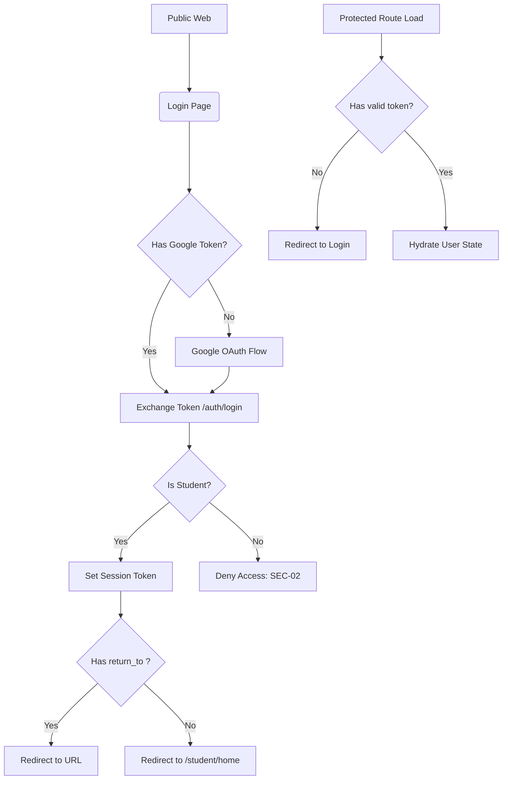
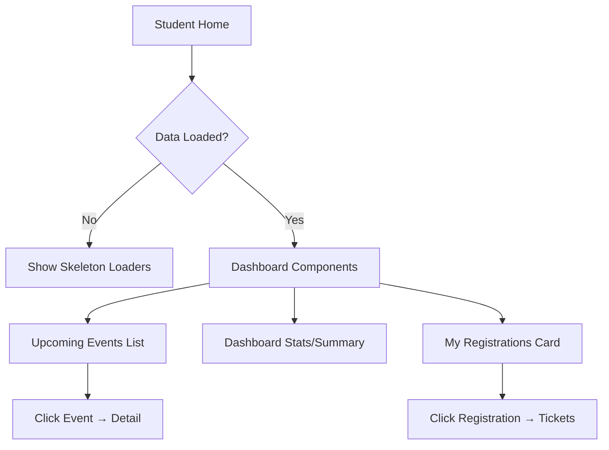
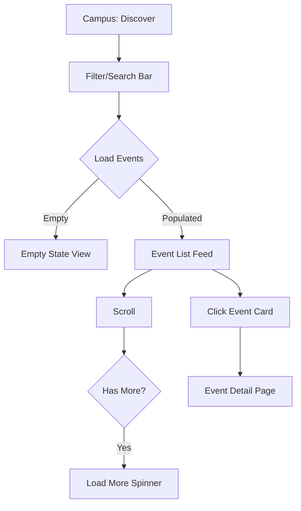
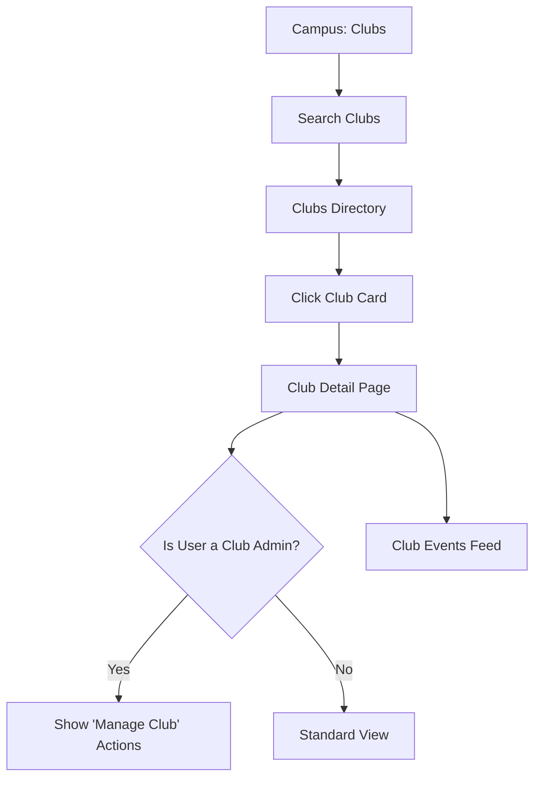
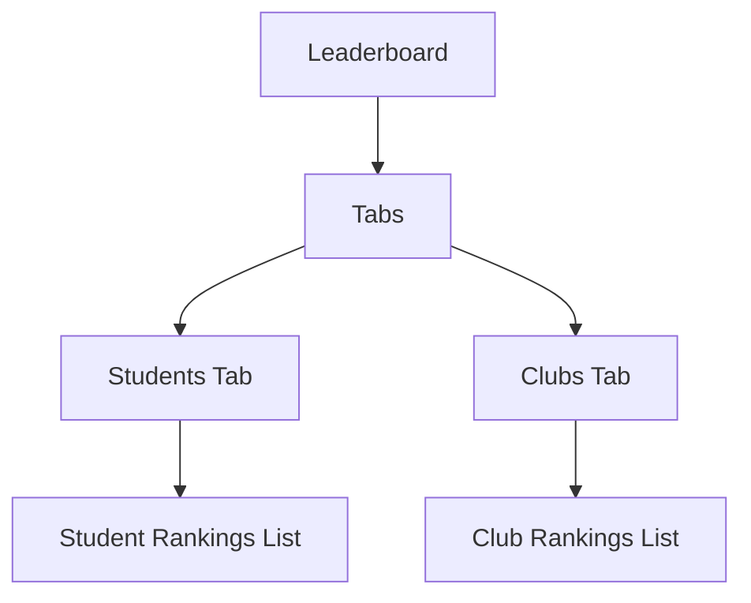
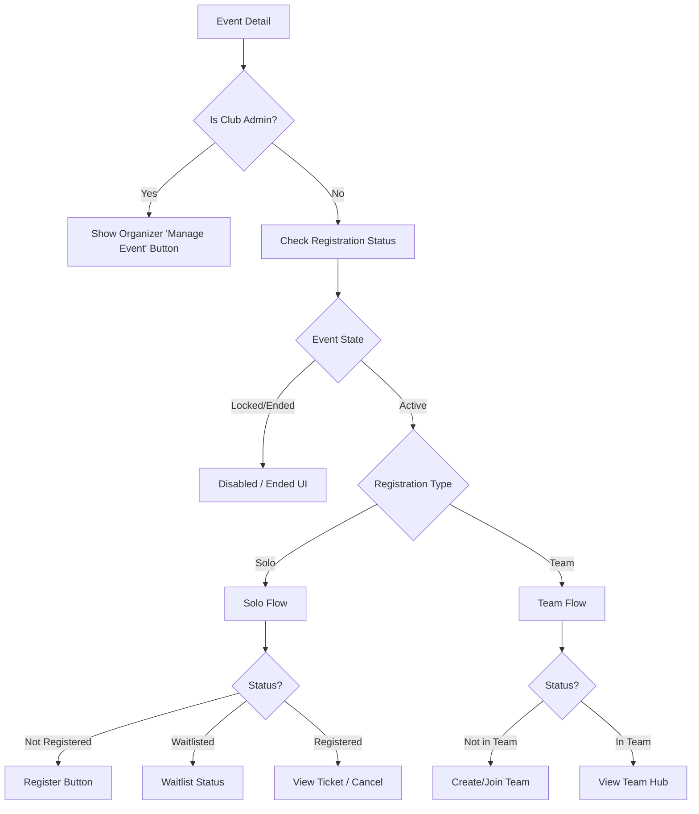
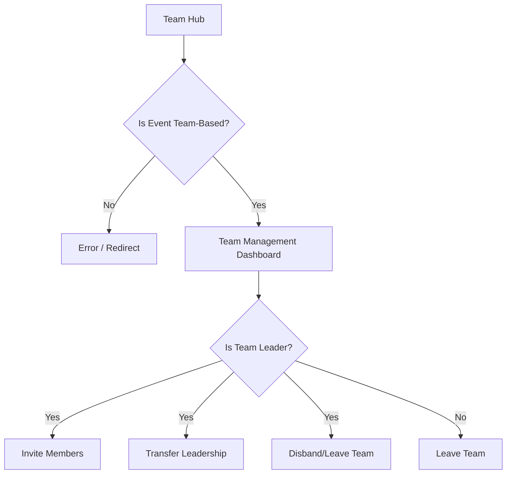
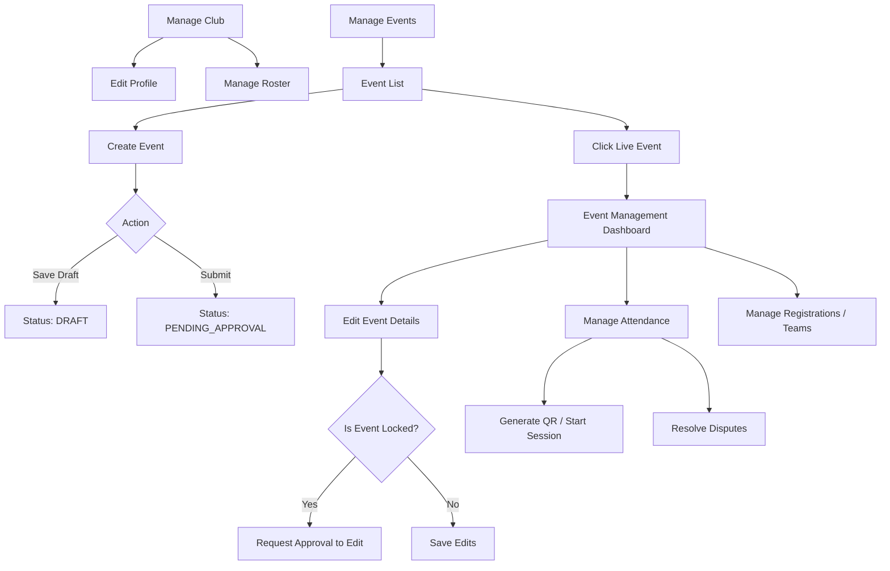
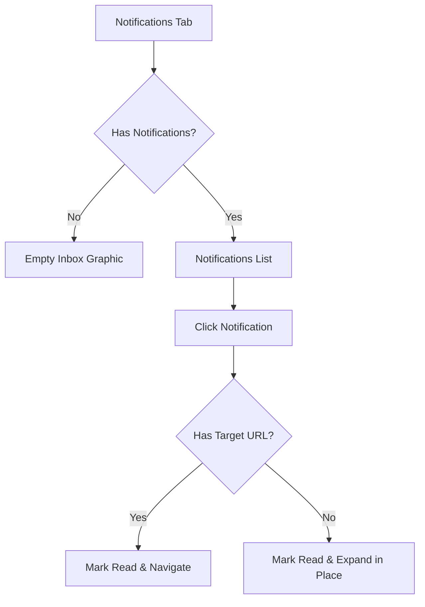
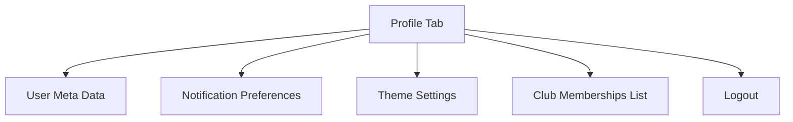

# Student Web App: Current UX State

This document is a faithful snapshot of the current state of the `apps/dashboard/app/(student)` routes. It serves as a baseline for the redesign.

---

## 1. Auth & Entry (Login → Home)

* **Distinct UI States:**
  * **Loading (spinning):** Full-screen hydration spinner when checking session tokens.
  * **Error:** Distinct visual badges for error scenarios (`INSTITUTIONAL_DOMAIN_NOT_ALLOWED`, `STUDENT_ACCESS_NOT_AUTHORIZED`, `ACCESS_DENIED`, `AUTHENTICATION_FAILED`).
* **Conditional Branches:**
  * **Role Restriction:** The student layout requires the user to have a global `STUDENT` role (via API response).
  * **Return Path:** Preserves deep-links using a `return_to` query parameter.
* **NOT YET BUILT:** None. Core auth flow is fully functioning.

---

## 2. Home Dashboard Flow

* **Distinct UI States:**
  * **Loading:** Independent skeleton loaders for User (`isUserLoading`), Registrations (`isRegLoading`), and Summary Data (`isSummaryLoading`).
  * **Error:** `<ErrorState>` component shown if aggregate fetching fails.
  * **Empty:** Shows "No upcoming events" graphic if registrations list is 0.
* **Conditional Branches:**
  * Aggregates multiple API responses; overall UI relies on all 3 resolving to remove the global loading block.
* **NOT YET BUILT:** None.

---

## 3. Campus: Discover Feed

* **Distinct UI States:**
  * **Loading:** Skeletons while the feed paginates or mounts.
  * **Empty:** Text when `data.length === 0`.
  * **Error:** `<ErrorState>` on fetch failure.
* **Conditional Branches:**
  * **Type Filter:** Branches API call if a `typeVal` (e.g., Hackathon, Workshop) is selected.
* **NOT YET BUILT:** 
  * Search input placeholders state "Search events, clubs, topics..." but lack complex fuzzy searching.

---

## 4. Campus: Clubs List & Detail

* **Distinct UI States:**
  * **Loading:** `isClubLoading` / `isEventsLoading` handled independently.
  * **Empty:** Empty state when a club has no upcoming/past events.
  * **Error:** Club not found error.
* **Conditional Branches:**
  * **Follower formatting:** Branches to shorthand formatting `(num >= 1000)` for large follower counts.
  * **Club Admin Override:** If the current student has `CLUB_ADMIN` rights for *this specific club*, management entry points become visible.
* **NOT YET BUILT:**
  * Search inputs are functionally basic.

---

## 5. Campus: Leaderboard

* **Distinct UI States:**
  * **Loading:** Independent loading states (`isStudentsLoading`, `isClubsLoading`).
  * **Empty:** Renders empty state if no points data exists for the selected timeframe.
* **Conditional Branches:**
  * Data fetched is entirely contingent on the active Tab.
* **NOT YET BUILT:** None.

---

## 6. Event Detail & Registration

* **Distinct UI States:**
  * **Loading:** Multiple discrete loaders (`isLoadingEvent`, `isLoadingReg`, `isLoadingTeam`, `isLoadingDisputes`, `isLoadingAttendance`).
  * **Error:** Fails gracefully with a return button.
* **Conditional Branches:**
  * **Organizer Mode:** Injects top-level admin buttons if user holds `CLUB_ADMIN` context.
  * **Lifecycle Lock:** Event `isEnded` or `isLocked` entirely hides registration CTAs.
  * **Status Toggles:** The CTA entirely changes depending on `registration.status` (Waitlisted vs Confirmed).
  * **Type Toggle:** `TEAM` events hide solo registration logic and mandate Team Hub transitions.
* **NOT YET BUILT:** None. Highly dynamic branch logic.

---

## 7. Team Hub

* **Distinct UI States:**
  * **Loading:** Event, Reg, and Team data must resolve.
  * **Empty:** Shows member slots when below maximum size.
* **Conditional Branches:**
  * **Type Guard:** Instantly branches/errors if `event.registrationType !== 'TEAM'`.
  * **Leadership:** Delete/Transfer buttons are strictly gated by checking if the user's ID matches the team's `leader_id`.
* **NOT YET BUILT:** None.

---

## 8. Organizer/Manage Flows

* **Distinct UI States:**
  * **Loading:** Heavily relies on suspense and query loading states across all dashboards.
  * **Empty:** Standard empty states for 0 teams, 0 registrations, or 0 disputes.
* **Conditional Branches:**
  * **Creation Lifecycle:** Form submission branches between `DRAFT` and `SUBMIT`.
  * **Edit Locks:** `event.state !== 'DRAFT'` enforces restrictive edit modes.
  * **Attendance Permissions:** UI branches based on `auth.canManageAttendance`.
  * **Active Session:** QR code and scanners only mount if `isSessionActive` is true.
* **NOT YET BUILT:**
  * Heavy reliance on placeholder text (e.g., "e.g. Auditorium 1", "Tell everyone what this club is about...", "Search registered student by name").
  * Dispute resolution requires a reason but relies on simple text inputs.

---

## 9. Notifications Flow

* **Distinct UI States:**
  * **Loading:** Standard spinner.
  * **Empty:** Clean empty graphic when `data?.pages[0]?.data.length === 0`.
  * **Error:** Retry state on fetch failure.
* **Conditional Branches:**
  * **Read Status:** Visually distinguishes unread (`!notif.readAt`) versus read.
  * **Navigation:** `targetHref` existence determines if a click is a link or just an accordion/status update.
* **NOT YET BUILT:** None.

---

## 10. Profile

* **Distinct UI States:**
  * **Loading:** Separates `isLoadingUser` from `isLoadingPrefs`.
  * **Error:** Explanatory text if user payload drops.
* **Conditional Branches:**
  * **Program/Batch Formatting:** UI branches to hide dividers if `batchText` or `programText` are missing from the student record.
* **NOT YET BUILT:** None.
