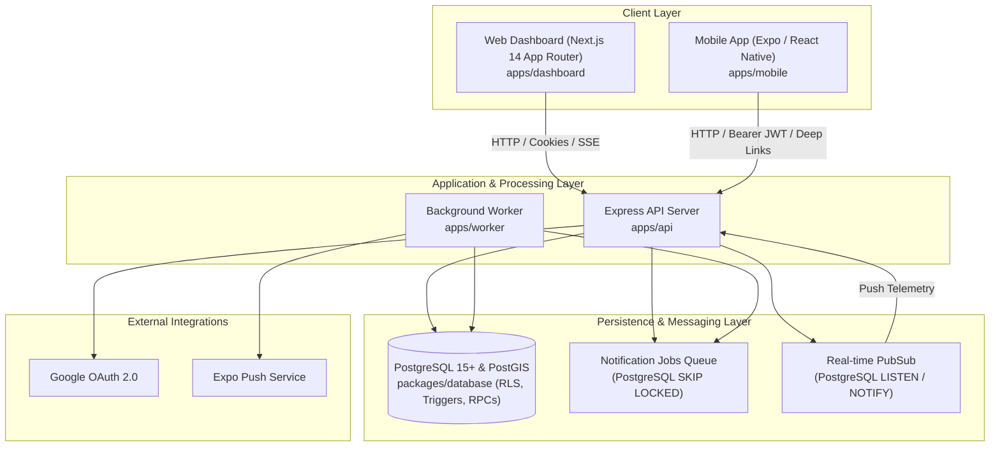
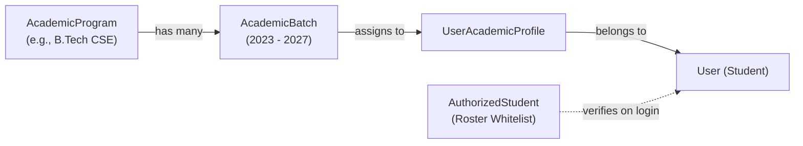
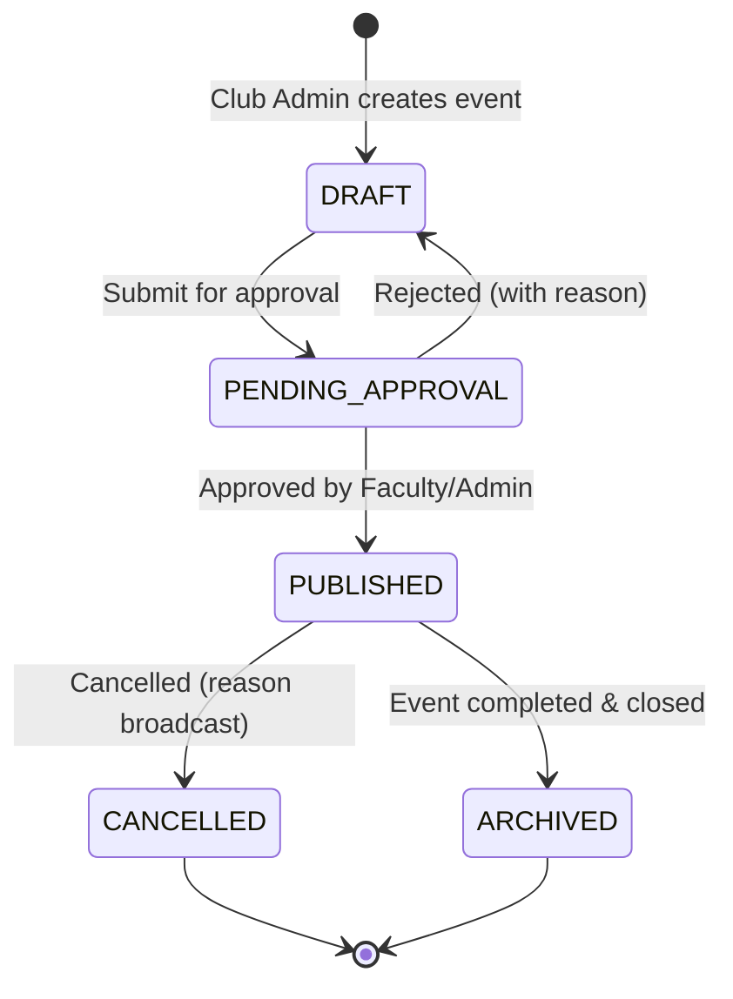
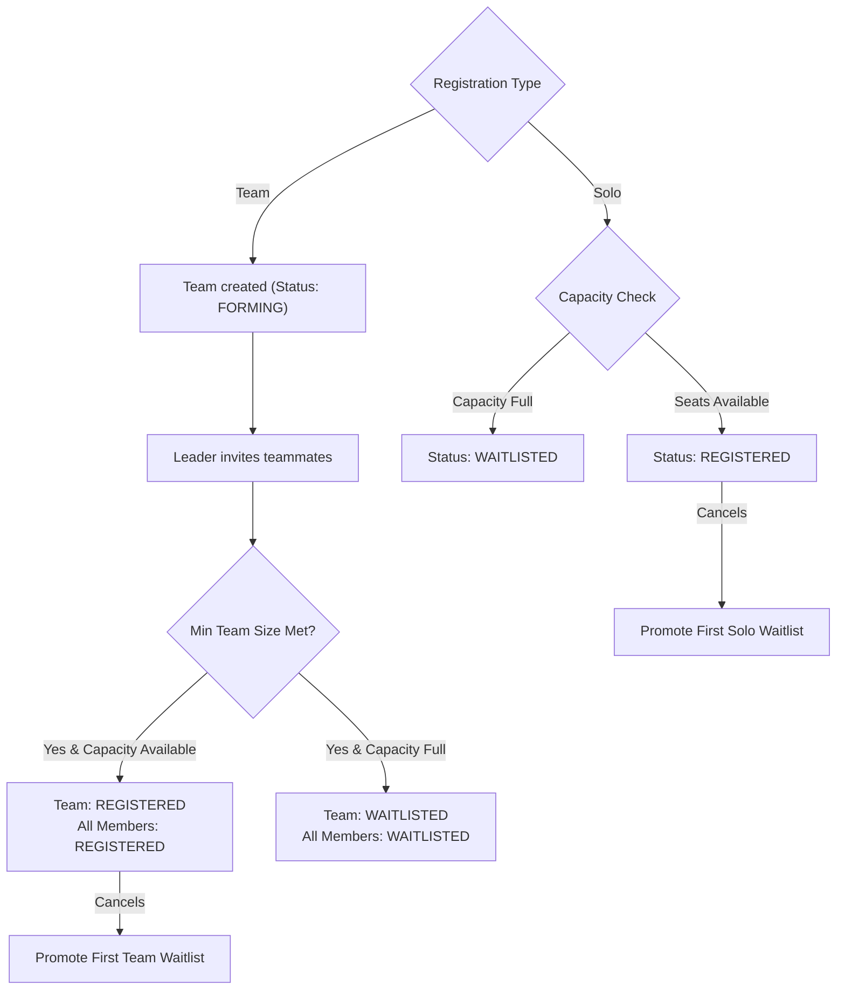
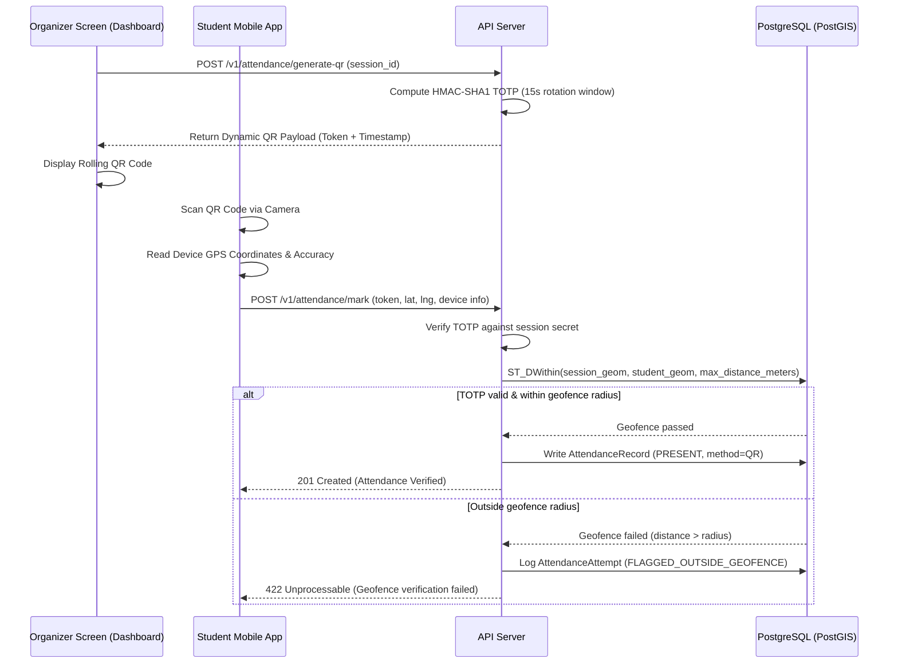
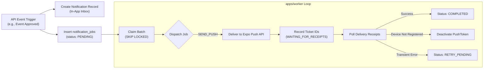

# NST Events — Comprehensive Features Specification

This document provides a complete, ground-truth inventory of all features, capabilities, subsystems, data models, workflows, and client screens implemented in the **NST Events** platform. Every section in this document is derived directly from the active codebase across `apps/api`, `apps/dashboard`, `apps/mobile`, `apps/worker`, `packages/database`, and `packages/shared`.

---

## 1. System Architecture & Platform Overview

The NST Events platform is organized as a high-performance pnpm monorepo managed with Turborepo:

### Core Architecture Characteristics:
- **API Server (`apps/api`)**: Node.js/TypeScript Express server utilizing RFC 7807 Problem Details error handling, dynamic route rate limiters, Helmet security headers, cookie parsing, and Prometheus metrics export.
- **Web Dashboard (`apps/dashboard`)**: Next.js (App Router) multi-portal web application with dedicated layouts for students (`(student)`), administrators/organizers (`(app)`), authentication (`(auth)`), and public landing/showcase surfaces (`(public)`).
- **Mobile Client (`apps/mobile`)**: Cross-platform Expo React Native application featuring native camera scanning, offline SQLite caching, background push routing, and Google Play In-App Updates.
- **Background Worker (`apps/worker`)**: Zero-external-dependency task runner utilizing native PostgreSQL concurrency (`FOR UPDATE SKIP LOCKED`) for notification dispatching, receipt polling, and scheduled lifecycle sweeps.
- **Database (`packages/database`)**: PostgreSQL with PostGIS extensions, Prisma ORM, fine-grained Row-Level Security (RLS) policies, and database-level stored procedures (RPCs) executed via `withUserContext()`.

---

## 2. Core Domain Entities & Database Schema

The database schema (`packages/database/prisma/schema.prisma`) defines the structural foundation of the platform:

| Domain | Entity / Model | Description |
| :--- | :--- | :--- |
| **Identity & Access** | `User` | Core account entity holding email, Google Sub ID, global role, and directory status. |
| | `RefreshToken` | Refresh token family tracking tokens with reuse detection. |
| | `MobileAuthCode` | Single-use transient authorization codes for mobile app deep-linking. |
| | `AuthEvent` | Audit log of authentication attempts, network classification, device info, and failure causes. |
| | `AuthorizedStudent` | Pre-approved institutional student whitelist for domain and student verification. |
| **Academic Hierarchy** | `AcademicProgram` | Degree programs (e.g., B.Tech CSE, BCA). |
| | `AcademicBatch` | Cohorts defined by admission and graduation years. |
| | `UserAcademicProfile` | Relational binding between a user and an academic batch. |
| | `EventAudienceBatch` | Restricts event visibility/registration to specific batches. |
| **Clubs & Handover** | `Club` | Student organization profile, branding, status, and leadership. |
| | `ClubMembership` | Per-club user role bindings (`MEMBER`, `CORE_MEMBER`, `CLUB_ADMIN`, `FACULTY_MENTOR`). |
| | `LeadershipHandoverRequest`| Formal requests for transferring club ownership and leadership. |
| **Events & Sessions** | `Event` | Central event record: type, visibility, state, location, registration window, capacity. |
| | `EventClub` | Multi-club co-hosting association with a designated primary club flag. |
| | `EventSlugHistory` | Historical slug records providing permanent 301 redirection. |
| | `AttendanceSession` | Individual check-in session holding TOTP secrets, geofences, and check-in windows. |
| **Dynamic Forms** | `FieldDefinition` | Reusable custom input definitions (global or club-scoped). |
| | `EventForm` | Custom event forms categorized by purpose (`REGISTRATION`, `SUBMISSION`, `FEEDBACK`). |
| | `EventFormField` | Junction joining field definitions to event forms with overrides and order. |
| | `StudentProfileValue` | Reusable student responses auto-populating form submissions. |
| | `EventRegistrationResponse`| Student form field answers stored as structured JSON. |
| **Registrations & Teams**| `EventRegistration` | Participant registrations tracking registration status, attendance status, and check-in times. |
| | `Team` | Group registration entity with customizable min/max team sizing. |
| **Attendance & Disputes**| `AttendanceRecord` | Verified attendance logs with attendance method, timestamp, and verification metadata. |
| | `AttendanceAttempt` | Telemetry logs of attendance verification attempts and geofence results. |
| | `AttendanceDispute` | Formal dispute submissions for missed or failed check-ins. |
| **Competition Results** | `EventResultSet` | Competition results container managing drafting, revisions, and publication states. |
| | `EventResultRevision` | Versioned revision history of published results and standings. |
| | `EventAward` | Awards/prizes (`RANKED_PLACEMENT`, `SPECIAL_AWARD`, `HONORABLE_MENTION`). |
| | `AwardRecipient` | Award winners linking individuals or teams with linked portfolio projects. |
| | `AwardRecipientMember`| Decomposed member mappings for winning teams. |
| | `ResultReport` | Dispute and abuse reporting filed against published results. |
| **Showcase & Portfolios**| `StudentProfile` | Public student profile featuring headline, bio, skills, interests, and external links. |
| | `StudentProfileCuratedItem`| Curated showcase items (pinned projects, awards, club roles). |
| | `StudentSlugHistory` | Vanity handle history ensuring profile URL continuity. |
| | `Project` | Student project portfolio items with rich metadata and cover media. |
| | `ProjectLink` | Resource links for projects (`DEMO`, `REPOSITORY`, `VIDEO`, `DOCUMENTATION`). |
| | `ProjectContributor` | Multi-student collaboration associations with invite workflows. |
| | `ProjectLike` | Student upvotes with spam-prevention constraints. |
| | `ProjectReport` | Abuse reporting filed against projects. |
| | `ProjectModerationAction`| Administrative moderation history (`HIDE`, `REMOVE`, `INVALIDATE_LIKES`). |
| **Notifications** | `Notification` | In-app user notifications with read tracking. |
| | `NotificationPreference`| User-level notification channel and category toggles. |
| | `PushToken` | Registered Expo push tokens per device. |
| | `NotificationJob` | Background worker queue jobs with retry counters, lock leases, and dead-letter handling. |
| **Governance & Ops** | `SystemPolicy` | Markdown-based policy content (Privacy Policy, Terms of Service) with concurrency locks. |
| | `RateLimitSetting` | Dynamic route rate limiting bucket settings. |
| | `RateLimitOverride` | Temporary rate limiting overrides (whitelist, block, custom limits). |
| | `AuditLog` | Platform-wide administrative audit trail. |

---

## 3. Authentication & Security Engine

Authentication is implemented in `apps/api/src/modules/auth` and supports both web and mobile environments:

### 3.1 Dual-Platform Google OAuth 2.0 Flow
- **Web App**:
  1. Frontend redirects to `/auth/google?platform=web`.
  2. Server generates cryptographic `state` and `nonce` parameters, set in `HttpOnly`, `SameSite=Lax`, signed cookies.
  3. Google redirects back to `/auth/google/callback`.
  4. Server validates `state` and `nonce`, exchanges code for Google ID token, and queries/creates the user in PostgreSQL.
  5. Sets `refresh_token` (`HttpOnly`, `Secure`, `SameSite=Strict`, 30-day expiry) and `user_role` cookies.
  6. Redirects user to `/student/home` or `/dashboard` based on role.
- **Mobile Client**:
  1. Mobile app launches native browser to `/auth/google?platform=mobile`.
  2. Callback generates a single-use cryptographically random token (`MobileAuthCode`) valid for 5 minutes.
  3. Redirects via deep link to `nst-events://(auth)/callback?code=<mobileCode>`.
  4. Mobile app exchanges the code at `POST /auth/mobile/exchange` for an `access_token` and `refresh_token`.

### 3.2 Token Architecture & Security Safeguards
- **Access Tokens**: Short-lived (15-minute) stateless JWTs carrying `sub`, `email`, `role`, and `name`.
- **Refresh Token Rotation & Family Tracking**: Each refresh token belongs to a family. When a token is refreshed (`POST /auth/refresh`), a new token is issued and the previous token is marked revoked.
- **Automatic Reuse Detection**: If an already-revoked refresh token is presented, the entire token family is immediately invalidated, terminating all active sessions for the user.
- **CSRF Defense-in-Depth**: State-changing authentication endpoints (`/auth/refresh`, `/auth/logout`) mandate the presence of custom header `X-Client-Platform: web|mobile`. Standard cross-origin HTML forms and scripts cannot set custom headers.
- **Remote Session Management**: Platform Admins can inspect all active refresh token sessions for any user and revoke them selectively or globally (`POST /v1/admin/users/:userId/revoke-sessions`).
- **Auth Telemetry**: Every login, failed attempt, refresh failure, and logout is recorded in `AuthEvent` with IP hash, network classification, device family, and reason.

---

## 4. Authorization & Role-Based Access Control (RBAC)

The platform enforces authorization at two independent levels:

### 4.1 Global Roles (`GlobalRole`)
Platform-wide administrative roles defined in `prisma.schema`:
- `PLATFORM_ADMIN`: Unrestricted platform access across all organizations, audits, users, background queues, rate limits, and configuration.
- `FACULTY_ADMIN`: Academic institutional administrator capable of approving/rejecting events, managing academic cohorts, and reviewing compliance.
- `FACULTY_MENTOR`: Faculty advisor assigned to guide specific clubs and oversee student activities.
- `STUDENT`: Standard student user capable of exploring events, registering, forming teams, marking attendance, and submitting projects.

### 4.2 Contextual Club Roles (`ClubRole`)
Scoped exclusively to individual clubs within `club_memberships`:
- `CLUB_ADMIN`: Full administrative control over the club profile, members, events, attendance sessions, dynamic forms, and competition results.
- `CORE_MEMBER`: Operational club staff capable of viewing registrations, scanning attendance, and managing event logistics.
- `MEMBER`: General registered member of the student organization.
- `FACULTY_MENTOR`: Faculty advisor affiliated with the club.

### 4.3 Database Row-Level Security (RLS)
PostgreSQL Row-Level Security enforces authorization directly at the database layer. Backend services execute database transactions within `withUserContext(userId, callback)`, setting PostgreSQL session variables (`app.current_user_id`). Queries automatically filter records based on user identity, club memberships, and global role privileges.

---

## 5. Academic Structure & Institutional Roster

Implemented in `apps/api/src/modules/academic-programs`, `academic-batches`, and `admin/students`:

- **Programs & Batches**: Academic degree programs (`AcademicProgram`) and graduating batches (`AcademicBatch`) group students into academic cohorts.
- **Email-Based Batch Inference**: On first authentication, the backend analyzes institutional email prefixes/domains (e.g., `e25b...`) to infer the student's admission year, program, and graduation year (`AssignmentSource: INSTITUTIONAL_EMAIL_INFERENCE`).
- **Manual Batch Overrides**: Platform and Faculty Admins can override student batch assignments (`PATCH /v1/admin/users/:userId/academic-batch`).
- **Student Roster Management**:
  - Whitelist mechanism (`AuthorizedStudent`) restricting login to valid institutional students.
  - Streaming CSV batch import (`POST /v1/admin/students/import-csv`) supporting up to 5,000 students per batch with automatic email validation and header normalization (`email`, `Email`, `EMAIL`).
  - Student status toggling (`ACTIVE` vs `REVOKED`).

---

## 6. Club & Student Organization Ecosystem

Implemented in `apps/api/src/modules/clubs`:

- **Club Status Lifecycle**: `ACTIVE` -> `INACTIVE` -> `DISSOLVED`.
- **Membership Operations**:
  - Add members with explicit roles (`POST /clubs/:id/members`).
  - Update membership tier (`PATCH /clubs/:id/members/:userId`).
  - Remove members (`DELETE /clubs/:id/members/:userId`).
- **Leadership Handover Pipeline**:
  - Club Leads initiate handover requests (`LeadershipHandoverRequest`) to transfer primary ownership.
  - Handover transitions through `PENDING` -> `APPROVED` / `REJECTED`.
  - Ensures seamless continuity between graduating senior leads and incoming junior leads.
- **Multi-Club Co-Hosting**: Events can be co-organized by multiple clubs (`EventClub`), with one club marked as primary organizer and others as collaborators.
- **Club Analytics & Activity**:
  - Overview of member counts, published events, attendance averages, and engagement (`GET /clubs/:id/analytics`).
  - Immutable activity audit log recording changes to club metadata, membership changes, and event states (`GET /clubs/:id/activity`).

---

## 7. Event Management & State Machine

Implemented in `apps/api/src/modules/events`:

### 7.1 Event Types & Visibility
- **Event Types**: `WORKSHOP`, `SEMINAR`, `COMPETITION`, `MEETUP`, `HACKATHON`, `CULTURAL`, `SPORTS`, `OTHER`.
- **Visibility Levels**:
  - `PUBLIC`: Listed openly in student discovery feeds and public web pages.
  - `UNLISTED`: Hidden from feeds, accessible exclusively via direct link or slug.
  - `RESTRICTED`: Accessible only to authorized institutional students.
- **Audience Scope**:
  - `ALL_STUDENTS`: Open to the entire student body.
  - `SPECIFIC_BATCHES`: Restricted to specified academic cohorts (`EventAudienceBatch`).

### 7.2 Slugs & Canonical Redirection
- **SEO & Vanity Slugs**: Human-readable slugs generated from event titles (e.g., `hack-nst-2026`).
- **Slug Availability Validation**: Real-time pre-flight verification endpoint (`GET /v1/events/validate-slug`).
- **Redirection History (`EventSlugHistory`)**: When an organizer changes an event slug, old slugs are recorded in history; visits to obsolete slugs automatically redirect to the current canonical URL.

### 7.3 Operational Controls
- **Event Locking**: Organizers or admins can lock an event (`POST /v1/events/:id/lock`), freezing edits to descriptions, locations, capacities, and dates during active operations.
- **Event Cancellation**: Requires an explicit reason (`POST /v1/events/:id/cancel`), transitioning registrations and triggering notification dispatches.

---

## 8. Dynamic Forms & Registration Studio

Implemented in `apps/api/src/modules/event-forms` and `field-definitions`:

- **Form Purposes (`FormPurpose`)**: `REGISTRATION`, `SUBMISSION`, `FEEDBACK`, `CUSTOM`.
- **Supported Field Types (`FieldType`)**:
  - `TEXT`, `URL`, `EMAIL`, `NUMBER`, `PHONE`, `SELECT`, `MULTI_SELECT`, `RADIO`.
- **Field Definitions (`FieldDefinition`)**:
  - Global definitions created by Platform Admins.
  - Organization-scoped definitions created by Club Admins.
  - Configurable validation: required flag, regex validation pattern, min/max length, option lists, and custom placeholder text.
- **Profile Autofill**: Frequently entered student details (e.g. GitHub handle, phone number, dietary preference) are saved to `StudentProfileValue` and automatically pre-filled into forms.
- **Lifecycle Sweeps**: Background worker sweeps periodically check for forms scheduled to release or close, transitioning their publication status automatically.

---

## 9. Registrations, Waitlist & Team Formation

Implemented in `apps/api/src/modules/registrations` and `teams`:

### 9.1 Registration Modes & Types
- **Modes (`RegistrationMode`)**: `REQUIRED` (tickets/registration needed) vs `NOT_REQUIRED` (walk-in events).
- **Types (`RegistrationType`)**: `INDIVIDUAL` (Solo) vs `TEAM`.

### 9.2 Team Management
- **Team Sizing Rules**: Each event defines `minTeamSize` and `maxTeamSize` (e.g. 2 to 4 members).
- **Team Lifecycles (`TeamStatus`)**:
  - `FORMING`: Team created, gathering members; does not consume global event capacity.
  - `REGISTERED`: Minimum members reached, registered; consumes capacity.
  - `WAITLISTED`: Valid team formed after event reached maximum capacity.
  - `CANCELLED`: Team disbanded by leader or admin.
- **Collaboration Controls**:
  - Leader invites members via email / user ID.
  - Members can accept or decline team invitations.
  - Leader can transfer team leadership (`POST /v1/teams/:id/transfer-leadership`).
  - Leader or admin can remove members (`DELETE /v1/teams/:id/members/:userId`).
- **Waitlist Engine**: When a registered participant or team cancels, the next waitlisted applicant or team is promoted to `REGISTERED`.

---

## 10. Dynamic Attendance & Anti-Fraud Engine

Implemented in `apps/api/src/modules/attendance`:

### 10.1 Dynamic Rolling QR (Anti-Screenshot Protection)
- Organizers open an active session's attendance portal.
- The server generates rotating tokens using per-session cryptographic TOTP secrets with a 15–30 second validity window.
- Sharing a screenshot of the QR code fails because the token expires before a remote student can scan it.

### 10.2 PostGIS Geospatial Geofencing
- Attendance sessions can specify latitude, longitude, and an acceptable radius in meters (e.g. 50m).
- Check-in requests require client GPS coordinates and accuracy telemetry.
- Verification uses PostGIS `ST_DWithin` on `geography(Point, 4326)` to ensure physical presence at the event venue.
- Mock location detection flags suspicious GPS spoofing attempts.

### 10.3 Offline Attendance Batch Sync
- For events with poor indoor network connectivity, the mobile client records scans locally in SQLite/AsyncStorage.
- Scans include the scanned TOTP token, timestamp, GPS telemetry, and device identifier.
- When connectivity resumes, the client calls `POST /v1/attendance/sync-offline`.
- The backend evaluates each record in the batch against the session's historical TOTP validity windows and logs verification outcomes.

### 10.4 Manual Overrides & CSV Export
- Club Admins can manually record attendance (`POST /events/:id/attendance/manual`) with audit reasons.
- Attendee lists can be streamed directly to CSV (`GET /events/:id/attendance/export`).

---

## 11. Attendance Dispute Pipeline

Implemented in `apps/api/src/modules/attendance`:

- **Dispute Submission (`POST /v1/attendance/disputes`)**:
  - Students submit formal disputes if GPS drift, camera failure, or network loss prevented check-in.
  - Requires session ID, explanation reason, and optional evidence links.
- **Review Workspace (`GET /v1/attendance/disputes`)**:
  - Filterable by event, status (`PENDING`, `APPROVED`, `REJECTED`), and date.
  - Accessible to Club Admins, Faculty Admins, and Platform Admins.
- **Resolution RPC (`PATCH /v1/attendance/disputes/:id`)**:
  - Stored procedure executes resolution atomically.
  - When approved, student's attendance record transitions to `EXCUSED` (`AttendanceStatus: EXCUSED`), ensuring attendance records remain accurate without falsifying a physical QR scan.

---

## 12. Competition Results, Recognitions & Honors

Implemented in `apps/api/src/modules/event-results`:

- **Lifecycle States (`ResultLifecycleState`)**:
  - `NOT_CONFIGURED` -> `DRAFT` -> `PUBLISHED` -> `WITHDRAWN`.
- **Revision History (`EventResultRevision`)**:
  - Organizers prepare award drafts in an organizer workspace (`GET /v1/events/:id/results/manage`).
  - Publishing creates an immutable revision. Subsequent corrections create revision increments, recording who modified results and why.
- **Award Classifications (`AwardType`)**:
  - `RANKED_PLACEMENT`: 1st, 2nd, 3rd, etc. Supports both `COMPETITION` ties (1224) and `DENSE` ties (1223).
  - `SPECIAL_AWARD`: Category honors (e.g. "Best UI/UX", "Best Pitch", "Most Innovative").
  - `HONORABLE_MENTION`: Commendations.
  - `CUSTOM`: Bespoke awards.
- **Recipients (`AwardRecipient`)**:
  - Can be awarded to individual students or teams.
  - For team awards, all members are mapped (`AwardRecipientMember`).
  - Supports external/guest winners without local accounts.
- **Showcase Integration (`AwardProjectLink`)**:
  - Winners can link their winning entry directly to a published project in the Project Showcase.
- **Dispute & Abuse Reports (`ResultReport`)**:
  - Students or public visitors can report contested placements (`POST /v1/events/:id/results/report`), triggering administrative review.
- **Decommissioned Gamification**:
  - Historical student/club gamification leaderboards and arbitrary points were completely decommissioned and removed from database schemas and migrations. Recognition is exclusively driven by verifiable competition results and awards.

---

## 13. Student Directory & Digital Portfolios

Implemented in `apps/api/src/modules/students`:

- **Public Directory (`GET /v1/students`)**:
  - Searchable directory of verified students filtered by academic program, batch, or skill tags.
- **Digital Profile (`GET /v1/students/:slug`)**:
  - Custom vanity handle (e.g., `/students/soham-dhande`).
  - Headline, bio, technical skills, interests, and external profile links (GitHub, LinkedIn, Portfolio).
- **Curated Showcase**:
  - Students can pin curated items (`POST /v1/students/me/curation`): standout projects, competition awards, and club leadership positions.
- **Granular Privacy Controls (`PATCH /v1/students/me/visibility`)**:
  - Toggle profile visibility in public directory.
  - Toggle visibility of achievements, projects, and club roles independently.
- **Handle History (`StudentSlugHistory`)**:
  - Changing a public handle records the prior handle, preserving bookmarks and external links with canonical redirects.

---

## 14. Project Showcase & Innovation Hub

Implemented in `apps/api/src/modules/projects`:

- **Project Discovery (`GET /v1/projects`)**:
  - Public gallery of student innovations filterable by category, tech stack, and academic batch.
- **Project Categories (`ProjectType`)**:
  - `PERSONAL`, `COURSEWORK`, `HACKATHON`, `OPEN_SOURCE`, `RESEARCH`, `HARDWARE`, `DESIGN`, `CASE_STUDY`.
- **Project Lifecycle & Visibility (`ProjectVisibility`)**:
  - `DRAFT` -> `PUBLISHED` -> `UNPUBLISHED` -> `REMOVED`.
- **Media & Resource Links (`ProjectLink`)**:
  - Multiple link types supported: `DEMO`, `REPOSITORY`, `VIDEO`, `DOCUMENTATION`, `OTHER`.
- **Multi-Author Collaborations**:
  - Project owners invite co-creators via institutional email (`POST /v1/projects/:id/contributors`).
  - Contributors can accept or decline invitations.
  - Project cards display all contributing students linked to their digital profiles.
- **Social Engagement & Anti-Manipulation**:
  - Authenticated students can like projects (`POST /v1/projects/:id/like`).
  - Duplicate likes and automated bot upvoting are blocked.
- **Abuse Reporting & Moderation**:
  - Public reporting (`POST /v1/projects/:id/report`) for plagiarism, spam, inappropriate content, or malicious links.
  - Administrative moderation dashboard (`GET /v1/admin/projects`) allowing admins to hide projects, remove them, or invalidate manipulated likes.

---

## 15. Notification Infrastructure & Background Worker

Implemented in `apps/api/src/modules/notifications` and `apps/worker`:

### 15.1 Multi-Channel Notifications
- **In-App Notification Feed**: Cursor-paginated notification center with unread counters and batch mark-as-read (`PATCH /v1/notifications/read-all`).
- **Real-Time Push**: Push notifications delivered instantly to connected web and mobile devices via Server-Sent Events (SSE).
- **Mobile Push Notifications**: Delivered via Expo Push Notification service to registered Android and iOS devices.

### 15.2 Background Worker Tasks (`apps/worker`)
- **Push Notification Execution (`sendPush.ts`)**: Batches push payloads and posts them to Expo's push service.
- **Push Receipt Polling (`receiptPolling.ts`)**: Verifies delivery receipts. Automatically cleans up stale tokens when Expo returns `DeviceNotRegistered`.
- **Form Release Sweeps (`form-release-sweep.ts`)**: Periodically checks for scheduled event forms and automatically activates or closes them.
- **Rate Limit Override Purges (`rate-limits-purge.ts`)**: Deletes expired temporary rate limit overrides.
- **Auth Events Retention Purges (`auth-events-retention.ts`)**: Purges authentication audit logs exceeding institutional retention windows.
- **Job Retention Purges (`notification-jobs-retention.ts`)**: Archives completed and failed jobs older than retention thresholds.

---

## 16. Dynamic Rate Limiting & Traffic Security

Implemented in `apps/api/src/modules/admin/rate-limits` and `middleware/rate-limit.ts`:

- **Configurable Token Buckets**:
  - `general`: Standard application requests (keyed by User ID for authenticated users, IP for unauthenticated users).
  - `auth`: Stricter bucket guarding `/auth/*` against brute-force attacks.
  - `attendance`: High-throughput bucket tuned for concurrent check-in bursts (`/attendance/mark`, `/attendance/generate-qr`, `/attendance/sync-offline`).
- **Dynamic Administrative Tuning (`PUT /v1/admin/rate-limits/:bucket`)**:
  - Platform Admins can modify bucket capacities and windows at runtime without redeploying the backend.
  - One-click reset to environment defaults (`POST /v1/admin/rate-limits/reset`).
- **Targeted Overrides (`POST /v1/admin/rate-limits/overrides`)**:
  - Apply temporary rate limit adjustments to specific IPs or User IDs.
  - Modes: `block` (immediate 429/403 block), `allow` (bypass rate limits for trusted campus IPs), or `custom_max` (adjusted quota for high-traffic organizer devices).
  - Overrides include mandatory expiration timestamps and reason notes.

---

## 17. Real-Time Telemetry & Server-Sent Events (SSE)

Implemented in `apps/api/src/modules/sse`:

- **Zero-Extra-Dependency Real-Time**: Built on PostgreSQL native `LISTEN` / `NOTIFY` via `pg-listener`.
- **Event Live Stream (`GET /v1/events/:id/live`)**:
  - Real-time updates on registration counts, capacity status, session transitions, and attendance alerts.
  - 30-second keep-alive heartbeats to prevent proxy timeouts.
  - Access controlled by event read permissions.
- **Personal Notifications Stream (`GET /v1/notifications/live`)**:
  - Dedicated private channel per user delivering in-app notifications, team invitations, and dispute decisions immediately upon creation.

---

## 18. Web Dashboard Application (`apps/dashboard`)

Built with Next.js 14 App Router, providing dedicated interfaces for every user persona:

### 18.1 Student Portal (`/student/*`)
- `/student/home`: Personalized student homepage showing registered events, upcoming schedules, quick check-in shortcuts, and recent notifications.
- `/student/campus`: Directory of student organizations and campus initiatives with search and tag filters.
- `/student/campus/clubs/[id]`: Detailed club showcase showing leadership, description, upcoming events, and past activities.
- `/student/events`: Searchable events directory with category filters, view modes (grid vs calendar view), and date pickers.
- `/student/events/[id]`: Comprehensive event view showing schedules, speaker bios, venue map, and registration actions.
- `/student/events/[id]/team`: Team gateway modal for forming teams, inviting members, managing rosters, or accepting invitations.
- `/student/profile`: Portfolio management interface for editing bio, skills, social links, and curating public showcase items.
- `/student/notifications`: In-app notification center with read/unread filtering and batch mark-as-read actions.

### 18.2 Organizer & Club Management Workspace (`/student/events/[id]/manage/*` & `/clubs/*`)
- `/student/events/[id]/manage`: Central event command center showing live attendance counters, capacity meters, and status controls.
- `/student/events/[id]/manage/attendance`: Dynamic rolling QR generator for check-in kiosks, attendee table, manual check-in modal, and CSV export.
- `/student/events/[id]/manage/registrations`: Registration roster, custom dynamic form responses viewer, and approval tools.
- `/student/events/[id]/manage/teams`: Team formation roster, roster completion monitoring, and manual waitlist promotions.
- `/student/events/[id]/manage/results`: Competition results studio for drafting award placements, assigning individual/team winners, linking showcase projects, and publishing revisions.
- `/clubs/[clubId]`: Club administration interface for editing club details, adding members, modifying roles, and reviewing activity logs.

### 18.3 Platform & Faculty Admin Console (`/admin/*`)
- `/admin`: Administrative summary dashboard showing system health and quick action items.
- `/admin/approvals`: Approval pipeline for pending event proposals with side-by-side metadata inspection and rejection reason dialogs.
- `/admin/users`: User directory, global role assignment (`GlobalRole`), academic batch mapping, session revocation, and manual user provisioning.
- `/admin/students`: Authorized student whitelist management with search, status toggling, and streaming CSV importer.
- `/admin/academic-programs`: Degree program management interface.
- `/admin/academic-batches`: Academic cohort management interface.
- `/admin/analytics`: Multi-tab analytical dashboard covering Overview, Attendance, Events, Registrations, Clubs, Disputes, and Users.
- `/admin/audit-logs`: Searchable, filterable audit log viewer with actor, action, target entity, IP address, and JSON diffs.
- `/admin/queues`: Native background queue monitor showing pending jobs, active processing, dead-letter jobs, and retry controls.
- `/admin/rate-limits`: Dynamic rate limit bucket configuration, default resets, and temporary override controls.
- `/admin/traffic-security`: Security dashboard tracking authentication events, brute-force login trends, failure reasons, and device/network distributions.
- `/admin/privacy-policy`: Markdown policy editor with live preview, concurrency version conflict detection, and instant publication.
- `/admin/projects`: Project moderation queue for reviewing reported showcase projects, resolving abuse tickets, and applying moderation actions.

### 18.4 Public Discovery & Landing Pages (`/(public)/*`)
- `/event/[slug]`: Public event landing page with OpenGraph metadata, description, and direct registration triggers.
- `/event/[slug]/results`: Published competition results page displaying podium winners, award badges, and linked student projects.
- `/projects`: Public showcase gallery of student engineering and design projects.
- `/projects/[slug]`: Project detail view with cover media, project description, demo links, repository buttons, and collaborator lists.
- `/projects/submit` & `/projects/[slug]/edit`: Project submission and editing interface with contributor invitations.
- `/students`: Public searchable directory of student profiles.
- `/students/[slug]`: Public student digital portfolio showing headline, bio, skills, external links, pinned projects, and verified achievements.
- `/privacy-policy`: Public institutional privacy policy page rendered from Markdown with HTTP cache-control headers.

---

## 19. Mobile Application (`apps/mobile`)

Developed using Expo React Native and NativeWind (Tailwind CSS):

### 19.1 Mobile Screen Structure
- **Authentication (`app/(auth)`)**:
  - Clean Google OAuth sign-in with automatic token exchange and deep-link routing.
- **Bottom Navigation Tabs (`app/(app)/(tabs)`)**:
  - **Home Tab (`index.tsx`)**: Welcome greeting, next registered event banner, fast QR check-in action, active event carousel, and club announcements.
  - **Explore Tab (`explore.tsx`)**: Searchable events directory with category filter chips, search input, and interactive student calendar view.
  - **Activity Tab (`activity.tsx`)**: Attendance activity overview, upcoming check-in requirements, and dispute status shortcuts.
  - **History Tab (`history.tsx`)**: Complete attendance history with status badges (`PRESENT`, `ABSENT`, `EXCUSED`), timestamps, and session details.
  - **Profile Tab (`profile.tsx`)**: Student profile overview, academic batch, total attended events counter, portfolio link, and settings access.
- **Event Experience (`app/(app)/events/[id]/*`)**:
  - `index.tsx`: Event detail screen with banner art, description, venue information, and dynamic registration buttons.
  - `register.tsx`: Registration screen supporting solo registration and dynamic form responses.
  - `teams.tsx`: Team dashboard for creating teams, viewing join codes, inviting peers, and transferring leadership.
  - `scan.tsx`: Native camera overlay for dynamic QR attendance scanning with real-time feedback.
  - `forms/[formId].tsx`: Dynamic form submission screen for event surveys and feedback.
  - `results.tsx`: Competition awards screen celebrating event winners.
- **Attendance Disputes (`app/(app)/disputes/*`)**:
  - `index.tsx`: User dispute history and statuses.
  - `new.tsx`: Dispute submission form with reason selector, GPS explanation, and evidence attachment.
  - `submitted.tsx`: Submission confirmation screen.
  - `[id].tsx`: Dispute detail and review decision view.
- **Student & Club Exploration**:
  - `clubs/index.tsx`: Campus clubs directory.
  - `students/index.tsx` & `students/[slug].tsx`: Student directory and public profile viewer.
  - `invitations.tsx`: Team invitations inbox with one-tap accept/decline controls.
  - `notifications.tsx`: In-app notification list with push routing.
  - `settings.tsx`: Notification preference toggles, profile visibility modal, theme toggle, and secure sign-out.

### 19.2 Native Integrations & Hardware Capabilities
- **Native Barcode Scanner**: High-speed camera scanning utilizing device camera APIs with bounding-box guide overlays.
- **Geolocation & Anti-Spoofing**: High-accuracy GPS positioning with mock-location flags to prevent spoofing apps.
- **Offline Storage Queue**: Local SQLite/AsyncStorage queue caching check-in attempts when network connectivity drops.
- **Google Play In-App Updates**: Custom native module integration (`modules/play-in-app-updates`) supporting flexible and immediate Play Store updates.
- **Expo Over-The-Air (OTA) Updates**: Immediate hotfix deployments without requiring full Play Store review cycles.
- **Google Play Install Referrer**: Custom native module (`modules/install-referrer`) capturing campaign attribution and deep links on first install.
- **Expo Push Notifications**: Push notification listener routing users directly to event or invitation screens.

---

## 20. Operational Monitoring & Health

Implemented in `apps/api/src/lib/metrics.ts` and `apps/api/src/app.ts`:

- **Readiness & Liveness Probes**:
  - `GET /health`: Immediate 200 OK process health check.
  - `GET /ready`: Database connection verification running `SELECT 1` against PostgreSQL.
- **Prometheus Metrics (`GET /metrics`)**:
  - Route execution latencies and status code counts via Prometheus histograms.
  - Active Server-Sent Events (SSE) live connection gauges.
  - Worker job processing duration labeled by job type.
  - Protected in production by timing-safe token verification (`METRICS_TOKEN`).
- **Cluster & Proxy Hardening**:
  - Express `trust proxy` configured for Kubernetes overlay networks (`10.0.0.0/8`, `172.16.0.0/12`, `192.168.0.0/16`) to ensure accurate client IP resolution behind Cloudflare tunnels and NGINX ingress.
  - Request body limits strictly capped at 100 KiB (with a targeted 256 KiB limit for Markdown policy documents) to prevent denial-of-service payload attacks.
